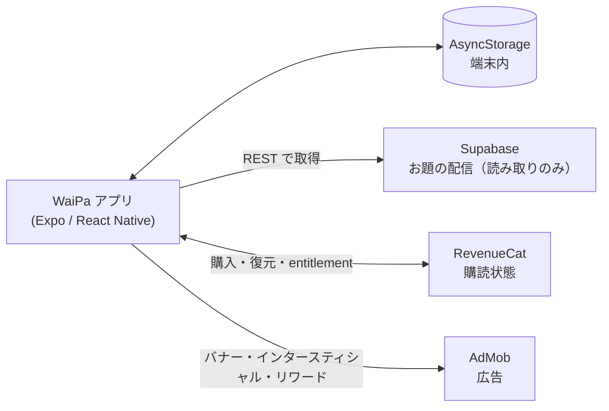
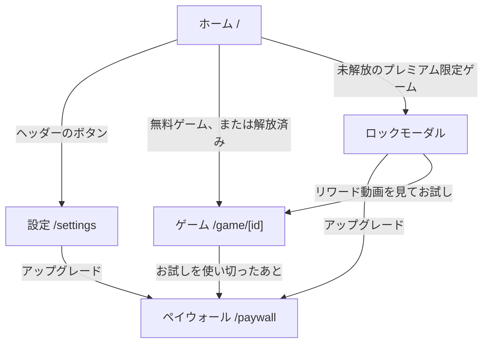
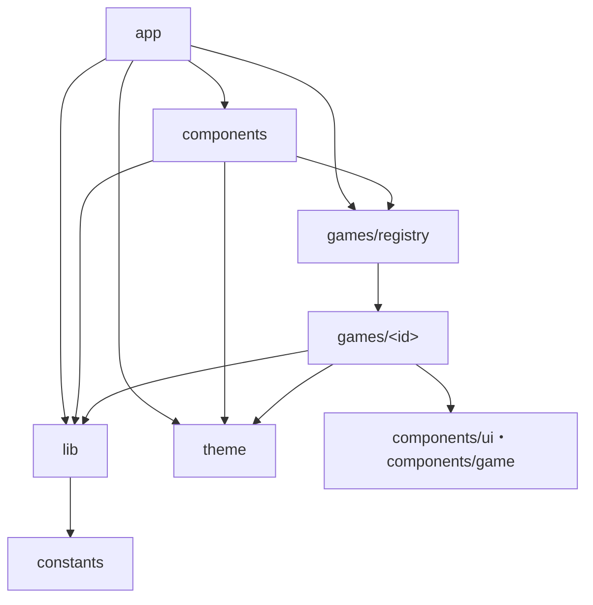

# WaiPa 基本設計書（アーキテクチャ概要）

> 草案（2026-11-10 作成）。コードを読んで現状を書き起こしたものです。

アプリ全体の構造を1枚で把握するためのドキュメントです。画面のつながり、ディレクトリごとの責務、外部サービスとの接続、プレミアム判定の流れを扱います。

個々のゲームのルールや画面の細部は扱いません。それらはコードとテストを正とします。手順や運用は次のドキュメントにあります。

| 知りたいこと                          | 参照先                                      |
| ------------------------------------- | ------------------------------------------- |
| 開発の流れ・TDD・コマンド             | [DEVELOPMENT.md](DEVELOPMENT.md)            |
| ゲームを追加する手順                  | [ADDING-A-GAME.md](ADDING-A-GAME.md)        |
| 広告の配置と表示条件                  | [ADS.md](ADS.md)                            |
| Supabase のテーブル・お題パック・運用 | [supabase/README.md](../supabase/README.md) |
| 機能ごとの設計の経緯                  | [superpowers/specs/](superpowers/specs/)    |

このドキュメントは、ディレクトリ構成、ゲームの共通インターフェース、外部サービスとの接続のいずれかを変える PR で一緒に更新します。

## 1. 全体像

WaiPa は端末の中だけでほぼ完結するアプリです。自前のサーバーは持ちません。外部とやり取りする相手は Supabase、RevenueCat、AdMob の3つです。



| 項目           | 採用しているもの                                                             |
| -------------- | ---------------------------------------------------------------------------- |
| フレームワーク | Expo SDK 58 / React Native 0.88 / React 19                                   |
| ルーティング   | expo-router（型付きルート）                                                  |
| 状態管理       | 自前の軽量ストア（`src/lib/create-store.ts`、`useSyncExternalStore` ベース） |
| 永続化         | AsyncStorage                                                                 |
| 課金           | react-native-purchases（RevenueCat）                                         |
| 広告           | react-native-google-mobile-ads（AdMob）                                      |
| テスト         | Jest（jest-expo）＋ React Native Testing Library                             |

## 2. 画面遷移

ルートは `src/app/` の5つです。

| ルート       | ファイル        | 役割                                                                                                                |
| ------------ | --------------- | ------------------------------------------------------------------------------------------------------------------- |
| `/`          | `index.tsx`     | ホーム。ヒーローバナー、ゲーム一覧、最下部にバナー広告                                                              |
| `/game/[id]` | `game/[id].tsx` | ゲーム。`id` で registry を引く。見つからないとき、未購読でお試し中でもないプレミアム限定ゲームのときはホームへ戻す |
| `/settings`  | `settings.tsx`  | 設定（効果音・バイブ・言語の表示・購入の復元・レビュー・問い合わせ）                                                |
| `/paywall`   | `paywall.tsx`   | プレミアム購入。モーダル表示                                                                                        |
| `/gallery`   | `gallery.tsx`   | UI 部品の確認用。開発ビルド以外ではホームへリダイレクト                                                             |



ゲーム画面では、全ゲーム共通の枠 `GameScreen`（`src/components/game/game-screen.tsx`）が表示を3段階で切り替えます。

1. intro: キャッチコピーと遊び方のダイジェスト。毎回表示する
2. setup: プレイヤー設定。`requiresPlayers` が true のゲームだけ通る
3. play: ヘッダー（戻る / タイトル / 遊び方）とゲーム本体

play の段階で画面を離れると、インタースティシャル広告の表示判定が走ります。intro だけ見て戻った場合は走りません。

## 3. ディレクトリの責務と依存方向

```
src/
├── app/          ルート定義と画面の組み立て
├── components/
│   ├── ui/       汎用の UI 部品（ボタン、カード、GlassSurface など）
│   ├── home/     ホーム専用の部品（グリッド、カード、ロックモーダル、バナー広告）
│   ├── game/     全ゲーム共通の枠と演出（GameScreen、ドラムロール、結果オーバーレイなど）
│   ├── settings/ 設定画面専用の部品
│   └── dice-3d/  3D サイコロの描画
├── games/        ゲーム本体。1ゲーム = 1ディレクトリ
├── lib/          ストア、外部サービスのラッパー、効果音、バイブ、乱数
├── constants/    広告ユニット ID、entitlement ID、お試しラウンド数
└── theme/        デザイントークン、プレイヤーカラー
```

依存は次の向きに限ります。



- `lib` は `app`・`components`・`games` を import しません（2026-11-10 時点で該当なし）。
- ゲーム同士は import しません。例外が1件あり、`daut-dice` が `chinchiro/iso-die` を使っています。
- 広告 SDK は `src/lib/gma.ts` 経由でだけ import します。`src/lib/__tests__/gma-boundary.test.ts` がこれを強制しています。

## 4. ゲームの共通インターフェース

ゲームは registry 駆動です。ホームのグリッド、イントロ画面、ルーティングは、すべて `src/games/registry.ts` の `games` 配列から作られます。

| ファイル                    | 役割                                                         |
| --------------------------- | ------------------------------------------------------------ |
| `src/games/types.ts`        | `GameMeta` 型の定義                                          |
| `src/games/<id>/meta.ts`    | そのゲームの `GameMeta`。タイトル、人数、遊び方、`Component` |
| `src/games/registry.ts`     | 各 `meta.ts` を並べた配列。並び順がホームの表示順            |
| `src/games/<id>/*-game.tsx` | エントリのコンポーネント。props は受け取らない               |

`GameMeta` のうち、動作を左右するのは次の項目です。

| 項目                        | 効果                                                                    |
| --------------------------- | ----------------------------------------------------------------------- |
| `id`                        | ルートの `[id]`、画像ディレクトリ名、お試しの記録に使う識別子           |
| `requiresPlayers`           | true なら play の前にプレイヤー設定を挟む                               |
| `minPlayers` / `maxPlayers` | プレイヤー設定で選べる人数の範囲                                        |
| `premium`                   | true ならホームでロック表示になり、未解放のあいだはロックモーダルを出す |
| `Component`                 | play の段階で描画するコンポーネント                                     |

ゲームのコンポーネントは props を受け取らないため、必要な情報は `lib` のストアから自分で取ります（プレイヤー名は `players-store`、お題は `topics-store` など）。

ゲーム内部の構成（純関数の `engine.ts`、フェーズ遷移の `reducer.ts`、フェーズごとの画面）は [ADDING-A-GAME.md](ADDING-A-GAME.md) にあります。

プレミアム限定ゲームは、上記に加えて、エントリのコンポーネントで `useTrialRoundConsumer(gameId, isRoundEnd)` を呼び、ラウンドの終わりを知らせます。これを呼ばないと、お試しプレイのラウンドが消費されません。

## 5. 状態の置き場所

状態管理ライブラリは使っていません。`src/lib/create-store.ts` の `createStore` と `createPersistedStore` でストアを作り、React からは `useSettings()` や `usePlayers()` のようなフックで購読します。

| ストア                   | 保存先                 | キー                                     | 中身                                                                |
| ------------------------ | ---------------------- | ---------------------------------------- | ------------------------------------------------------------------- |
| `settingsStore`          | AsyncStorage           | `waipa.settings`                         | 効果音・バイブの ON/OFF                                             |
| `playersStore`           | AsyncStorage           | `waipa.players`                          | 人数、プレイヤー名、名前セットの履歴                                |
| `trialStore`             | AsyncStorage ＋ メモリ | `waipa.trials.used`                      | お試し済みのゲーム ID（永続）。進行中のお試しと消費ラウンドはメモリ |
| `topicsStore`            | AsyncStorage           | `waipa.topics.v1`                        | Supabase から取得したお題のキャッシュ                               |
| `wordPairsStore`         | AsyncStorage           | `waipa.word_pairs.v1`                    | Supabase から取得したワードペアのキャッシュ                         |
| `customPunishmentsStore` | AsyncStorage           | `waipa.inshu-suijaku.custom-punishments` | 飲酒衰弱のカスタム罰ゲーム                                          |
| `packUnlockStore`        | メモリ                 | なし                                     | リワード視聴で解放したお題パック                                    |
| `premium.ts`             | メモリ                 | なし                                     | プレミアムが有効かどうか。元データは RevenueCat SDK が持つ          |

効果音とバイブは `playSound()` と `haptics.*` を通して鳴らします。どちらも `settingsStore` を見て、OFF のときは何もしません。

### 起動時の処理

`src/app/_layout.tsx` がマウント時に次の処理をします。

1. `initPremium()` で RevenueCat を設定し、購読状態を取得する
2. 購読状態が確定したら、`initAds()` で ATT の許可を確認し、AdMob を初期化して、インタースティシャルを先読みする。プレミアムなら何もしない
3. `settingsStore`・`playersStore`・`trialStore` を AsyncStorage から復元する
4. `topicsStore`・`wordPairsStore` をキャッシュから復元し、続けて Supabase から取り直す
5. 効果音を登録する

3 以降は 1 の完了を待たずに進みます。`customPunishmentsStore` だけは起動時に復元せず、飲酒衰弱を開いたときに復元します。

## 6. 外部サービスとの接続

### Supabase のお題配信

- 用途はお題とワードペアの配信だけです。認証、書き込み、リアルタイム同期は使っていません。
- クライアントライブラリは入れていません。`src/lib/supabase-rest.ts` の `fetchRows()` が、anon キーを付けて REST API を `fetch` で呼びます。
- テーブルは `topics` と `word_pairs` の2つです。RLS は「`is_premium = false` の行だけ誰でも読める」で、書き込みのポリシーはありません。
- お題とワードペアは起動時に取得します。そのため、お題の変更は各端末の次回起動から反映されます。取得に失敗してもエラーにせず、キャッシュをそのまま使います。
- `king_premium` パックだけは起動時に取得せず、王様のいない王様ゲームの中で追加で取得します。
- お題の追加や修正はダッシュボードの SQL Editor から行います。アプリの更新は要りません。

### RevenueCat の購読状態

- RevenueCat の SDK を呼ぶのは `src/lib/premium.ts` だけです。画面やストアは `usePremium()`（React 用）か `isPremiumUnlocked()`（それ以外）で状態を読みます。
- entitlement `premium`（`src/constants/purchases.ts`）が有効なら、プレミアムと判定します。
- 購入は `purchasePremium()`、復元は `restorePremium()` で行います。どちらも結果を文字列で返し、例外は投げません。
- **API キーが未設定のときは RevenueCat を初期化しません**。この状態では、開発ビルドならプレミアム扱い、本番ビルドなら非プレミアム扱いになります。
- 購読の検証は RevenueCat に任せています。Supabase 側での検証はありません。

### AdMob の広告

- 初期化とインタースティシャルの表示は `src/lib/ads.ts` が行い、SDK は `src/lib/gma.ts` が再エクスポートします。
- インタースティシャルを出すかどうかは `adsEnabled()` で判定し、その中身は `!isPremiumUnlocked()` です。
- ホームのバナーは `useAdsEnabled()` で判定します。AdMob の初期化が済み、かつ非プレミアムのあいだだけ表示します。
- 配置、表示条件、頻度の定数は [ADS.md](ADS.md) にまとめてあります。

### web ビルド用のスタブ

ネイティブ専用の SDK を web ビルドに含めないよう、`.web.ts` のスタブを置いています（`lib/gma.web.ts`、`lib/att.web.ts`、`components/splash-overlay.web.tsx`、`components/dice-3d/r3f.web.ts`）。

## 7. プレミアム判定とロック解除の流れ

判定の出どころは `isPremiumUnlocked()` の1か所です。これを次の箇所が使います。

| 使う側                             | プレミアムのときの挙動                                                             |
| ---------------------------------- | ---------------------------------------------------------------------------------- |
| `GameGrid` / `GameCard`            | プレミアム限定ゲームをロック表示にせず、直接開く                                   |
| `game/[id].tsx`                    | プレミアム限定ゲームを開ける。未購読でそのゲームのお試し中でもなければホームへ戻す |
| `ads.ts`                           | ATT の要求も AdMob の初期化もせず、バナーとインタースティシャルを出さない          |
| `pack-unlock-store`                | 限定お題パックを常に解放済みとして扱う                                             |
| `trial-store` / `TrialLockOverlay` | お試しの導線とロックオーバーレイを出さない                                         |
| `paywall.tsx`                      | 購入ボタンの代わりに加入済みの表示を出す                                           |

非プレミアムのユーザーがプレミアム限定ゲームをタップしたときの流れは次のとおりです。

1. `GameGrid` がロックモーダル（`PremiumLockModal`）を出す
2. 「アップグレード」を選ぶと `/paywall` へ進む。購入が成功すると `premium.ts` が状態を更新し、ホームのロック表示が外れる
3. そのゲームをまだお試ししていなければ、リワード動画の導線も出る。視聴を終えると `trialStore.startTrial()` が「お試し済み」を保存し、ゲームへ進む
4. ゲームがラウンドの終わりを知らせるたびに、消費ラウンドが1つ増える
5. `TRIAL_ROUNDS`（現在 2）に達すると、`TrialLockOverlay` がゲームの上に重なり、`/paywall` へ誘導する
6. ゲーム画面を離れると、進行中のお試しは終了する。「お試し済み」は残るため、同じゲームのお試しは二度とできない

お題パックの解放は、お試しプレイとは別に `packUnlockStore` で扱います。王様のいない王様ゲームの限定パック `king_premium` は、リワード動画の視聴で解放され、ゲームを出ると再びロックされます。

## 8. 設計判断の記録

| 日付       | 判断                                                                                 | 理由                                                                                            |
| ---------- | ------------------------------------------------------------------------------------ | ----------------------------------------------------------------------------------------------- |
| 2026-07-06 | MVP は1台回しのゲームだけにする。複数端末の同期とルーム機能は第2弾                   | リアルタイム基盤を外して、初回リリースを早く低リスクで出すため                                  |
| 2026-07-06 | 収益は広告を主軸にし、プレミアムは補助にする                                         | 記録が見つからない                                                                              |
| 2026-07-16 | OTA 更新（EAS Update）を使わない。更新はすべてストア審査を通す                       | お題の更新は Supabase 配信でまかなえる。EAS Update の有料プランを避け、運用費を抑える           |
| 2026-07-19 | UI のアイコンは `@expo/vector-icons` を使い、絵文字は使わない                        | 絵文字は端末や OS のバージョンで見た目が変わるため。`meta.emoji` はサムネイルの代替なので対象外 |
| 2026-07-19 | リワードで解放したお題パックは保存せず、ゲームを出たら再ロックする（issue #6）       | 「その飲み会のあいだ」だけ解放し、繰り返しの視聴につなげるため                                  |
| 2026-07-19 | お試しプレイは各ゲーム1回きり、2ラウンドまで（issue #106）                           | 記録が見つからない                                                                              |
| 2026-10-04 | `king_premium` パックを `is_premium = false` にする（issue #134）                    | 課金限定ではなくリワードで解放するパックであり、RLS のままでは anon キーで取得できなかったため  |
| 2026-11-10 | 広告の初期化は購読状態が確定してから行う（issue #158）                               | 購読者に ATT の要求、AdMob の初期化、バナーの表示を走らせないため                               |
| 2026-11-10 | プレミアム判定はホームのグリッドに加えて `/game/[id]` のルートでも行う（issue #159） | ディープリンクなど、グリッドを通らない入口でもロックを効かせるため                              |

## 9. 確認したい点

草案を書くためにコードを読んで気づいた点です。広告の初期化順と `/game/[id]` のプレミアム判定の2件は、issue #158 と #159 で修正しました。残りは次の2件です。

1. **CLAUDE.md の技術スタックには Supabase の用途として「認証・お題配信・課金検証」とありますが、実装されているのはお題配信だけです**。認証と課金検証を今後入れるのか、記述を現状に合わせるのかを決める必要があります。
2. **`src/lib/first-visit.ts` はテスト以外から使われていません**。
