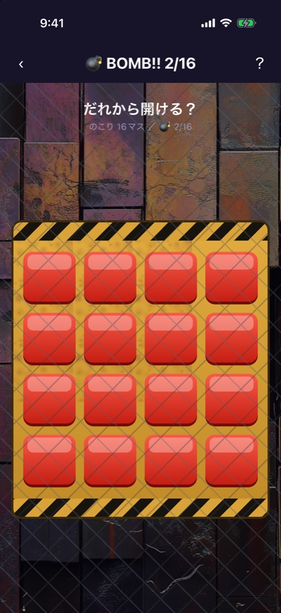
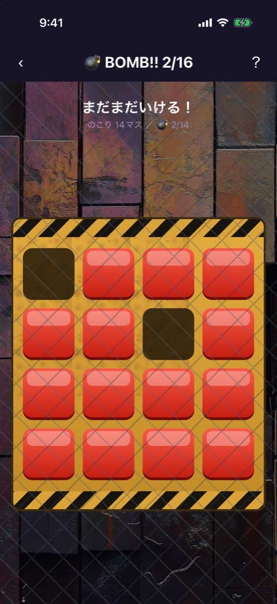
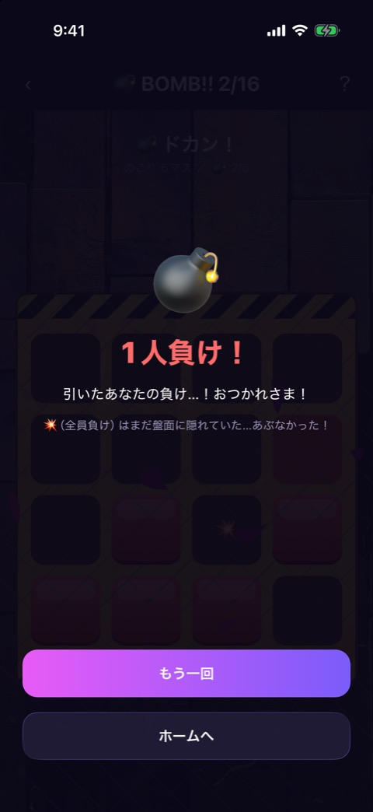

# BOMB!! 2/16

| 項目       | 内容                          |
| ---------- | ----------------------------- |
| 画面ID     | `bomb-216`                    |
| ルート     | `/game/bomb-2-16`             |
| 実装       | `src/games/bomb-216/`         |
| 種別       | ゲーム（無料）                |
| 人数       | 2〜12人。プレイヤー登録は不要 |
| お題パック | 使わない                      |

## 概要

16個のボタンを1人1つずつ開けていき、爆弾を引いたら負けになる運試しのゲームです。爆弾は「1人負け」と「全員負け」の2個です。

ゲーム ID は `bomb-2-16` で、ソースのディレクトリ名（`bomb-216`）とは違います。

フェーズは2つで、`bomb-game.tsx` が持つ状態で切り替えます。

| フェーズ | 画面                   | 実装                                                                 |
| -------- | ---------------------- | -------------------------------------------------------------------- |
| `play`   | 盤面                   | `bomb-game.tsx`、`tile.tsx`、`hazard-panel.tsx`、`fence-overlay.tsx` |
| `result` | 盤面の上に結果を重ねる | `explosion-overlay.tsx`、共通の `result-overlay.tsx`                 |

画面上部には [ゲーム共通のヘッダー](game-play-frame.md) が出ます。

## 盤面

 

左が開始時、右が2マス開けた状態です。

### 表示項目

| No  | 項目       | 内容                                                                                          |
| --- | ---------- | --------------------------------------------------------------------------------------------- |
| 1   | メッセージ | 開始時は「だれから開ける？」。セーフのたびに「セーフ！」「あぶな〜い！」などからランダムに1つ |
| 2   | カウンター | 「のこり ◯マス ／ 💣 2/◯」。残りのマス数と、爆弾を引く確率の分母を示す                        |
| 3   | 盤面       | 4×4 の16マス。未開封は赤いボタン、開封済みは黒い穴                                            |
| 4   | 背景       | 背景画像と、金網の重ね                                                                        |

### 操作

| 操作                   | 結果                                                                                     |
| ---------------------- | ---------------------------------------------------------------------------------------- |
| 未開封のマスをタップ   | セーフなら穴になり、メッセージとカウンターが変わる。タップ音と軽いバイブレーションが鳴る |
| 爆弾のマスをタップ     | 盤面が揺れ、爆発音と強いバイブレーションが鳴る。0.9秒後に結果を重ねる                    |
| 開封済みのマスをタップ | 何も起きない                                                                             |

誰の番かは画面には出ません。端末を回しながら、順番に1つずつ開けます。

## 結果

「1人負け」を引いたときの表示です。

### 表示項目

| No  | 項目           | 1人負けのとき                                           | 全員負けのとき                           |
| --- | -------------- | ------------------------------------------------------- | ---------------------------------------- |
| 1   | 絵文字         | 💣                                                      | 💥                                       |
| 2   | 見出し         | 「1人負け！」                                           | 「全員負け！！」                         |
| 3   | 本文           | 「引いたあなたの負け…！おつかれさま！」                 | 「この爆弾はみんなの爆弾。全員アウト！」 |
| 4   | 補足           | 「💥（全員負け）はまだ盤面に隠れていた…あぶなかった！」 | 「💣（1人負け）も盤面に隠れていた」      |
| 5   | もう一回ボタン | 「もう一回」                                            | 同じ                                     |
| 6   | ホームボタン   | 「ホームへ」                                            | 同じ                                     |

結果の裏では、残りのマスも開いて、もう1つの爆弾の位置が見えます。

### 操作

| 操作                 | 結果                             |
| -------------------- | -------------------------------- |
| 「もう一回」をタップ | 盤面を作り直して、最初から始める |
| 「ホームへ」をタップ | ホームへ戻る                     |

## 遷移

- 入口: [ゲームのイントロ](game-intro.md) の「ゲームスタート」。
- 出口: ホーム（「ホームへ」、またはヘッダーの戻る）。

## テスト

- `src/games/bomb-216/__tests__/`

## 補足

- 「全員負け」の結果は、撮影していません。
- メッセージの絵文字（💣、💥）は、コンテンツとして使っているものです。
