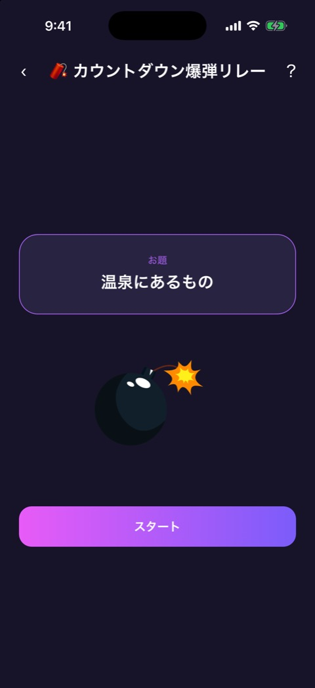
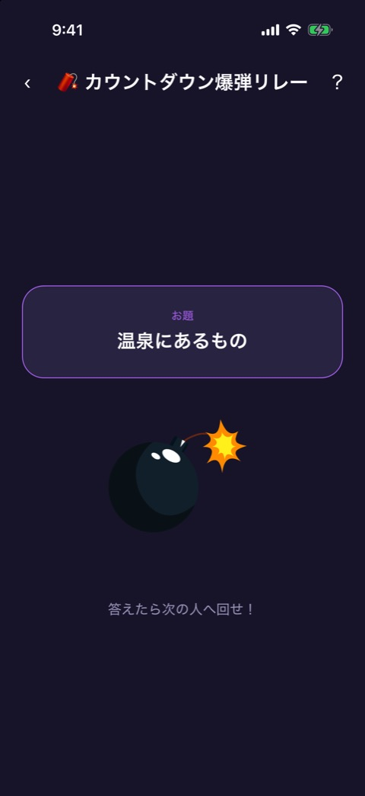
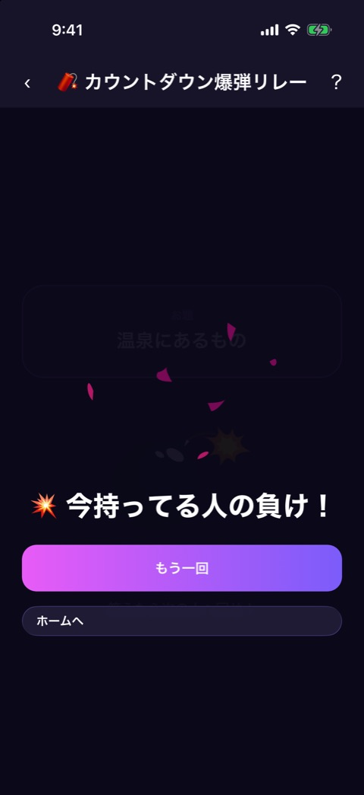

# カウントダウン爆弾リレー

| 項目       | 内容                          |
| ---------- | ----------------------------- |
| 画面ID     | `bomb-relay`                  |
| ルート     | `/game/bomb-relay`            |
| 実装       | `src/games/bomb-relay/`       |
| 種別       | ゲーム（無料）                |
| 人数       | 3〜12人。プレイヤー登録は不要 |
| お題パック | `talk`                        |

## 概要

お題に答えながら端末を回していき、爆発した瞬間に持っていた人が負けになるゲームです。爆発までの時間は見えません。

フェーズは3つで、`bomb-relay-game.tsx` が持つ状態で切り替えます。

| フェーズ   | 画面                   | 実装                               |
| ---------- | ---------------------- | ---------------------------------- |
| `ready`    | お題の確認             | `bomb-relay-game.tsx`              |
| `ticking`  | カウントダウン中       | `bomb-relay-game.tsx`、`engine.ts` |
| `exploded` | 画面の上に結果を重ねる | `explosion-overlay.tsx`            |

画面上部には [ゲーム共通のヘッダー](game-play-frame.md) が出ます。

## お題の確認とカウントダウン

 

左がお題の確認、右がカウントダウン中です。

### 表示項目

| No  | 項目         | 内容                                             | 表示条件         |
| --- | ------------ | ------------------------------------------------ | ---------------- |
| 1   | お題のカード | 「お題」と、お題の本文（「温泉にあるもの」など） | 常時             |
| 2   | 爆弾         | 爆弾のアニメーション。カウントダウン中は脈打つ   | 常時             |
| 3   | 開始ボタン   | 「スタート」                                     | お題の確認のとき |
| 4   | 案内         | 「答えたら次の人へ回せ！」                       | カウントダウン中 |

### 操作

| 操作                 | 結果                                           |
| -------------------- | ---------------------------------------------- |
| 「スタート」をタップ | 爆発までの時間を決めて、カウントダウンを始める |

カウントダウン中は、画面で操作するものはありません。お題に答えたら、端末を次の人に渡します。

爆発までの時間は、10秒から45秒のあいだでランダムに決まります。残り時間は表示しません。カウントダウン中は一定の間隔でバイブレーションが鳴り、その間隔は 0.7 秒から始まって、爆発が近づくほど短くなります（最短 0.14 秒）。

## 結果

### 表示項目

| No  | 項目           | 内容                        |
| --- | -------------- | --------------------------- |
| 1   | 爆発の演出     | 爆発のアニメーション        |
| 2   | 結果           | 「💥 今持ってる人の負け！」 |
| 3   | もう一回ボタン | 「もう一回」                |
| 4   | ホームボタン   | 「ホームへ」                |

### 操作

| 操作                 | 結果                                             |
| -------------------- | ------------------------------------------------ |
| 「もう一回」をタップ | まだ出ていないお題を選び直して、お題の確認に戻る |
| 「ホームへ」をタップ | ホームへ戻る                                     |

## 遷移

- 入口: [ゲームのイントロ](game-intro.md) の「ゲームスタート」。
- 出口: ホーム（「ホームへ」、またはヘッダーの戻る）。

## テスト

- `src/games/bomb-relay/__tests__/`

## 補足

- お題を Supabase から取得できていないときは、アプリに同梱した予備のお題（20問）を使います。
- カウントダウンの音（`tick`）は、音源がまだ登録されておらず、鳴りません。バイブレーションだけが鳴ります。
