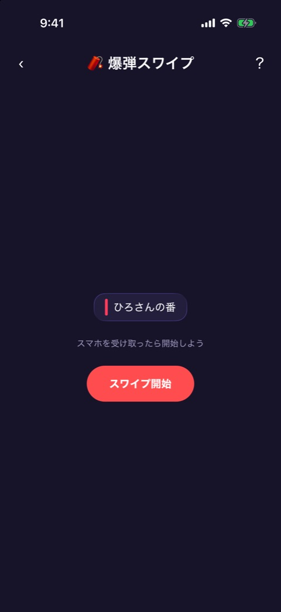
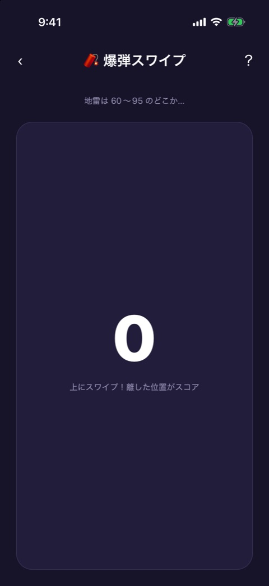
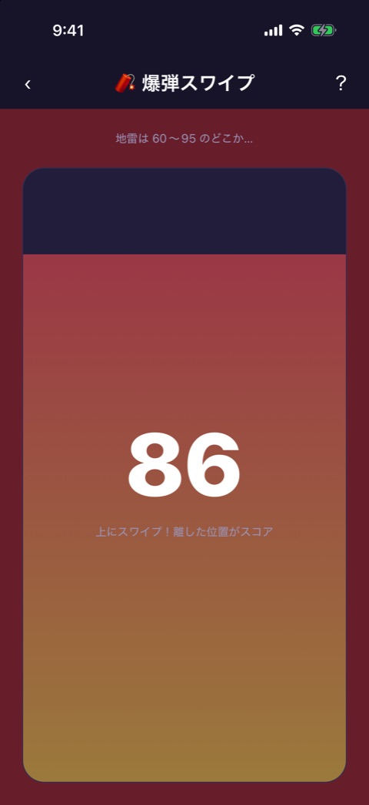
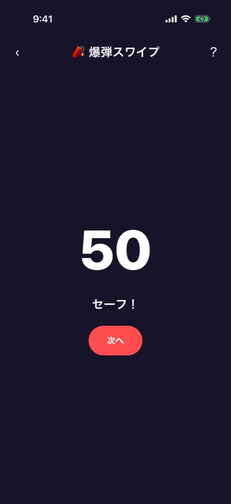
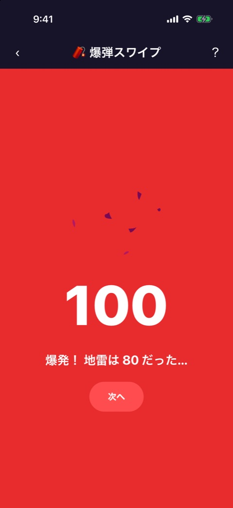
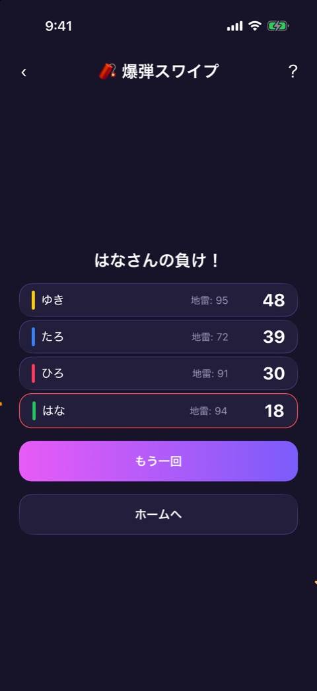

# 爆弾スワイプ

| 項目       | 内容                          |
| ---------- | ----------------------------- |
| 画面ID     | `bomb-swipe`                  |
| ルート     | `/game/bomb-swipe`            |
| 実装       | `src/games/bomb-swipe/`       |
| 種別       | ゲーム（プレミアム限定）      |
| 人数       | 2〜12人。プレイヤー登録が必要 |
| お題パック | 使わない                      |

## 概要

ゲージを上へスワイプし、指を離した位置がスコア（0〜100）になる度胸試しです。60〜95 のどこかに地雷が隠れていて、地雷以上のスコアで離すと爆発して負けです。誰も爆発しなかったときは、一番スコアの低い人が負けです。

地雷の位置は、プレイヤーごとに別々に決まります（60〜95 の整数）。

フェーズは `engine.ts` が持ちます。

| フェーズ   | 画面     | 実装                               |
| ---------- | -------- | ---------------------------------- |
| `handoff`  | 受け渡し | `bomb-swipe-game.tsx`              |
| `swiping`  | スワイプ | `bomb-swipe-game.tsx`、`gauge.tsx` |
| `safe`     | セーフ   | `bomb-swipe-game.tsx`              |
| `exploded` | 爆発     | `bomb-swipe-game.tsx`              |
| `result`   | 結果     | `round-result.tsx`                 |

`handoff` から `safe` または `exploded` までを人数ぶん繰り返します。画面上部には [ゲーム共通のヘッダー](game-play-frame.md) が出ます。お試しプレイでは、結果が出るたびに1ラウンドを消費します（[お試しロック](trial-lock.md)）。

## 受け渡し

プレイヤーカラーの縦バーと「◯◯さんの番」、「スマホを受け取ったら開始しよう」、「スワイプ開始」ボタンを出します。「スワイプ開始」でスワイプへ進みます。

## スワイプ

 

### 表示項目

| No  | 項目     | 内容                                             |
| --- | -------- | ------------------------------------------------ |
| 1   | ヒント   | 「地雷は 60〜95 のどこか…」                      |
| 2   | ゲージ   | 縦長の枠。スワイプした高さまで下から色が満ちる   |
| 3   | スコア   | 今のスコアと「上にスワイプ！離した位置がスコア」 |
| 4   | 赤い重ね | 画面全体の赤み。スコアが高いほど濃くなる         |

### 操作

| 操作                 | 結果                                                                                           |
| -------------------- | ---------------------------------------------------------------------------------------------- |
| ゲージを上へスワイプ | 指の位置に合わせてスコアが変わる。10点の区切りを超えるたびに、心音と軽いバイブレーションが鳴る |
| 指を離す             | そのときのスコアで確定する。地雷以上なら爆発、未満ならセーフ                                   |

スコアは、ゲージの下端からスワイプした距離を、ゲージの高さに対する割合で 0〜100 にしたものです。ゲージの上端を超えても100で止まります。地雷と同じスコアも爆発です。

## セーフと爆発

 

| 結果   | 表示                                                                                                     |
| ------ | -------------------------------------------------------------------------------------------------------- |
| セーフ | スコアと「セーフ！」                                                                                     |
| 爆発   | 背景が赤くなり、爆発のアニメーション、スコア、「爆発！ 地雷は 80 だった…」。爆発音と強いバイブレーション |

どちらも「次へ」で、次の人の受け渡しへ進みます。最後の人のあとは結果へ進みます。

## 結果

ドラムロールのあとで表示します。

### 表示項目

| No  | 項目           | 内容                                                                                                                       |
| --- | -------------- | -------------------------------------------------------------------------------------------------------------------------- |
| 1   | 敗者           | 「◯◯さんの負け！」。複数のときは「・」でつなぐ                                                                             |
| 2   | スコアの一覧   | プレイヤーカラーの縦バー、名前、「地雷: ◯◯」、スコア。スコアの高い順。爆発した人はスコアの前に 💥 が付いて赤字、行が赤い枠 |
| 3   | もう一回ボタン | 「もう一回」                                                                                                               |
| 4   | ホームボタン   | 「ホームへ」                                                                                                               |

負けは、爆発した人がいればその全員、いなければ一番スコアの低い人（同点なら全員）です。

### 操作

| 操作                 | 結果                                        |
| -------------------- | ------------------------------------------- |
| 「もう一回」をタップ | 地雷を決め直して、1人目の受け渡しから始める |
| 「ホームへ」をタップ | ホームへ戻る                                |

## 遷移

- 入口: [参加メンバー](player-setup.md) の「つぎへ」。
- 出口: ホーム（「ホームへ」、またはヘッダーの戻る）。お試しを使い切ったときは [お試しロック](trial-lock.md) からペイウォールへ。

## テスト

- `src/games/bomb-swipe/__tests__/`（`engine`、`gauge`、`round-result`、`bomb-swipe-game`）
