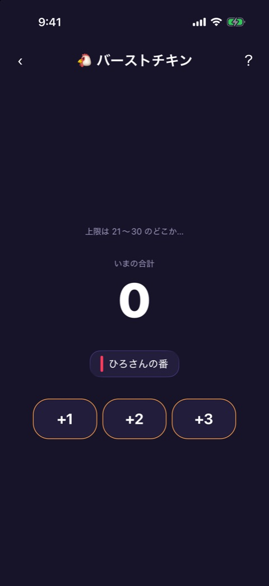
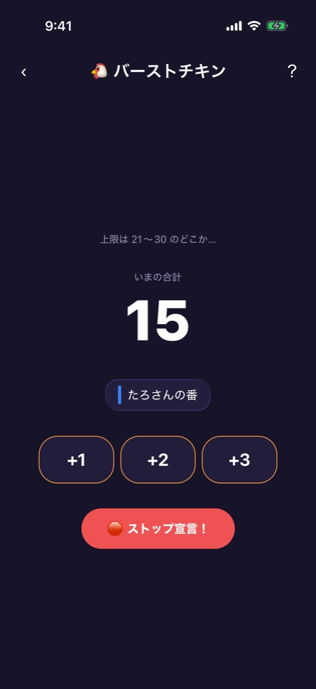
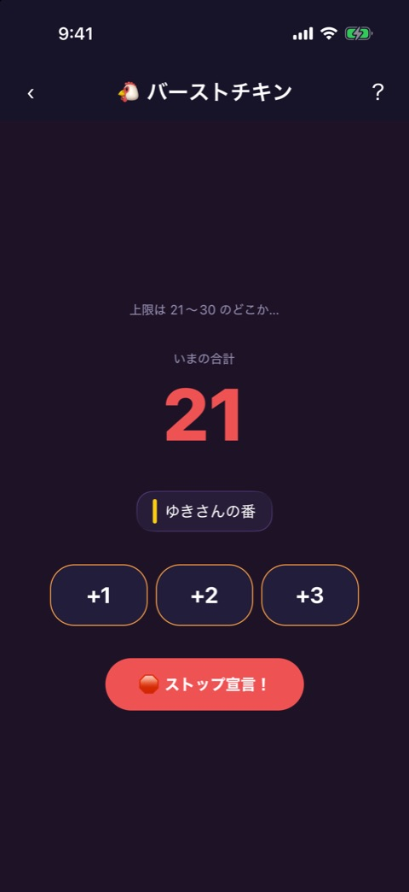
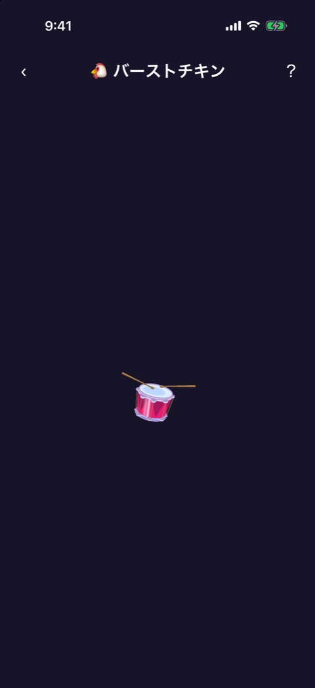
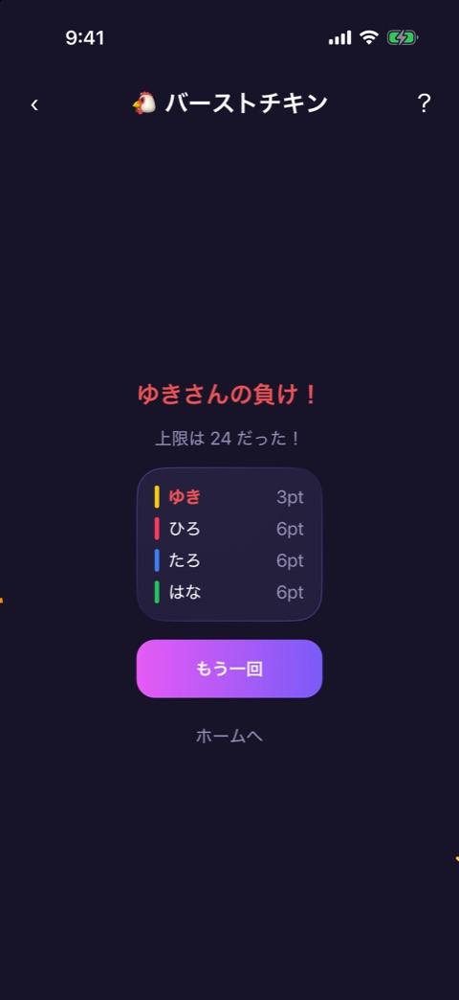
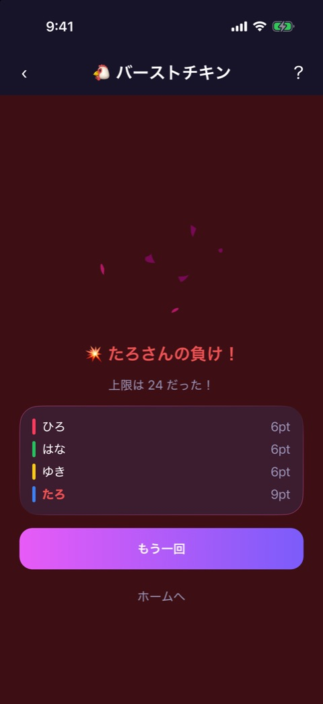

# バーストチキン

| 項目       | 内容                          |
| ---------- | ----------------------------- |
| 画面ID     | `burst-chicken`               |
| ルート     | `/game/burst-chicken`         |
| 実装       | `src/games/burst-chicken/`    |
| 種別       | ゲーム（プレミアム限定）      |
| 人数       | 2〜12人。プレイヤー登録が必要 |
| お題パック | 使わない                      |

## 概要

21〜30 のどこかに隠された上限に向かって、順番に +1、+2、+3 を積み上げていくチキンレースです。積んで上限を超えた人が負けです。合計が15以上になると「ストップ宣言」ができ、その時点で一番積んでいない人が負けになります。

フェーズは `engine.ts` が持ちます。

| フェーズ   | 画面                     | 実装                                   |
| ---------- | ------------------------ | -------------------------------------- |
| `playing`  | 積み上げ                 | `burst-chicken-game.tsx`、`tension.ts` |
| `exploded` | 上限を超えたときの結果   | `round-result.tsx`                     |
| `settled`  | ストップ宣言のあとの結果 | `round-result.tsx`                     |

画面上部には [ゲーム共通のヘッダー](game-play-frame.md) が出ます。お試しプレイでは、結果が出るたびに1ラウンドを消費します（[お試しロック](trial-lock.md)）。

## 積み上げ

  

左から、開始時、合計15でストップ宣言が出た状態、合計21で画面が赤みを帯びた状態です。

### 表示項目

| No  | 項目           | 内容                                                 | 表示条件             |
| --- | -------------- | ---------------------------------------------------- | -------------------- |
| 1   | ヒント         | 「上限は 21〜30 のどこか…」                          | 常時                 |
| 2   | 合計           | 「いまの合計」と数字。15を超えると赤くなる           | 常時                 |
| 3   | 手番の表示     | プレイヤーカラーの縦バーと「◯◯さんの番」             | 常時                 |
| 4   | 積むボタン     | 「+1」「+2」「+3」                                   | 常時                 |
| 5   | ストップボタン | 「🛑 ストップ宣言！」                                | 合計が15以上         |
| 6   | 赤い重ね       | 画面全体に赤みを重ねる。合計15から30にかけて濃くなる | 合計が15を超えたあと |

上限は、ラウンドを始めるときに 21〜30 からランダムに決まり、結果が出るまで表示しません。

### 操作

| 操作                          | 結果                                                                               |
| ----------------------------- | ---------------------------------------------------------------------------------- |
| 「+1」「+2」「+3」をタップ    | 合計に足す。上限以下なら次の人の番になる。上限を超えたら、その人の負けで結果へ進む |
| 「🛑 ストップ宣言！」をタップ | 手番の人がストップを宣言し、精算して結果へ進む                                     |

積むたびにバイブレーションが鳴ります。積んだあとの合計が 22.5 以上（赤みが半分以上）になるときは、強いバイブレーションになります。

### ストップ宣言の精算

それぞれの人が積んだ数の合計（pt）を比べ、一番少ない人が負けです。

- 宣言した人が一番少ない（同点を含む）ときは、宣言した人だけが負けです。
- 宣言した人以外で一番少ない人が複数いるときは、その全員が負けです。

## 結果

  

左から、ストップ宣言のあとのドラムロール、ストップ宣言の結果、上限を超えたときの結果です。

### 表示項目

| No  | 項目           | 内容                                                                 |
| --- | -------------- | -------------------------------------------------------------------- |
| 1   | 敗者           | 「◯◯さんの負け！」。上限を超えたときは先頭に 💥 が付く               |
| 2   | 上限の発表     | 「上限は 24 だった！」                                               |
| 3   | 積んだ数の一覧 | プレイヤーカラーの縦バー、名前、積んだ数（pt）。少ない順。敗者は赤字 |
| 4   | もう一回ボタン | 「もう一回」                                                         |
| 5   | ホームのリンク | 「ホームへ」                                                         |

上限を超えたときは、爆発のアニメーションと爆発音、強いバイブレーションが出て、背景が赤くなります。ストップ宣言のときは、ドラムロールのあとで結果が出ます。

### 操作

| 操作                 | 結果                                                                |
| -------------------- | ------------------------------------------------------------------- |
| 「もう一回」をタップ | 上限を決め直して、新しいラウンドを始める。最初の手番は1人ずつずれる |
| 「ホームへ」をタップ | ホームへ戻る                                                        |

## 遷移

- 入口: [参加メンバー](player-setup.md) の「つぎへ」。
- 出口: ホーム（「ホームへ」、またはヘッダーの戻る）。お試しを使い切ったときは [お試しロック](trial-lock.md) からペイウォールへ。

## テスト

- `src/games/burst-chicken/__tests__/`（`engine`、`tension`、`round-result`、`burst-chicken-game`）

## 補足

- 積むときの音（`tick`）は、音源がまだ登録されておらず、鳴りません。
- 宣言した人以外の複数人が負けになる精算の結果は、撮影していません。
