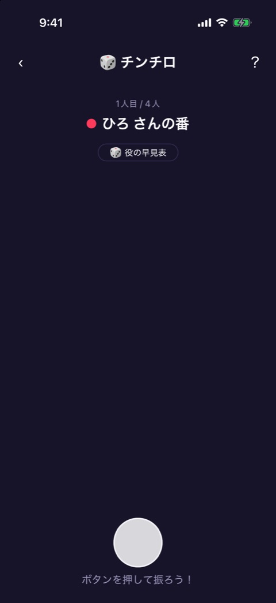
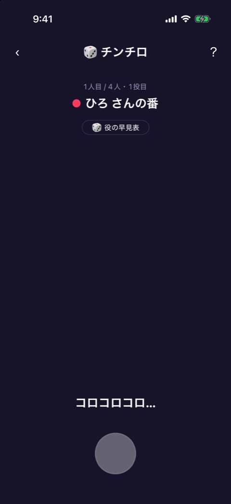
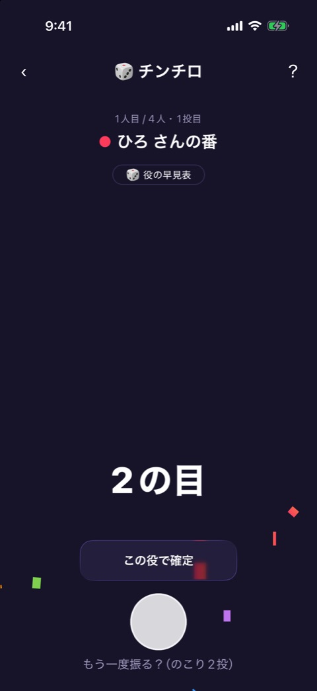
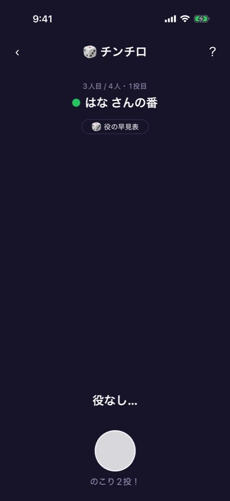
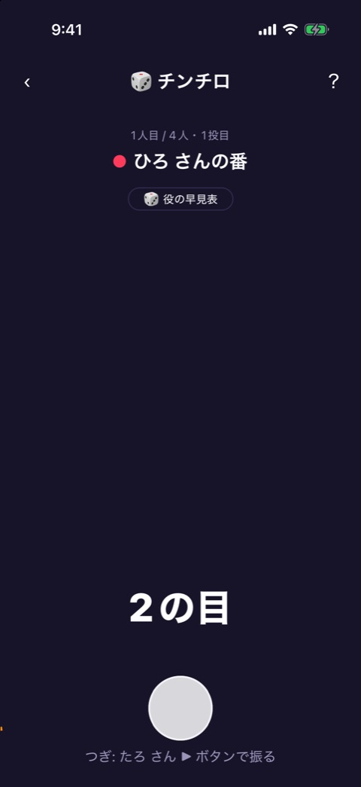
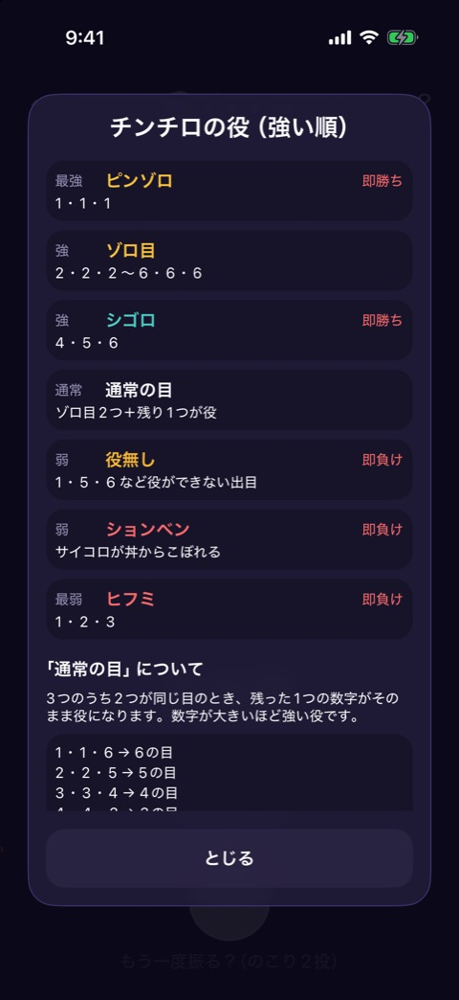
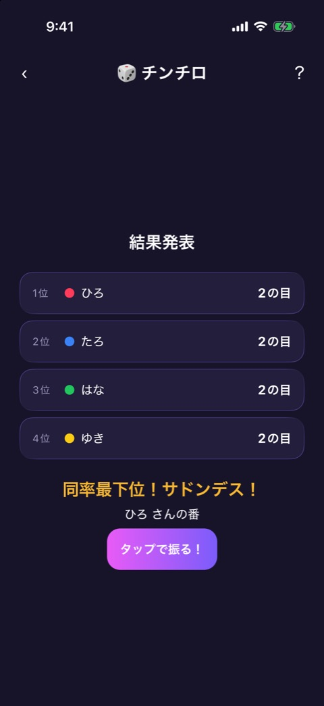
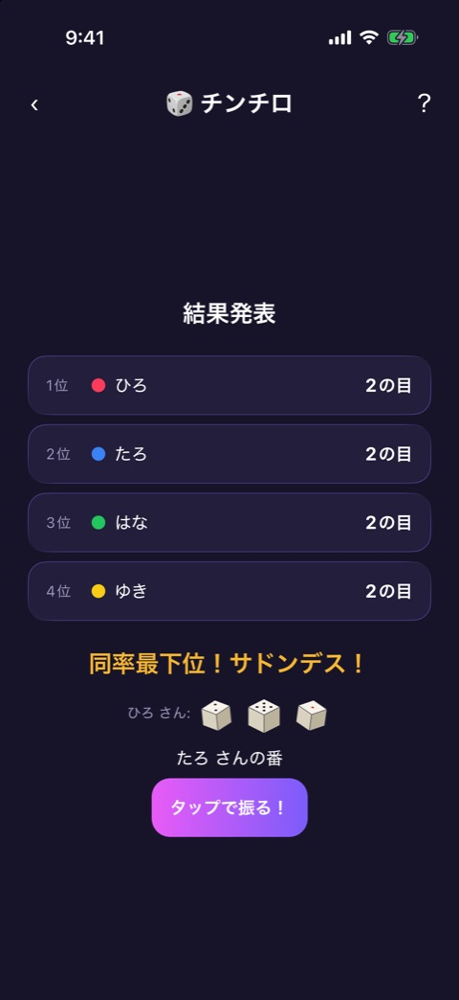
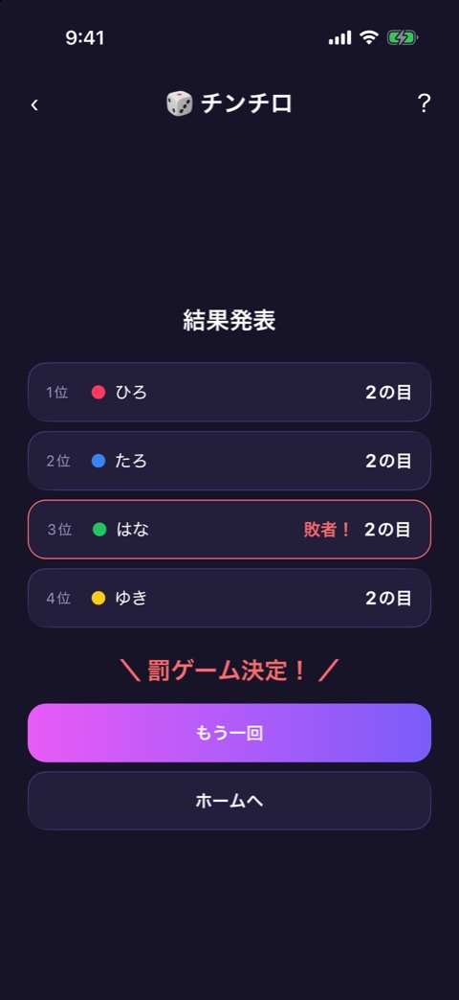

# チンチロ

| 項目       | 内容                                              |
| ---------- | ------------------------------------------------- |
| 画面ID     | `chinchiro`                                       |
| ルート     | `/game/chinchiro`                                 |
| 実装       | `src/games/chinchiro/`、`src/components/dice-3d/` |
| 種別       | ゲーム（無料）                                    |
| 人数       | 2〜12人。プレイヤー登録が必要                     |
| お題パック | 使わない                                          |

## 概要

サイコロ3つを丼に振り、出た役の強さで勝負するゲームです。1人最大3回まで振れます。一番弱かった人が負けです。

1人ずつ順番に振り、全員が終わると結果発表に進みます。1人ぶんの進行は `reducer.ts` が持ちます。

| フェーズ  | 意味                                   |
| --------- | -------------------------------------- |
| `idle`    | まだ振っていない                       |
| `rolling` | サイコロを振っている最中（1.2秒）      |
| `open`    | 役なし、またはションベン。まだ振れる   |
| `choice`  | 役が出た。確定するか、振り直すかを選ぶ |
| `settled` | 役が確定した。次の人へ進める           |
| `result`  | 全員が終わった                         |

画面は、サイコロを振る画面（`chinchiro-play.tsx`）と結果発表（`result.tsx`）の2つです。画面上部には [ゲーム共通のヘッダー](game-play-frame.md) が出ます。

## サイコロを振る画面

  

左から、振る前、振っている最中、役が出たあとです。

 

左が役なしのとき、右が役を確定したあとです。

### 表示項目

| No  | 項目         | 内容                                                                                 | 表示条件                 |
| --- | ------------ | ------------------------------------------------------------------------------------ | ------------------------ |
| 1   | 順番         | 「1人目 / 4人」。1回でも振ると「・1投目」が付く                                      | 常時                     |
| 2   | 番の案内     | プレイヤーカラーの丸と「◯◯ さんの番」                                                | 常時                     |
| 3   | 早見表ボタン | 「🎲 役の早見表」                                                                    | 常時                     |
| 4   | 丼とサイコロ | 3D のサイコロ。振る前は静止した状態を出す                                            | 常時                     |
| 5   | 状況の表示   | 振っている最中は「コロコロコロ…」。役なしは「役なし…」、ションベンは「ションベン！」 | 振ったあと               |
| 6   | 役の表示     | 「2の目」「アラシ（5）！」「ピンゾロ！」など。ピンゾロのときは紙吹雪も出る           | 役が出たとき             |
| 7   | 確定ボタン   | 「この役で確定」                                                                     | 役が出て、まだ振れるとき |
| 8   | 振るボタン   | 画面下の丸いボタン                                                                   | 常時                     |
| 9   | ヒント       | 振るボタンの下の1行。下の表のとおり                                                  | 常時                     |

ヒントは、状況に応じて変わります。

| 状況                     | ヒント                           |
| ------------------------ | -------------------------------- |
| 振る前                   | 「ボタンを押して振ろう！」       |
| 役なしで、まだ振れる     | 「のこり2投！」                  |
| 役が出て、まだ振れる     | 「もう一度振る？（のこり2投）」  |
| 役が確定し、次の人がいる | 「つぎ: ◯◯ さん ▶ ボタンで振る」 |
| 最後の人の役が確定した   | 「結果発表へ」                   |

### 操作

| 操作                      | 結果                               |
| ------------------------- | ---------------------------------- |
| 振るボタンをタップ        | 状況によって変わる。下の表のとおり |
| 「この役で確定」をタップ  | 今の役で確定する                   |
| 「🎲 役の早見表」をタップ | 役の早見表を開く                   |

| 振るボタンを押したときの状況 | 結果                                  |
| ---------------------------- | ------------------------------------- |
| 振る前、または役なし         | サイコロを振る                        |
| 役が出て、まだ確定していない | 今の役を捨てて、振り直す              |
| 役が確定し、次の人がいる     | 次の人に交代して、その人の1投目を振る |
| 最後の人の役が確定した       | 結果発表へ進む                        |

役は最後に振った結果で決まります。振り直すと、前の役には戻れません。3投目は、役が出ても出なくてもそこで確定します。ピンゾロは、出た時点で確定します。

5% の確率で、サイコロが丼からこぼれる「ションベン」になります。3投目が役なしかションベンなら「目なし」です。

## 役の早見表

役を強い順に並べたモーダルです（`rules-modal.tsx`）。下へスクロールでき、「とじる」で閉じます。

| 強さ | 役         | 出目                                             |
| ---- | ---------- | ------------------------------------------------ |
| 最強 | ピンゾロ   | 1・1・1                                          |
| 強   | ゾロ目     | 2・2・2 〜 6・6・6                               |
| 強   | シゴロ     | 4・5・6                                          |
| 通常 | 通常の目   | 2つが同じ目で、残り1つが役。数字が大きいほど強い |
| 弱   | 役無し     | 役ができない出目                                 |
| 弱   | ションベン | サイコロが丼からこぼれる                         |
| 最弱 | ヒフミ     | 1・2・3                                          |

## 結果発表

  

左から、最下位が同率だったとき、サドンデス中、敗者の確定後です。

### 表示項目

| No  | 項目           | 内容                                                                                    | 表示条件              |
| --- | -------------- | --------------------------------------------------------------------------------------- | --------------------- |
| 1   | 見出し         | 「結果発表」                                                                            | 常時                  |
| 2   | 順位の行       | 順位、プレイヤーカラーの丸、名前、役。発表前は「？？？」                                | 常時                  |
| 3   | サドンデス     | 「同率最下位！サドンデス！」、直前に振った人の出目、「◯◯ さんの番」、「タップで振る！」 | 最下位が2人以上のとき |
| 4   | 敗者の印       | 行の中の「敗者！」と赤い枠                                                              | 敗者の確定後          |
| 5   | 決定の表示     | 「＼ 罰ゲーム決定！ ／」                                                                | 敗者の確定後          |
| 6   | もう一回ボタン | 「もう一回」                                                                            | 敗者の確定後          |
| 7   | ホームボタン   | 「ホームへ」                                                                            | 敗者の確定後          |

順位は役の強い順で、上から1行ずつ出ます。最下位の行は、ドラムロールの演出のあとで出ます。

### サドンデス

最下位が2人以上いるときは、その人たちだけでサドンデスをします。

- 1人ずつ「タップで振る！」で1回だけ振ります。役なしとションベンは「目なし」として扱います。
- 全員が振り終わると、一番弱かった人が敗者になります。
- 一番弱い人がまた2人以上いるときは、その人たちだけでもう一度振ります。

### 操作

| 操作                       | 結果                        |
| -------------------------- | --------------------------- |
| 「タップで振る！」をタップ | サドンデスの1投を振る       |
| 「もう一回」をタップ       | 役を消して、1人目から始める |
| 「ホームへ」をタップ       | ホームへ戻る                |

## 遷移

- 入口: [参加メンバー](player-setup.md) の「つぎへ」。
- 出口: ホーム（「ホームへ」、またはヘッダーの戻る）。

## テスト

- `src/games/chinchiro/__tests__/`
- `src/components/dice-3d/` のテスト

## 補足

- 丼と 3D のサイコロは、シミュレータでは描画されず、スクリーンショットでは空白になっています。実機での表示は未確認です。
- ションベンとピンゾロの画面は、撮影していません。
