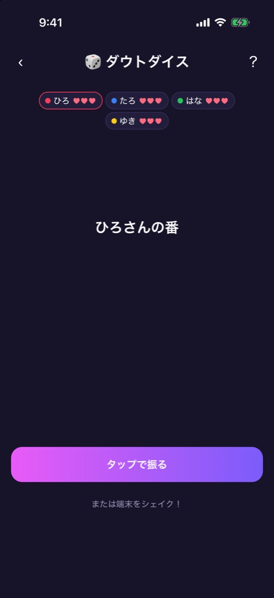
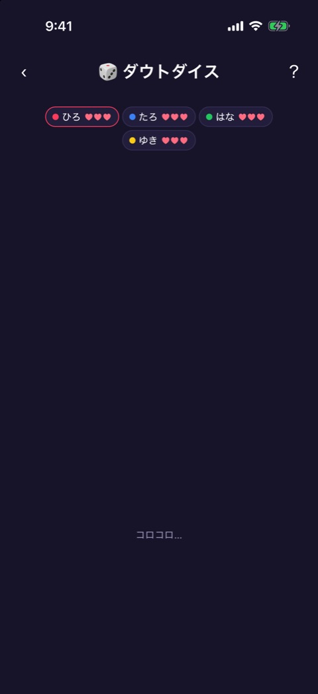
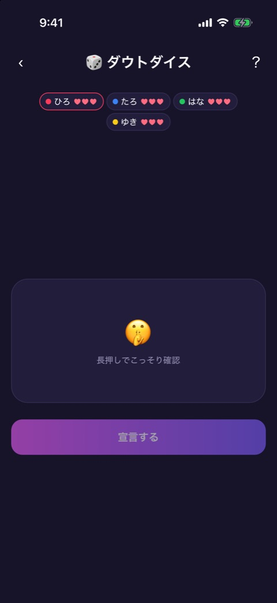
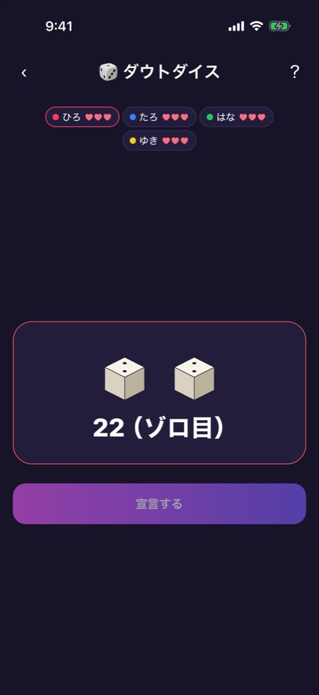
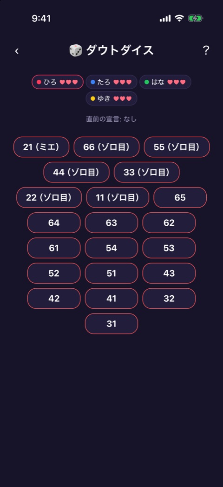
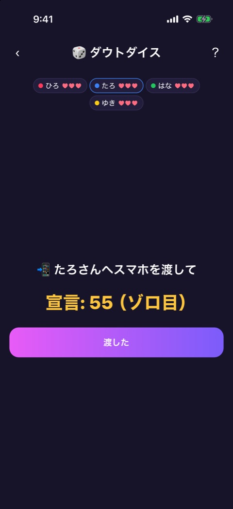
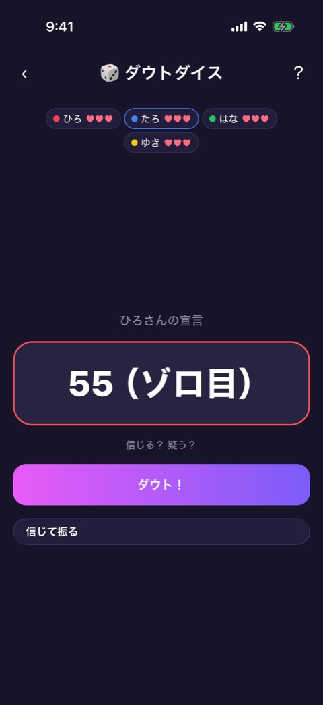
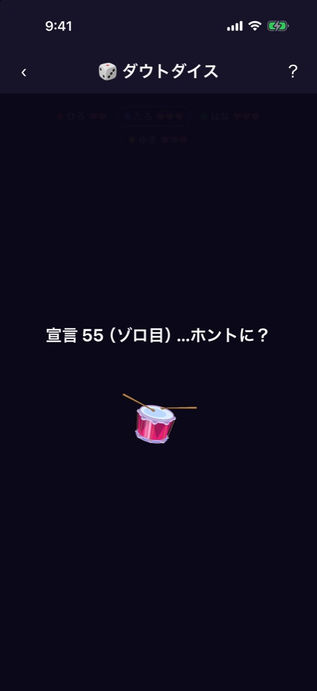
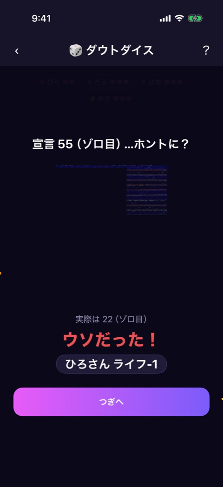

# ダウトダイス

| 項目       | 内容                         |
| ---------- | ---------------------------- |
| 画面ID     | `daut-dice`                  |
| ルート     | `/game/daut-dice`            |
| 実装       | `src/games/daut-dice/`       |
| 種別       | ゲーム（プレミアム限定）     |
| 人数       | 3〜8人。プレイヤー登録が必要 |
| お題パック | 使わない                     |

## 概要

2つのサイコロをこっそり振って出目を宣言し、端末を回していくブラフゲームです（マイヤー風）。宣言は直前の宣言より強い役しか選べません。実際の出目と違う宣言（ブラフ）もできます。宣言を受けた人は、「ダウト」で疑うか、信じて自分が振るかを選びます。全員ライフ3から始め、ライフが尽きた人の負けです。

役は強い順に、21（ミエ）、ゾロ目（66 → 11）、通常の目（65 → 31）の21通りです。出目は大きいほうを十の位にして読みます（3 と 5 なら 53）。

フェーズは `reducer.ts` が持ちます。

| フェーズ   | 画面                   | 実装                                     |
| ---------- | ---------------------- | ---------------------------------------- |
| `roll`     | 振る                   | `daut-dice-game.tsx`、`use-shake.ts`     |
| `peek`     | 出目のこっそり確認     | `daut-dice-game.tsx`、`dice-roll-3d.tsx` |
| `declare`  | 宣言を選ぶ             | `declare-list.tsx`                       |
| `handover` | 次の人へ渡す           | `daut-dice-game.tsx`                     |
| `respond`  | ダウトか信じるかを選ぶ | `respond-screen.tsx`                     |
| `reveal`   | 答え合わせ             | `reveal-overlay.tsx`                     |
| `result`   | 結果                   | `result-screen.tsx`                      |

どのフェーズでも、画面上部には [ゲーム共通のヘッダー](game-play-frame.md) と、全員のライフの一覧（`lives-bar.tsx`）が出ます。ライフの一覧では、手番の人に枠が付きます。

お試しプレイでは、結果が出るたびに1ラウンドを消費します（[お試しロック](trial-lock.md)）。

## 振る

 

### 表示項目

| No  | 項目       | 内容                       |
| --- | ---------- | -------------------------- |
| 1   | 番の案内   | 「◯◯さんの番」             |
| 2   | 振るボタン | 「タップで振る」           |
| 3   | ヒント     | 「または端末をシェイク！」 |

### 操作

| 操作                     | 結果                                                              |
| ------------------------ | ----------------------------------------------------------------- |
| 「タップで振る」をタップ | サイコロを振り、転がる演出（「コロコロ…」）のあと出目の確認へ進む |
| 端末を振る（シェイク）   | 同上。加速度が 1.8G を超えたときに反応し、1.2秒は続けて反応しない |

## 出目のこっそり確認

 

左が表示前、右が長押ししているあいだの表示です。

### 表示項目

| No  | 項目         | 内容                                                                                                |
| --- | ------------ | --------------------------------------------------------------------------------------------------- |
| 1   | 出目のパネル | ふだんは 🤫 と「長押しでこっそり確認」。長押し中だけ、サイコロ2つと役（「22（ゾロ目）」など）を出す |
| 2   | 宣言ボタン   | 「宣言する」                                                                                        |

### 操作

| 操作                 | 結果                           |
| -------------------- | ------------------------------ |
| パネルを長押し       | 押しているあいだだけ出目を出す |
| 「宣言する」をタップ | 宣言を選ぶ画面へ進む           |

「宣言する」は、出目を一度見るまで押せません。長押し中も押せません。

## 宣言を選ぶ

### 表示項目

| No  | 項目       | 内容                                                             |
| --- | ---------- | ---------------------------------------------------------------- |
| 1   | 直前の宣言 | 「直前の宣言: なし」または「直前の宣言: 55（ゾロ目）」           |
| 2   | 宣言の一覧 | 21通りの役のボタンを強い順に並べる。直前の宣言以下の役は押せない |

### 操作

| 操作               | 結果                                                                   |
| ------------------ | ---------------------------------------------------------------------- |
| 役のボタンをタップ | その役を宣言し、次の人へ渡す画面へ進む。実際の出目と同じでなくてもよい |

## 次の人へ渡す

### 表示項目

| No  | 項目         | 内容                                                 |
| --- | ------------ | ---------------------------------------------------- |
| 1   | 案内         | 「📲 ◯◯さんへスマホを渡して」                        |
| 2   | 宣言         | 「宣言: 55（ゾロ目）」。宣言のあとに渡すときだけ出る |
| 3   | 渡したボタン | 「渡した」                                           |

### 操作

| 操作               | 結果                                                                         |
| ------------------ | ---------------------------------------------------------------------------- |
| 「渡した」をタップ | 宣言のあとなら、ダウトか信じるかを選ぶ画面へ。新しいラウンドなら、振る画面へ |

## ダウトか信じるか

### 表示項目

| No  | 項目         | 内容                                                               |
| --- | ------------ | ------------------------------------------------------------------ |
| 1   | 宣言者       | 「◯◯さんの宣言」                                                   |
| 2   | 宣言         | 宣言された役                                                       |
| 3   | ヒント       | 「信じる？ 疑う？」。宣言が 21（ミエ）のときは「21はダウトのみ！」 |
| 4   | ダウトボタン | 「ダウト！」                                                       |
| 5   | 信じるボタン | 「信じて振る」。宣言が 21（ミエ）のときは出ない                    |

### 操作

| 操作                   | 結果                                                                       |
| ---------------------- | -------------------------------------------------------------------------- |
| 「ダウト！」をタップ   | 答え合わせへ進む                                                           |
| 「信じて振る」をタップ | 自分が振る画面へ進む。次に宣言するときは、受けた宣言より強い役しか選べない |

## 答え合わせ

 

### 表示項目

| No  | 項目         | 内容                                                          |
| --- | ------------ | ------------------------------------------------------------- |
| 1   | 見出し       | 「宣言 55（ゾロ目） …ホントに？」                             |
| 2   | 実際の出目   | サイコロ2つと「実際は 22（ゾロ目）」                          |
| 3   | 判定         | 「ウソだった！」または「ホントだった！ ダウト失敗…」          |
| 4   | ライフの減少 | 「◯◯さん ライフ-1」                                           |
| 5   | 進むボタン   | 誰かのライフが0になったときは「結果へ」、それ以外は「つぎへ」 |

実際の出目が宣言と同じか、より強ければ「ホント」です。ウソだったときは宣言した人が、ホントだったときはダウトした人がライフを1失います。

### 操作

| 操作               | 結果                                                                                                                   |
| ------------------ | ---------------------------------------------------------------------------------------------------------------------- |
| 「つぎへ」をタップ | ライフを失った人から新しいラウンドを始める。宣言はリセットされる。端末を持っている人以外が始めるときは、渡す画面を挟む |
| 「結果へ」をタップ | 結果へ進む                                                                                                             |

## 結果

ライフが0になった人の負けです。

### 表示項目

| No  | 項目           | 内容                                                          |
| --- | -------------- | ------------------------------------------------------------- |
| 1   | 敗者           | 「💥 ◯◯さんの負け！」                                         |
| 2   | ライフの一覧   | プレイヤーカラーの縦バー、名前、残りのライフ（♥）。0の人は 💔 |
| 3   | もう一回ボタン | 「もう一回」                                                  |
| 4   | ホームボタン   | 「ホームへ」                                                  |

### 操作

| 操作                 | 結果                                             |
| -------------------- | ------------------------------------------------ |
| 「もう一回」をタップ | ライフを戻し、負けた人から始める。渡す画面を挟む |
| 「ホームへ」をタップ | ホームへ戻る                                     |

## 遷移

- 入口: [参加メンバー](player-setup.md) の「つぎへ」。
- 出口: ホーム（「ホームへ」、またはヘッダーの戻る）。お試しを使い切ったときは [お試しロック](trial-lock.md) からペイウォールへ。

## テスト

- `src/games/daut-dice/__tests__/`（`engine`、`reducer`、`declare-list`、`lives-bar`、`respond-screen`、`reveal-overlay`、`result-screen-glass`、`use-shake`、`daut-dice-game`）

## 補足

- 結果画面は撮影していません（1人のライフを3回減らす必要があるため）。
- 振る画面と答え合わせの 3D のサイコロは、シミュレータでは正しく描画されず、空白や乱れた表示になっています。実機での表示は未確認です。
- 3D のサイコロは、出目の確認と答え合わせ以外では、実際の出目とは関係のない見た目だけの目を出します。
