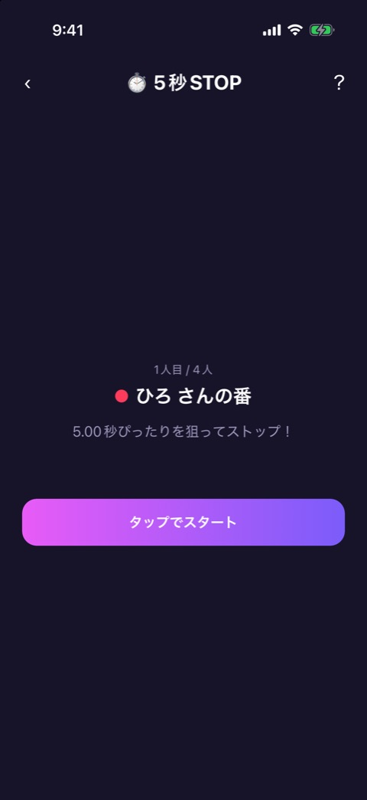
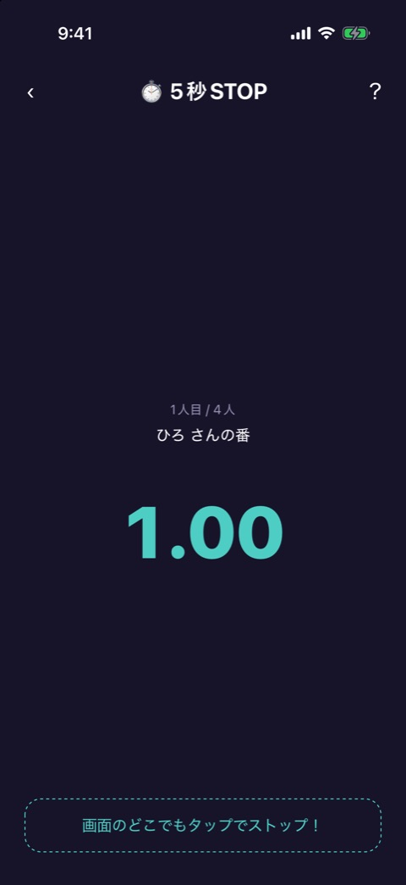
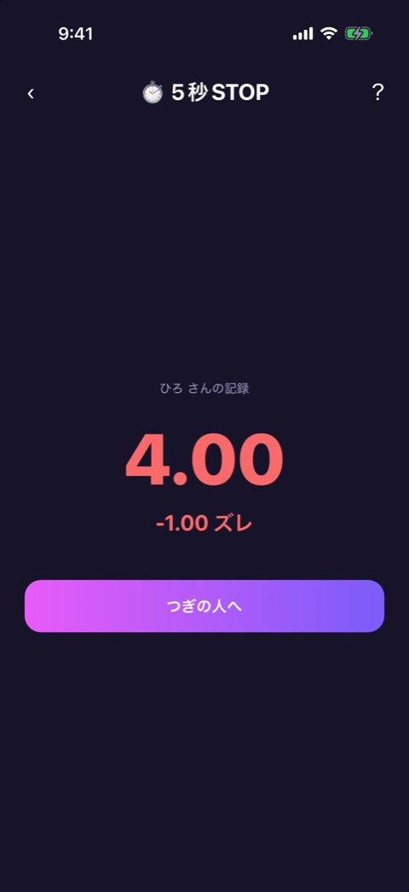
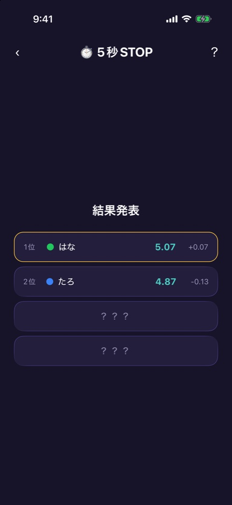
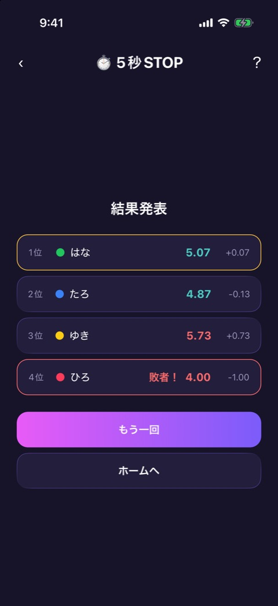

# 5秒STOP

| 項目       | 内容                          |
| ---------- | ----------------------------- |
| 画面ID     | `five-sec-stop`               |
| ルート     | `/game/five-sec-stop`         |
| 実装       | `src/games/five-sec-stop/`    |
| 種別       | ゲーム（無料）                |
| 人数       | 2〜12人。プレイヤー登録が必要 |
| お題パック | 使わない                      |

## 概要

タイマーを 5.00 秒ぴったりで止めることを狙うゲームです。途中から数字が見えなくなるので、最後は感覚で止めます。5.00 秒から一番遠かった人が負けです。

1人ずつ順番に計測し、全員が終わると結果発表に進みます。

| 段階     | 画面       | 実装                                                    |
| -------- | ---------- | ------------------------------------------------------- |
| 開始前   | 番の案内   | `stopwatch-play.tsx`（`standby`）                       |
| 計測中   | タイマー   | `stopwatch-play.tsx`（`measuring`）、`use-stopwatch.ts` |
| 記録     | 記録の表示 | `stopwatch-play.tsx`（`record`）、`judge.ts`            |
| 結果発表 | ランキング | `result.tsx`                                            |

開始前から記録までを人数ぶん繰り返します。画面上部には [ゲーム共通のヘッダー](game-play-frame.md) が出ます。

## 開始前

### 表示項目

| No  | 項目       | 内容                                  |
| --- | ---------- | ------------------------------------- |
| 1   | 順番       | 「1人目 / 4人」                       |
| 2   | 番の案内   | プレイヤーカラーの丸と「◯◯ さんの番」 |
| 3   | ヒント     | 「5.00秒ぴったりを狙ってストップ！」  |
| 4   | 開始ボタン | 「タップでスタート」                  |

### 操作

| 操作                         | 結果         |
| ---------------------------- | ------------ |
| 「タップでスタート」をタップ | 計測を始める |

## 計測中

### 表示項目

| No  | 項目       | 内容                                                                               |
| --- | ---------- | ---------------------------------------------------------------------------------- |
| 1   | 順番と名前 | 「1人目 / 4人」「◯◯ さんの番」                                                     |
| 2   | タイマー   | 経過秒数。2.5秒から薄くなり、3.0秒で見えなくなる。以後はドラムロールの演出に変わる |
| 3   | 案内       | 「画面のどこでもタップでストップ！」                                               |

### 操作

| 操作                 | 結果                     |
| -------------------- | ------------------------ |
| 画面のどこかをタップ | 計測を止めて、記録を出す |

## 記録

### 表示項目

| No  | 項目       | 内容                                                        |
| --- | ---------- | ----------------------------------------------------------- |
| 1   | 見出し     | 「◯◯ さんの記録」                                           |
| 2   | ぴったり賞 | 「＼ ぴったり賞 ／」と紙吹雪。ズレが ±0.05 秒以内のときだけ |
| 3   | 記録       | 止めた秒数                                                  |
| 4   | ズレ       | 5.00 秒との差。「-1.00 ズレ」のように符号付きで出す         |
| 5   | 進むボタン | 最後の人は「結果発表へ」、それ以外は「つぎの人へ」          |

記録とズレの色は、ズレの大きさで4段階に変わります。

| ズレ           | 段階       |
| -------------- | ---------- |
| ±0.05 秒以内   | ぴったり賞 |
| ±0.20 秒以内   | いい線     |
| ±0.50 秒以内   | おしい     |
| それより大きい | 遠い       |

### 操作

| 操作                                 | 結果                                 |
| ------------------------------------ | ------------------------------------ |
| 「つぎの人へ」「結果発表へ」をタップ | 次の人の開始前、または結果発表へ進む |

## 結果発表

 

左が発表の途中、右が全員ぶん出そろった状態です。

### 表示項目

| No  | 項目           | 内容                                                             |
| --- | -------------- | ---------------------------------------------------------------- |
| 1   | 見出し         | 「結果発表」                                                     |
| 2   | 順位の行       | 順位、プレイヤーカラーの丸、名前、記録、ズレ。発表前は「？？？」 |
| 3   | ぴったり賞     | 行の中の「ぴったり賞」バッジ。ズレが ±0.05 秒以内の人            |
| 4   | 敗者の印       | 「敗者！」と赤い枠。5.00 秒から一番遠かった人                    |
| 5   | もう一回ボタン | 「もう一回」                                                     |
| 6   | ホームボタン   | 「ホームへ」                                                     |

順位は、ズレの小さい順です。1位から0.6秒おきに1行ずつ出て、敗者の行だけは最後にドラムロールの演出のあとで出ます。

### 操作

| 操作                 | 結果                                  |
| -------------------- | ------------------------------------- |
| 「もう一回」をタップ | 記録を消して、1人目の開始前から始める |
| 「ホームへ」をタップ | ホームへ戻る                          |

## 遷移

- 入口: [参加メンバー](player-setup.md) の「つぎへ」。
- 出口: ホーム（「ホームへ」、またはヘッダーの戻る）。

## テスト

- `src/games/five-sec-stop/__tests__/`（`stopwatch-play`、`use-stopwatch`、`judge`、`result`、`five-sec-stop-game`）

## 補足

- 数字が見えなくなったあとの計測中と、ぴったり賞の画面は、撮影していません。
