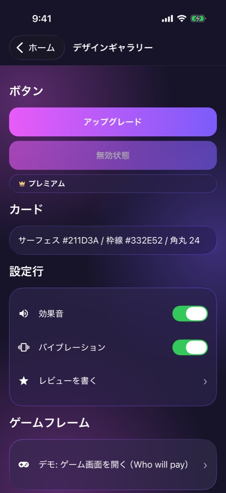

# デザインギャラリー

| 項目   | 内容                                     |
| ------ | ---------------------------------------- |
| 画面ID | `gallery`                                |
| ルート | `/gallery`                               |
| 実装   | `src/app/gallery.tsx`                    |
| 種別   | 画面（開発用。ネイティブのヘッダー付き） |

## 目的

共通の UI 部品の見た目と動きを、1画面で確かめるための開発用の画面です。ユーザーには見せません。

## スクリーンショット

## 表示項目

| No  | 見出し         | 内容                                                                               |
| --- | -------------- | ---------------------------------------------------------------------------------- |
| 1   | ボタン         | グラデーションボタン「アップグレード」、無効状態のボタン、ピルボタン「プレミアム」 |
| 2   | カード         | サーフェスの色、枠線の色、角丸の値を書いたカード                                   |
| 3   | 設定行         | トグル付きの「効果音」「バイブレーション」、矢印付きの「レビューを書く」           |
| 4   | ゲームフレーム | 「デモ: ゲーム画面を開く（Who will pay）」                                         |
| 5   | お題データ     | 取得済みのお題の状況                                                               |

## 操作

| 操作                                       | 結果                                   |
| ------------------------------------------ | -------------------------------------- |
| 「ホーム」をタップ                         | ホームへ戻る                           |
| 「アップグレード」をタップ                 | タップ音を鳴らす                       |
| ピルボタン「プレミアム」をタップ           | 成功のバイブレーションを鳴らす         |
| 「効果音」「バイブレーション」を切り替える | 設定を保存する（設定画面と同じストア） |
| 「レビューを書く」をタップ                 | 強いバイブレーションを鳴らす           |
| 「デモ: ゲーム画面を開く」をタップ         | Who will pay のゲーム画面へ進む        |

## 状態

開発ビルド以外では、この画面を開くとホームへリダイレクトします。

## 遷移

- 入口: ホーム最下部の「デザインギャラリー」（開発ビルドのみ）。
- 出口: ホーム、Who will pay のゲーム画面。

## テスト

- `src/app/__tests__/gallery.test.tsx`
