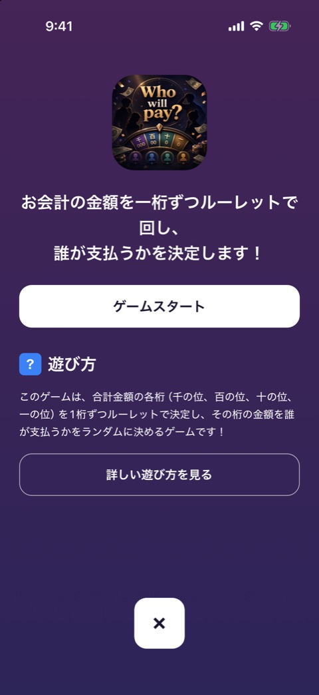

# ゲームのイントロ

| 項目   | 内容                                                                               |
| ------ | ---------------------------------------------------------------------------------- |
| 画面ID | `game-intro`                                                                       |
| ルート | `/game/[id]`（`GameScreen` の intro の段階）                                       |
| 実装   | `src/components/game/game-intro-screen.tsx`、`src/components/game/game-screen.tsx` |
| 種別   | 画面（全ゲーム共通）                                                               |

## 目的

ゲームを始める前に、どんなゲームかを一目で伝える画面です。ゲームを開くたびに毎回表示します。

## スクリーンショット

Who will pay の例です。表示する文言と画像は、ゲームごとの `meta.ts` から取ります。

## 表示項目

| No  | 項目                 | 内容                             | 元になる値                                                     |
| --- | -------------------- | -------------------------------- | -------------------------------------------------------------- |
| 1   | 背景                 | ゲームのテーマ色のグラデーション | `meta.gradient`                                                |
| 2   | サムネイル           | 角丸の正方形の画像               | `meta.thumbnail`。なければグラデーションに `meta.emoji`        |
| 3   | キャッチコピー       | 中央寄せの見出し                 | `meta.catchCopy`。なければ `meta.tagline`                      |
| 4   | 開始ボタン           | 「ゲームスタート」               | 固定                                                           |
| 5   | 遊び方の見出し       | 「？」のバッジと「遊び方」       | 固定                                                           |
| 6   | 遊び方のダイジェスト | 数行の説明文                     | `meta.summary`。なければ `meta.howToPlay` を改行でつないだもの |
| 7   | 詳細ボタン           | 「詳しい遊び方を見る」           | 固定                                                           |
| 8   | 閉じるボタン         | 画面下部の「×」                  | 固定                                                           |

## 操作

| 操作                           | 結果                                                                                                       |
| ------------------------------ | ---------------------------------------------------------------------------------------------------------- |
| 「ゲームスタート」をタップ     | `meta.requiresPlayers` が true なら [参加メンバー](player-setup.md) へ進む。そうでなければゲーム本体へ進む |
| 「詳しい遊び方を見る」をタップ | [遊び方](how-to-play.md) のモーダルを開く                                                                  |
| 「×」をタップ                  | 前の画面（通常はホーム）へ戻る                                                                             |

どのボタンも、タップでバイブレーションが鳴ります（設定で ON のとき）。

## 状態

この画面だけを見て戻った場合は、インタースティシャル広告の表示判定は走りません。判定が走るのは、ゲーム本体まで進んでから画面を離れたときです。

## 遷移

- 入口: ホームのゲームカード。プレミアムロックのモーダルからのお試し開始。
- 出口: 参加メンバー、ゲーム本体、ホーム。

未購読でそのゲームのお試し中でもないプレミアム限定ゲームは、この画面を出さずにホームへ戻します（`src/app/game/[id].tsx`）。

## テスト

- `src/components/game/__tests__/game-screen.test.tsx`
- `src/app/__tests__/game-route.test.tsx`
