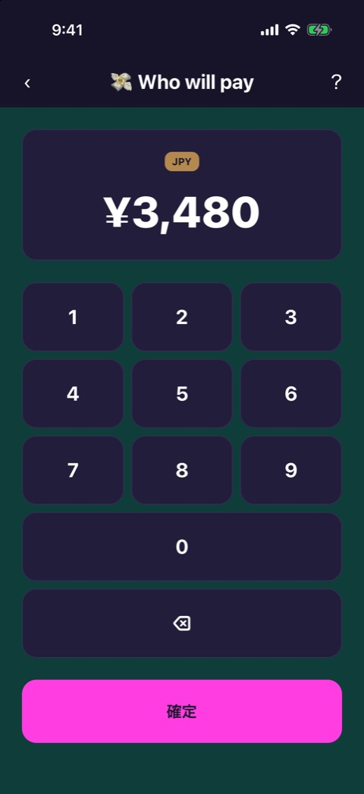
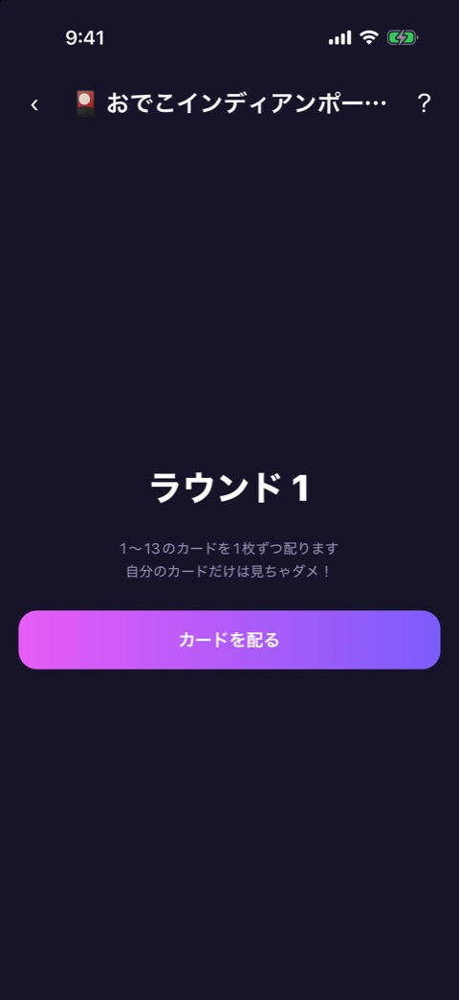

# ゲーム本体の枠

| 項目   | 内容                                        |
| ------ | ------------------------------------------- |
| 画面ID | `game-play-frame`                           |
| ルート | `/game/[id]`（`GameScreen` の play の段階） |
| 実装   | `src/components/game/game-screen.tsx`       |
| 種別   | 画面の枠（全ゲーム共通）                    |

## 目的

各ゲームの本体を表示する共通の枠です。上部のヘッダーと、ゲーム本体の領域からなります。ゲームごとの中身は、それぞれのゲームの設計書を参照してください。

## スクリーンショット

 

左は Who will pay の例です。右のように長いタイトルは、末尾が「…」で省略されます。

## 表示項目

| No  | 項目         | 内容                                                                                                        |
| --- | ------------ | ----------------------------------------------------------------------------------------------------------- |
| 1   | 戻るボタン   | 左上の「‹」                                                                                                 |
| 2   | タイトル     | `meta.emoji` と `meta.title`。1行に収まらなければ省略                                                       |
| 3   | 遊び方ボタン | 右上の「？」                                                                                                |
| 4   | ゲーム本体   | `meta.Component` を描画する                                                                                 |
| 5   | お試しロック | プレミアム限定ゲームのときだけ、本体の上に [お試しロック](trial-lock.md) を重ねる（条件を満たすときに表示） |

## 操作

| 操作                                       | 結果                                      |
| ------------------------------------------ | ----------------------------------------- |
| 「‹」をタップ                              | 前の画面（通常はホーム）へ戻る            |
| 「？」をタップ                             | [遊び方](how-to-play.md) のモーダルを開く |
| iOS のスワイプバック、Android の戻るボタン | 「‹」と同じ                               |

## 状態

この段階の画面から離れると、どの方法で離れても、インタースティシャル広告の表示判定が走ります（未購読で、広告の読み込みが済んでいるとき）。イントロやプレイヤー設定の段階で離れたときは走りません。詳しくは [ADS.md](../ADS.md) を参照してください。

プレミアム限定ゲームのお試し中に画面を離れると、お試しは終わります。

## 遷移

- 入口: [ゲームのイントロ](game-intro.md) の「ゲームスタート」（プレイヤー登録が要らないゲーム）、[参加メンバー](player-setup.md) の「つぎへ」。
- 出口: 前の画面、[遊び方](how-to-play.md)、各ゲームの「ホームへ」。

## テスト

- `src/components/game/__tests__/game-screen.test.tsx`
