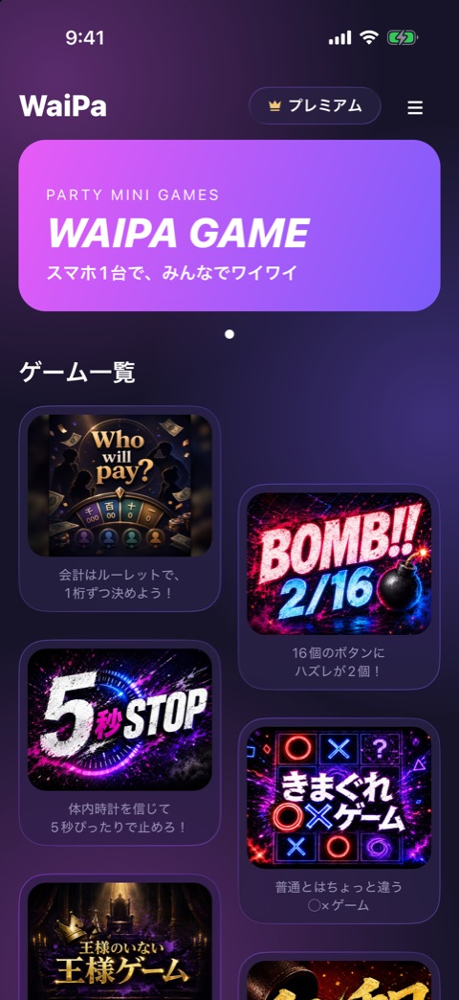
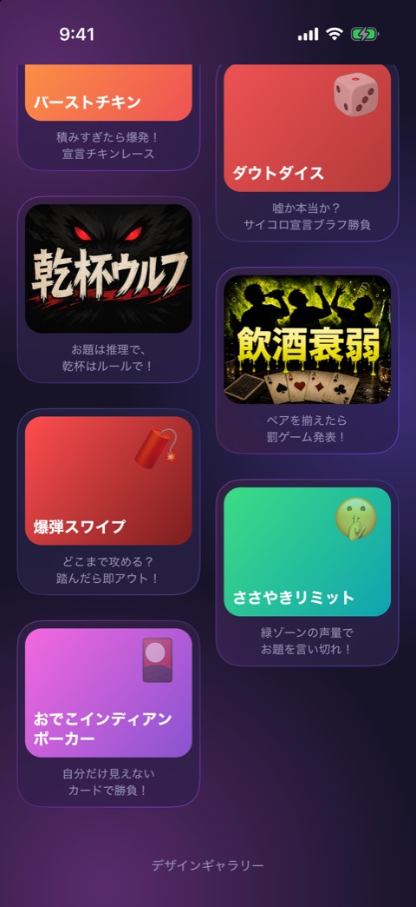
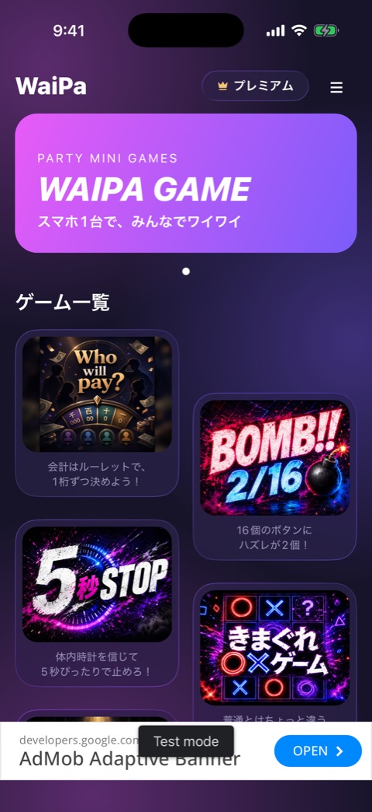
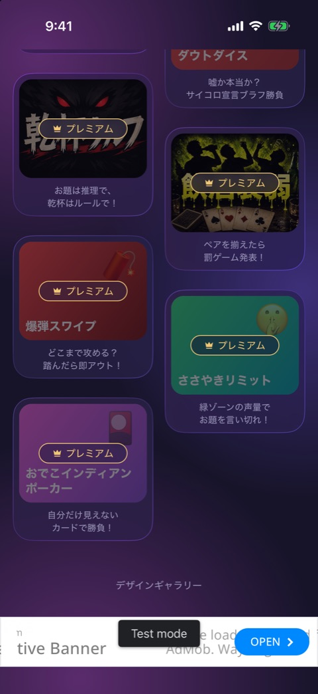

# ホーム

| 項目   | 内容                                        |
| ------ | ------------------------------------------- |
| 画面ID | `home`                                      |
| ルート | `/`                                         |
| 実装   | `src/app/index.tsx`、`src/components/home/` |
| 種別   | 画面（アプリの起点）                        |

## 目的

遊ぶゲームを選ぶ画面です。アプリを起動すると最初に表示されます。

## スクリーンショット

 

左が上部、右が最下部までスクロールした状態です。プレミアム扱いの開発ビルドで撮っているため、ロック表示とバナー広告は写っていません。

 

未購読のときの表示です。撮影のときだけ開発ビルドを未購読扱いにして撮りました。左は最下部にバナー広告（テスト広告）、右はプレミアム限定ゲームのロック表示です。

## 表示項目

| No  | 項目               | 内容                                                                                 | 表示条件                             | 実装                 |
| --- | ------------------ | ------------------------------------------------------------------------------------ | ------------------------------------ | -------------------- |
| 1   | ロゴ               | 文字の「WaiPa」                                                                      | 常時                                 | `home-header.tsx`    |
| 2   | プレミアムボタン   | 王冠アイコンと「プレミアム」                                                         | 常時                                 | `home-header.tsx`    |
| 3   | メニューボタン     | 「≡」                                                                                | 常時                                 | `home-header.tsx`    |
| 4   | ヒーローバナー     | 「PARTY MINI GAMES」「WAIPA GAME」「スマホ1台で、みんなでワイワイ」とページドット1つ | 常時。スライドは1枚で固定            | `hero-banner.tsx`    |
| 5   | 見出し             | 「ゲーム一覧」                                                                       | 常時                                 | `index.tsx`          |
| 6   | ゲームカード       | サムネイルと、その下のキャッチコピー（2行まで）                                      | registry に登録された全ゲーム        | `game-card.tsx`      |
| 7   | ロック表示         | カードに重なる薄い黒のマスクと「プレミアム」バッジ                                   | プレミアム限定ゲームで、未購読のとき | `game-card.tsx`      |
| 8   | デザインギャラリー | 文字リンク                                                                           | 開発ビルドのみ                       | `index.tsx`          |
| 9   | バナー広告         | 画面最下部に固定                                                                     | 広告の初期化が済み、未購読のとき     | `home-banner-ad.tsx` |

ゲームカードは2列の千鳥配置です。registry の並び順で、偶数番目を左列、奇数番目を右列に置き、右列を半タイルぶん下げています。サムネイル画像がないゲームは、テーマ色のグラデーションに絵文字とタイトルを重ねて表示します。

## 操作

| 操作                                 | 結果                                                               |
| ------------------------------------ | ------------------------------------------------------------------ |
| プレミアムボタンをタップ             | 設定（`/settings`）へ進む                                          |
| メニューボタンをタップ               | 設定（`/settings`）へ進む                                          |
| 無料ゲームのカードをタップ           | ゲーム（`/game/[id]`）へ進む                                       |
| プレミアム限定ゲームのカードをタップ | 購読者ならゲームへ進む。未購読ならプレミアムロックのモーダルを出す |
| デザインギャラリーをタップ           | デザインギャラリー（`/gallery`）へ進む                             |
| 上下にスクロール                     | ゲーム一覧を送る。バナー広告は最下部に固定されたまま               |

カードとメニューボタンのタップでは、バイブレーションが鳴ります（設定で ON のとき）。

## 状態

| 状態       | 条件              | 表示の違い                                                               |
| ---------- | ----------------- | ------------------------------------------------------------------------ |
| 未購読     | プレミアムが無効  | プレミアム限定ゲームにロック表示が付く。広告の初期化後にバナー広告が出る |
| 購読中     | プレミアムが有効  | ロック表示もバナー広告も出ない                                           |
| 開発ビルド | `__DEV__` が true | 最下部に「デザインギャラリー」のリンクが出る                             |

購入や復元で購読状態が変わると、ロック表示とバナー広告はその場で切り替わります。

## 遷移

- 入口: アプリの起動。各画面からの「戻る」。ゲームの結果画面の「ホームへ」。
- 出口: 設定、ゲーム、デザインギャラリー、プレミアムロックのモーダル。

## テスト

- `src/app/__tests__/index.test.tsx`
- `src/components/home/__tests__/`（`home-header`、`game-grid`、`game-card`、`home-banner-ad`、`premium-lock-modal`）

## 補足

- ヒーローバナーは、ページドットがありますが、スライドは1枚だけです。
