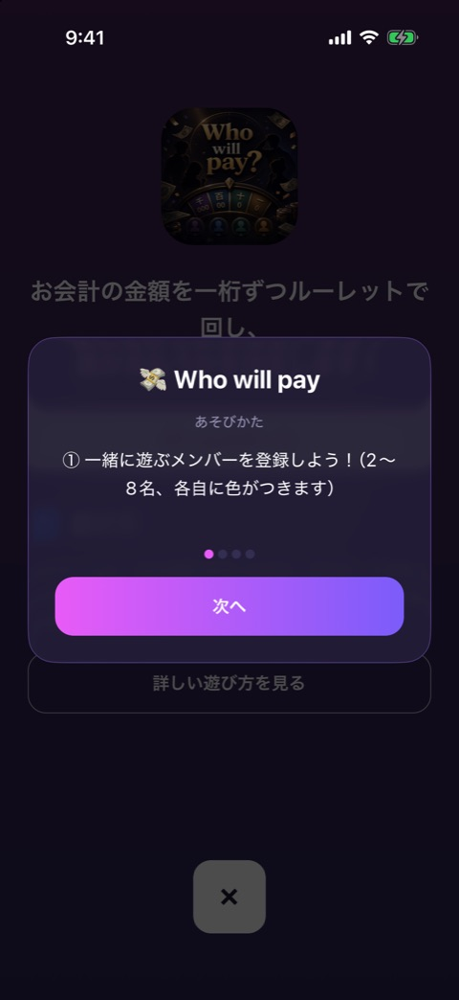
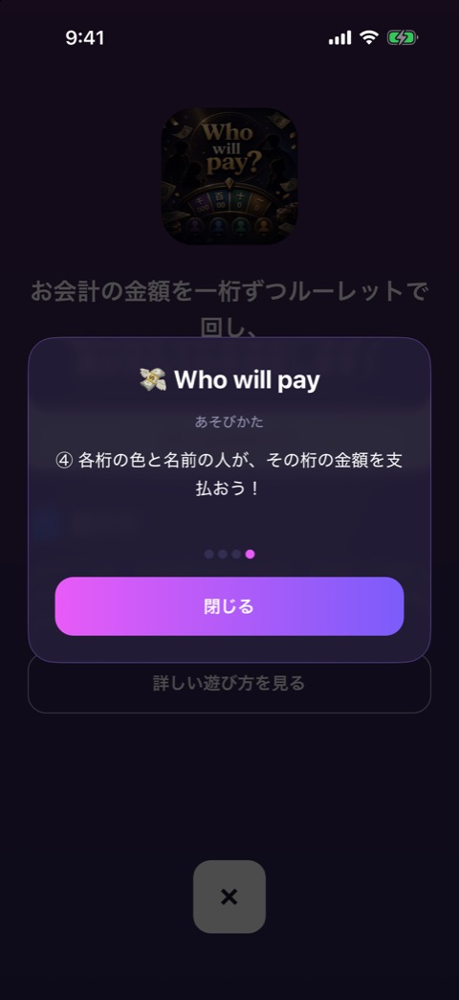

# 遊び方

| 項目   | 内容                                        |
| ------ | ------------------------------------------- |
| 画面ID | `how-to-play`                               |
| ルート | なし（`GameScreen` の上に重ねて表示）       |
| 実装   | `src/components/game/how-to-play-modal.tsx` |
| 種別   | モーダル（全ゲーム共通）                    |

## 目的

ゲームの遊び方を、1ページに1項目ずつ順番に読んでもらうモーダルです。

## スクリーンショット

 

左が1ページ目、右が最終ページです。

## 表示項目

| No  | 項目         | 内容                                             | 元になる値                   |
| --- | ------------ | ------------------------------------------------ | ---------------------------- |
| 1   | タイトル     | 絵文字とゲーム名                                 | `meta.emoji` と `meta.title` |
| 2   | ラベル       | 「あそびかた」                                   | 固定                         |
| 3   | 本文         | 今のページの説明文                               | `meta.howToPlay` の1項目     |
| 4   | ページドット | ページ数ぶんの点。今のページだけ色が付く         | `meta.howToPlay` の件数      |
| 5   | ボタン       | 最終ページ以外は「次へ」、最終ページは「閉じる」 | 固定                         |

背景は半透明の黒で、下の画面が透けて見えます。

## 操作

| 操作                       | 結果             |
| -------------------------- | ---------------- |
| 「次へ」をタップ           | 次のページへ進む |
| 「閉じる」をタップ         | モーダルを閉じる |
| Android の戻るボタンを押す | モーダルを閉じる |

背景をタップしても閉じません。前のページへ戻る操作もありません。

## 状態

開くたびに1ページ目から始まります。

## 遷移

- 入口: [ゲームのイントロ](game-intro.md) の「詳しい遊び方を見る」。ゲーム本体のヘッダー右の「？」。
- 出口: 開いた元の画面。

## テスト

- `src/components/game/__tests__/how-to-play-modal.test.tsx`
