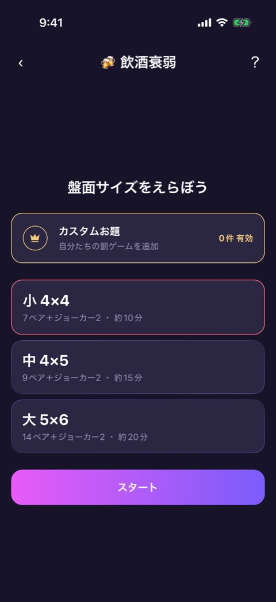
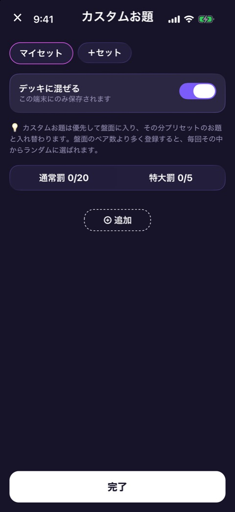
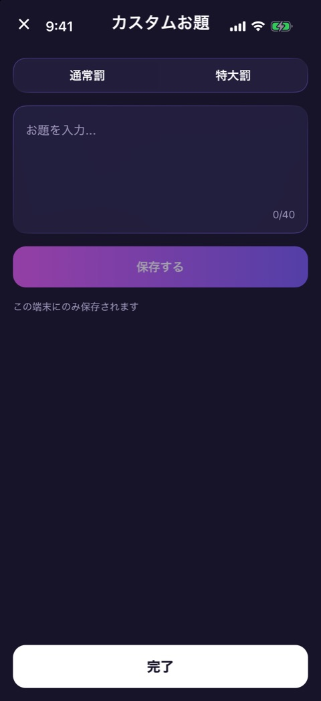
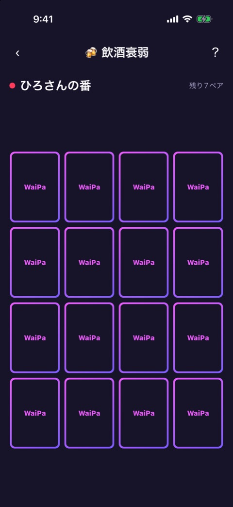
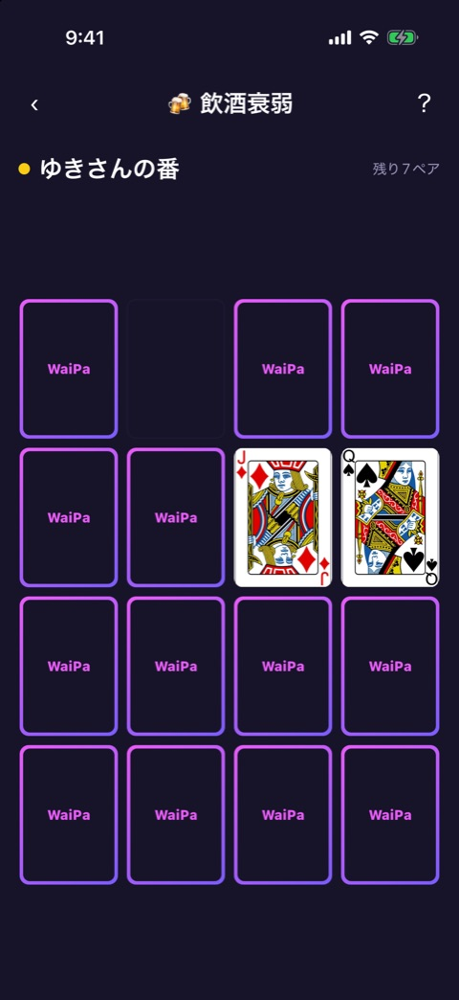
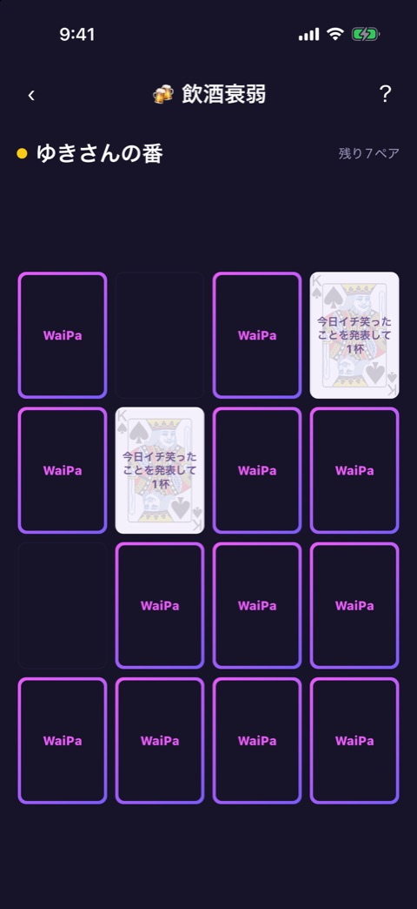
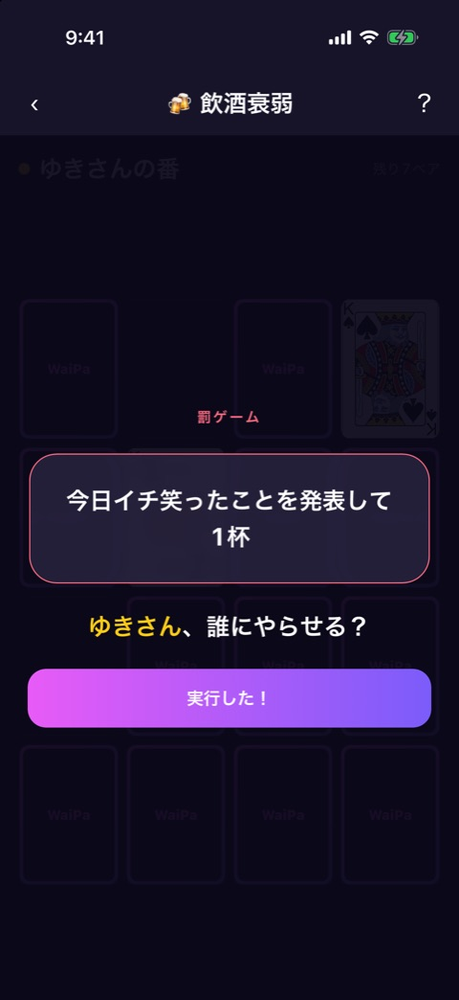
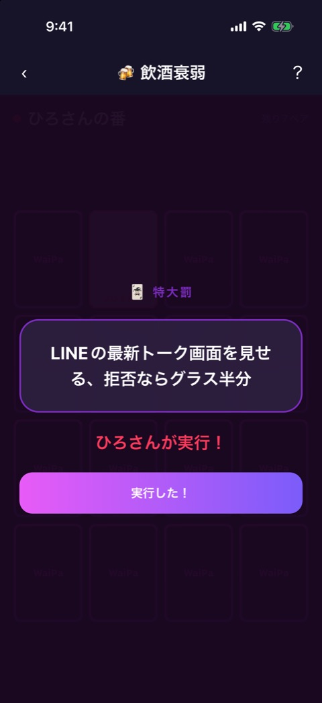

# 飲酒衰弱

| 項目       | 内容                                                              |
| ---------- | ----------------------------------------------------------------- |
| 画面ID     | `inshu-suijaku`                                                   |
| ルート     | `/game/inshu-suijaku`                                             |
| 実装       | `src/games/inshu-suijaku/`、`src/lib/custom-punishments-store.ts` |
| 種別       | ゲーム（プレミアム限定）                                          |
| 人数       | 2〜12人。プレイヤー登録が必要                                     |
| お題パック | 使わない（罰ゲームはアプリに同梱。自分たちで追加もできる）        |

## 概要

トランプの神経衰弱に罰ゲームを仕込んだゲームです。ペアがそろうと、そのペアに隠されていた罰ゲームが発表され、そろえた人が実行する人を指名します。ジョーカー（2枚）を引いた人は、特大罰を自分で実行します。全部のペアがなくなると、獲得ペア数のランキングを発表します。

フェーズは `reducer.ts` が持ちます。

| フェーズ    | 画面                        | 実装                                              |
| ----------- | --------------------------- | ------------------------------------------------- |
| `size`      | 盤面サイズの選択            | `size-select.tsx`、`custom-punishments-sheet.tsx` |
| `play`      | 盤面                        | `inshu-suijaku-game.tsx`、`card-grid.tsx`         |
| `matchAnim` | ペアがそろった演出（約1秒） | `card-grid.tsx`                                   |
| `jokerAnim` | ジョーカーの演出（約0.6秒） | `card-grid.tsx`                                   |
| `punish`    | 盤面の上に罰ゲームを重ねる  | `punish-reveal.tsx`                               |
| `result`    | 結果                        | `result-screen.tsx`                               |

画面上部には [ゲーム共通のヘッダー](game-play-frame.md) が出ます。お試しプレイでは、結果が出るたびに1ラウンドを消費します（[お試しロック](trial-lock.md)）。

## 盤面サイズの選択

### 表示項目

| No  | 項目           | 内容                                                                                               |
| --- | -------------- | -------------------------------------------------------------------------------------------------- |
| 1   | 見出し         | 「盤面サイズをえらぼう」                                                                           |
| 2   | カスタムお題   | 王冠のアイコン、「カスタムお題」「自分たちの罰ゲームを追加」と、状態（「◯件 有効」または「オフ」） |
| 3   | サイズの選択肢 | 下の表の3つ。初期値は小                                                                            |
| 4   | 開始ボタン     | 「スタート」                                                                                       |

| サイズ | ペア数 | 枚数（ジョーカー込み） | 目安   |
| ------ | ------ | ---------------------- | ------ |
| 小 4×4 | 7      | 16                     | 約10分 |
| 中 4×5 | 9      | 20                     | 約15分 |
| 大 5×6 | 14     | 30                     | 約20分 |

### 操作

| 操作                     | 結果                                                               |
| ------------------------ | ------------------------------------------------------------------ |
| 「カスタムお題」をタップ | カスタムお題のシートを開く                                         |
| サイズをタップ           | そのサイズを選ぶ                                                   |
| 「スタート」をタップ     | トランプ52枚から、ペア数ぶんの絵柄を選んでカードを配り、盤面へ進む |

### カスタムお題のシート

 

左が一覧、右が追加のフォームです。カスタムお題は、この端末にだけ保存されます（AsyncStorage の `waipa.inshu-suijaku.custom-punishments`）。

| 項目           | 内容                                                                                                                                               |
| -------------- | -------------------------------------------------------------------------------------------------------------------------------------------------- |
| セット         | 「マイセット」などのセットのチップと「＋セット」。セットは5つまで。長押しで削除（確認あり）                                                        |
| デッキに混ぜる | トグル。ON のとき、選んでいるセットのお題を盤面に入れる                                                                                            |
| 説明           | 「カスタムお題は優先して盤面に入り、その分プリセットのお題と入れ替わります。盤面のペア数より多く登録すると、毎回その中からランダムに選ばれます。」 |
| 件数           | 「通常罰 0/20」「特大罰 0/5」                                                                                                                      |
| お題の一覧     | 登録したお題。それぞれに「編集」「削除」                                                                                                           |
| 追加ボタン     | 「⊕ 追加」                                                                                                                                         |
| フォーム       | 「通常罰」「特大罰」の切り替え、「お題を入力...」（40文字まで）、「保存する」                                                                      |
| 完了ボタン     | 「完了」。シートを閉じる                                                                                                                           |

通常罰はペアのカードに、特大罰はジョーカーに割り当てられます。

## 盤面

 

### 表示項目

| No  | 項目       | 内容                                                       |
| --- | ---------- | ---------------------------------------------------------- |
| 1   | 手番の表示 | プレイヤーカラーの丸と「◯◯さんの番」                       |
| 2   | 残りペア数 | 「残り7ペア」                                              |
| 3   | カード     | 裏は「WaiPa」。表はトランプの絵柄。ジョーカーには「JOKER」 |

### 操作

| めくった結果      | 挙動                                                                                               |
| ----------------- | -------------------------------------------------------------------------------------------------- |
| 2枚がペア         | カードの上に罰ゲームの文が浮かぶ演出（約1秒）のあと、罰ゲームの発表へ。その人の獲得ペア数が1増える |
| 2枚がペアではない | 1.5秒見せてから裏に戻し、次の人の番にする                                                          |
| ジョーカー        | 1枚目をめくっていれば裏に戻し、短い演出（約0.6秒）のあと、特大罰の発表へ                           |

2枚めくられているあいだと、演出のあいだは、カードをめくれません。

## 罰ゲームの発表

  

左から、ペアがそろった演出、ペアの罰ゲーム、ジョーカーの特大罰です。

### 表示項目

| No  | 項目       | ペアのとき                                         | ジョーカーのとき   |
| --- | ---------- | -------------------------------------------------- | ------------------ |
| 1   | ラベル     | 「罰ゲーム」                                       | 「🃏 特大罰」      |
| 2   | 罰ゲーム   | 罰ゲームの文。飲む系の罰にはグラスのアイコンが付く | 特大罰の文         |
| 3   | 指示       | 「◯◯さん、誰にやらせる？」                         | 「◯◯さんが実行！」 |
| 4   | 完了ボタン | 「実行した！」                                     | 同じ               |

罰ゲームの中には「ラッキー」が1つあり、それに当たったときの指示は「◯◯さん、ラッキー！全員から拍手！」です。

### 操作

| 操作                   | 結果                                                               |
| ---------------------- | ------------------------------------------------------------------ |
| 「実行した！」をタップ | 次の人の番にして盤面へ戻る。ペアがすべてなくなっていれば結果へ進む |

ペアがそろっても、同じ人が続けてめくることはできません。

## 結果

### 表示項目

| No  | 項目           | 内容                                                         |
| --- | -------------- | ------------------------------------------------------------ |
| 1   | 見出し         | 「🏆 結果発表」                                              |
| 2   | 順位の行       | 順位、名前、獲得ペア数。獲得数が一番少ない人に「最下位」の印 |
| 3   | もう一回ボタン | 「もう一回」                                                 |
| 4   | ホームのリンク | 「ホームへ」                                                 |

順位は獲得ペア数の多い順で、同じ数の人は同じ順位です。全員が同じ数のときは、最下位の印を付けません。

### 操作

| 操作                 | 結果                                 |
| -------------------- | ------------------------------------ |
| 「もう一回」をタップ | 同じサイズでカードを配り直して始める |
| 「ホームへ」をタップ | ホームへ戻る                         |

## 遷移

- 入口: [参加メンバー](player-setup.md) の「つぎへ」。
- 出口: ホーム（「ホームへ」、またはヘッダーの戻る）。お試しを使い切ったときは [お試しロック](trial-lock.md) からペイウォールへ。

## テスト

- `src/games/inshu-suijaku/__tests__/`（`engine`、`reducer`、`punishments`、`card-assets`、`card-grid`、`size-select`、`custom-punishments-sheet`、`punish-reveal`、`result-screen`、`inshu-suijaku-game`）
- `src/lib/__tests__/custom-punishments-store.test.ts`

## 補足

- **カスタムお題のシートのヘッダーが、端末のステータスバーに重なっています**。左上の「×」が時計の位置にあり、シミュレータではタップしても閉じられませんでした（「完了」では閉じられます）。シートの `Modal` の中で、上の安全領域の余白を取っていないためと思われます。
- 結果画面と、ラッキーの罰ゲームは撮影していません。
