# 乾杯ウルフ

| 項目       | 内容                                                           |
| ---------- | -------------------------------------------------------------- |
| 画面ID     | `kanpai-wolf`                                                  |
| ルート     | `/game/kanpai-wolf`                                            |
| 実装       | `src/games/kanpai-wolf/`                                       |
| 種別       | ゲーム（プレミアム限定）                                       |
| 人数       | 3〜12人。プレイヤー登録が必要                                  |
| お題パック | Supabase の `word_pairs`（`food`、`place`、`aruaru`、`adult`） |

## 概要

1人（7人以上なら1人か2人）だけ少し違うお題を持つ「ウルフ」を、会話で探す推理ゲームです（ワードウルフ）。毎ラウンド1つ「乾杯ルール」が公開され、議論中にその条件が起きたらみんなで乾杯します。ウルフは投票で選ばれても、市民のお題を当てれば逆転勝ちです。

お題はペア（「ラーメン」と「うどん」など）で配信され、どちらが市民（多数派）のお題になるかは毎回ランダムに決まります。

フェーズは `reducer.ts` が持ちます。

| フェーズ         | 画面                 | 実装                        |
| ---------------- | -------------------- | --------------------------- |
| `setup`          | 設定                 | `setup-screen.tsx`          |
| `deal`           | お題くばり           | `deal-pass.tsx`             |
| `trigger-reveal` | 乾杯ルールの発表     | `trigger-reveal-screen.tsx` |
| `discuss`        | 議論タイム           | `discuss-screen.tsx`        |
| `vote`           | 投票                 | `vote-screen.tsx`           |
| `runoff-discuss` | 同票のときの再議論   | `discuss-screen.tsx`        |
| `reveal`         | 開票                 | `reveal-overlay.tsx`        |
| `reversal`       | ウルフの逆転チャンス | `reversal-screen.tsx`       |
| `kanpai-time`    | 逆転失敗の乾杯       | `kanpai-time-screen.tsx`    |
| `result`         | 結果                 | `result-screen.tsx`         |

画面上部には [ゲーム共通のヘッダー](game-play-frame.md) が出ます。お試しプレイでは、結果が出るたびに1ラウンドを消費します（[お試しロック](trial-lock.md)）。

## 設定

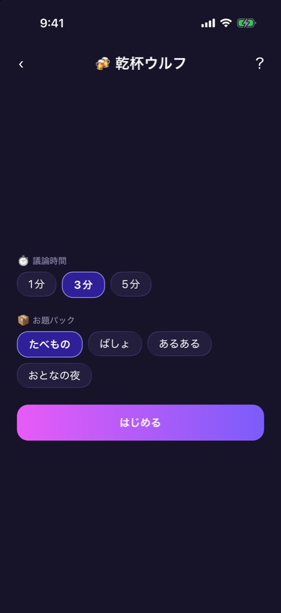

### 表示項目

| No  | 項目         | 内容                                                                                  | 表示条件      |
| --- | ------------ | ------------------------------------------------------------------------------------- | ------------- |
| 1   | ウルフの人数 | 「🐺 ウルフの人数」と「1人」「2人」。初期値は1人                                      | 7人以上のとき |
| 2   | 議論時間     | 「⏱️ 議論時間」と「1分」「3分」「5分」。初期値は3分                                   | 常時          |
| 3   | お題パック   | 「📦 お題パック」と「たべもの」「ばしょ」「あるある」「おとなの夜」。初期値はたべもの | 常時          |
| 4   | 開始ボタン   | 「はじめる」                                                                          | 常時          |

### 操作

| 操作                   | 結果                                                           |
| ---------------------- | -------------------------------------------------------------- |
| 各項目のチップをタップ | その値を選ぶ                                                   |
| 「はじめる」をタップ   | お題のペアと乾杯ルールを選び、ウルフを決めて、お題くばりへ進む |

## お題くばり

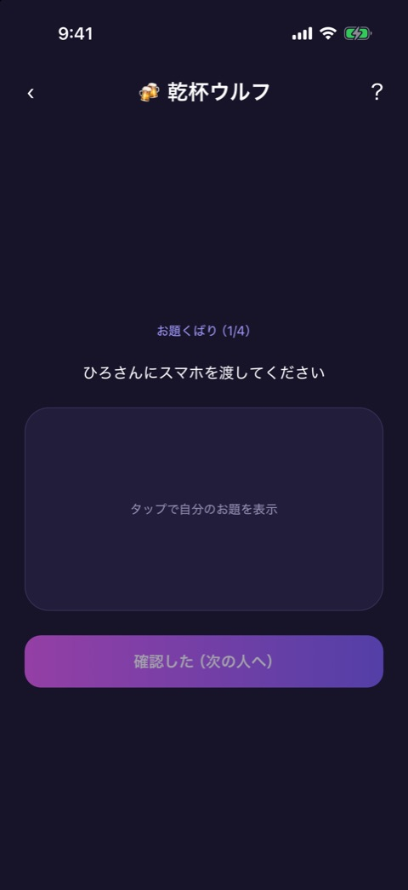 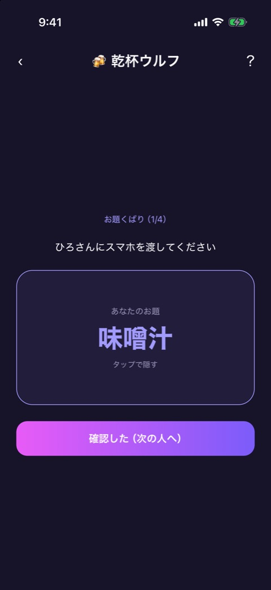

### 表示項目

| No  | 項目         | 内容                                                                                   |
| --- | ------------ | -------------------------------------------------------------------------------------- |
| 1   | 進み具合     | 「お題くばり（1/4）」                                                                  |
| 2   | 案内         | 「◯◯さんにスマホを渡してください」                                                     |
| 3   | お題のパネル | ふだんは「タップで自分のお題を表示」。表示中は「あなたのお題」、お題、「タップで隠す」 |
| 4   | 確認ボタン   | 最後の人は「確認した（乾杯ルールへ！）」、それ以外は「確認した（次の人へ）」           |

### 操作

| 操作               | 結果                                         |
| ------------------ | -------------------------------------------- |
| パネルをタップ     | お題を出す。もう一度タップで隠す             |
| 確認ボタンをタップ | 次の人へ。最後の人のあとは乾杯ルールの発表へ |

確認ボタンは、お題を一度表示するまで押せません。

## 乾杯ルールの発表

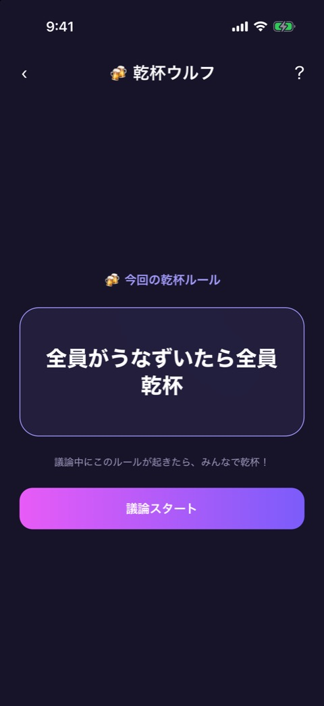

「🍻 今回の乾杯ルール」と、ルールの本文、「議論中にこのルールが起きたら、みんなで乾杯！」を出します。「議論スタート」で議論タイムへ進みます。

乾杯ルールは、アプリに同梱した12種類から、まだ使っていないものを選びます（「誰かが質問されたら全員乾杯」「敬語を使ったら本人が一口」など）。全部使い切ったら、また全部から選びます。

## 議論タイム

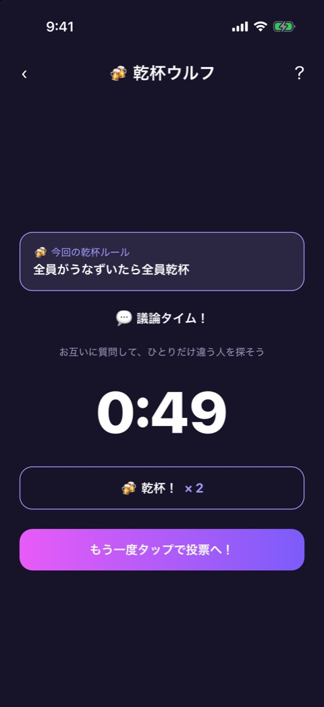

乾杯を2回押し、「投票へすすむ」を1回押した状態です。

### 表示項目

| No  | 項目       | 内容                                                                                                             |
| --- | ---------- | ---------------------------------------------------------------------------------------------------------------- |
| 1   | 乾杯ルール | 「🍻 今回の乾杯ルール」と本文                                                                                    |
| 2   | 見出し     | 「💬 議論タイム！」。再議論のときは「🗳️ 決選投票の前に、もう一度話し合おう」                                     |
| 3   | ヒント     | 「お互いに質問して、ひとりだけ違う人を探そう」。再議論のときは「同票だった人たちに質問して、ウルフを見極めよう」 |
| 4   | タイマー   | 残り時間。10秒を切ると色が変わる                                                                                 |
| 5   | 乾杯ボタン | 「🍻 乾杯！」と、このラウンドの乾杯の回数（「× 2」）                                                             |
| 6   | 投票ボタン | 「投票へすすむ」。1回押すと「もう一度タップで投票へ！」に変わる                                                  |

### 操作

| 操作                        | 結果                |
| --------------------------- | ------------------- |
| 「🍻 乾杯！」をタップ       | 乾杯の回数を1増やす |
| 「投票へすすむ」を2回タップ | 投票へ進む          |
| （時間切れ）                | 自動で投票へ進む    |

再議論の時間は60秒です。

## 投票

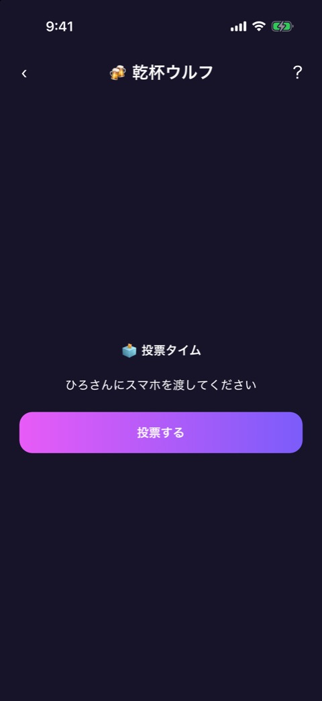 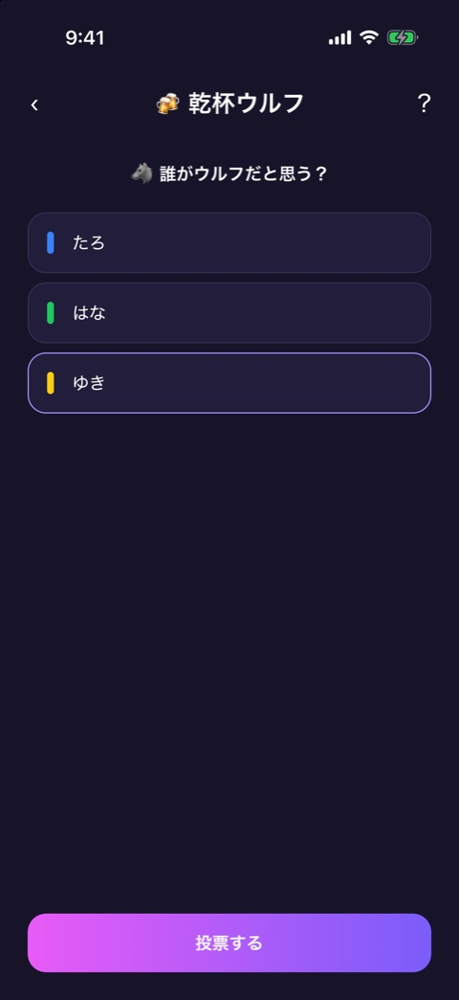

1人ずつ端末を回して投票します。

### 表示項目

| No  | 項目       | 内容                                                              |
| --- | ---------- | ----------------------------------------------------------------- |
| 1   | 受け渡し   | 「🗳️ 投票タイム」「◯◯さんにスマホを渡してください」と「投票する」 |
| 2   | 投票先     | 「🐺 誰がウルフだと思う？」と、自分以外の名前の一覧               |
| 3   | 投票ボタン | 「投票する」。投票先を選ぶまで押せない                            |

### 操作と開票

| 状況                         | 挙動                                                     |
| ---------------------------- | -------------------------------------------------------- |
| 最多票が1人                  | その人を開票へ                                           |
| 最多票が複数（全員ではない） | 同票の人を候補にして決選投票。投票するのは候補以外の全員 |
| 全員が同票                   | 再議論（60秒）のあと、通常の投票をやり直す               |
| 決選投票でも同票             | 候補を残したまま再議論し、決着するまで繰り返す           |

## 開票

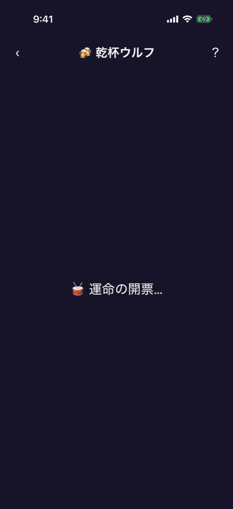 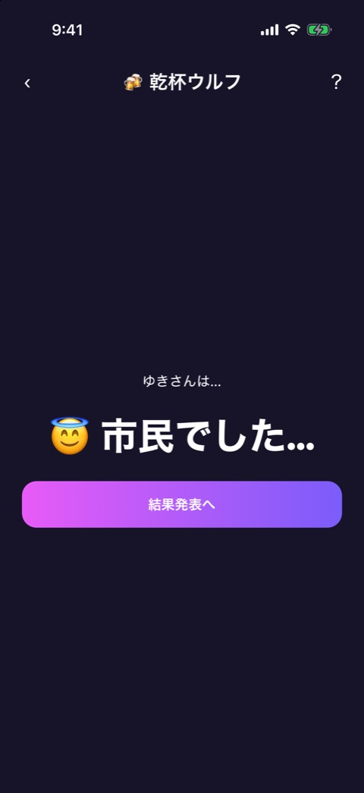 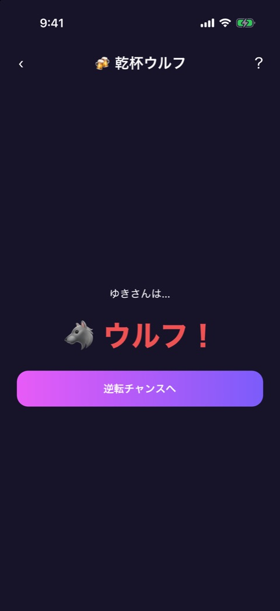

「🥁 運命の開票…」のあと、「◯◯さんは…」と正体を出します。

| 正体   | 表示               | ボタン             | 次                   |
| ------ | ------------------ | ------------------ | -------------------- |
| 市民   | 「😇 市民でした…」 | 「結果発表へ」     | 結果（ウルフの勝利） |
| ウルフ | 「🐺 ウルフ！」    | 「逆転チャンスへ」 | 逆転チャンス         |

## 逆転チャンス

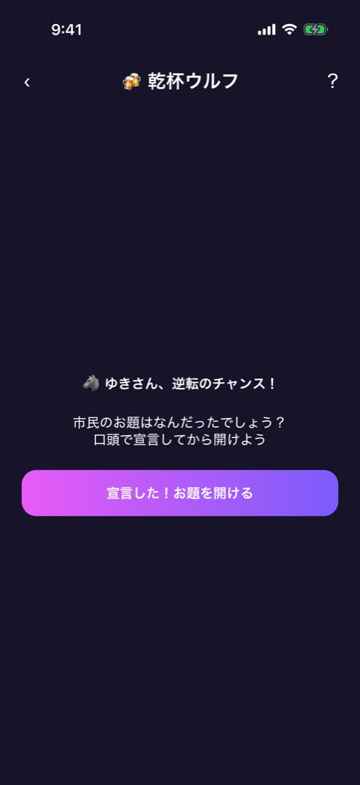 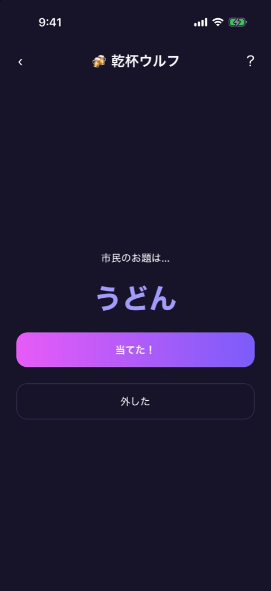

### 表示項目

| No  | 項目         | 内容                                                            |
| --- | ------------ | --------------------------------------------------------------- |
| 1   | 見出し       | 「🐺 ◯◯さん、逆転のチャンス！」                                 |
| 2   | 案内         | 「市民のお題はなんだったでしょう？ 口頭で宣言してから開けよう」 |
| 3   | 開けるボタン | 「宣言した！お題を開ける」                                      |
| 4   | 市民のお題   | 開けたあとに「市民のお題は…」とお題を出す                       |
| 5   | 判定ボタン   | 「当てた！」「外した」                                          |

ウルフが口で答えを言ってから開け、当たったかどうかはその場の全員で判断してボタンを押します。

| 操作                 | 結果                       |
| -------------------- | -------------------------- |
| 「当てた！」をタップ | 結果（ウルフの逆転勝利）へ |
| 「外した」をタップ   | 逆転失敗の乾杯へ           |

## 逆転失敗の乾杯

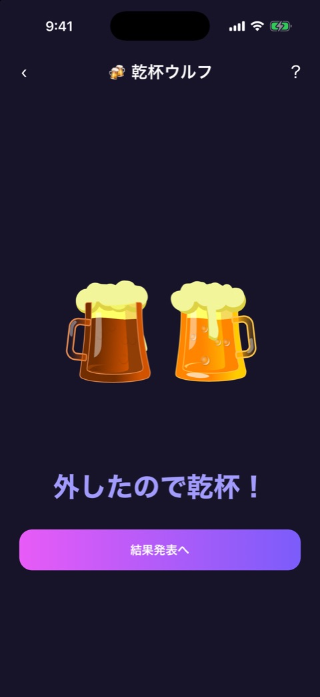

乾杯のアニメーションと「外したので乾杯！」を出します。「結果発表へ」で結果（市民チームの勝利）へ進みます。

## 結果

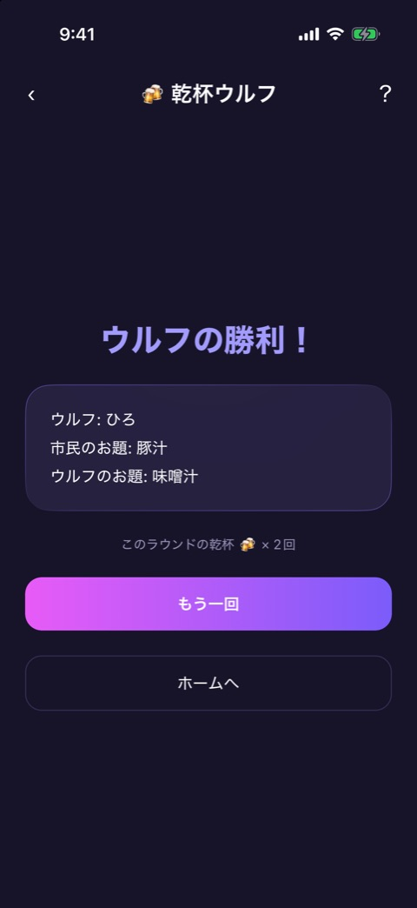 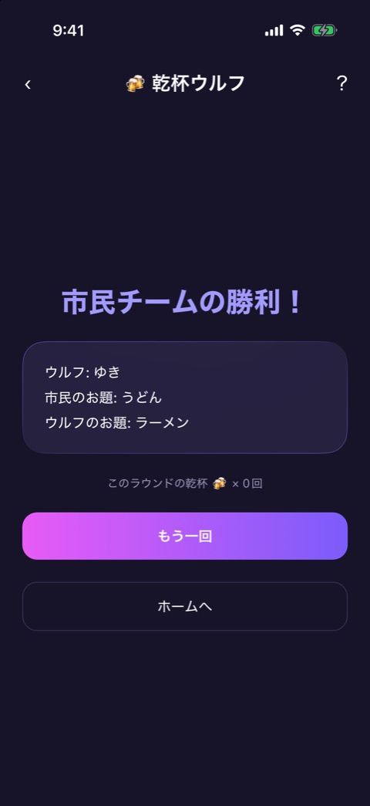

### 表示項目

| No  | 項目           | 内容                                                                   |
| --- | -------------- | ---------------------------------------------------------------------- |
| 1   | 見出し         | 「市民チームの勝利！」「ウルフの勝利！」「ウルフの逆転勝利！」のどれか |
| 2   | 答え           | 「ウルフ: ◯◯」「市民のお題: ◯◯」「ウルフのお題: ◯◯」                   |
| 3   | 乾杯の回数     | 「このラウンドの乾杯 🍻 × ◯回」                                        |
| 4   | もう一回ボタン | 「もう一回」                                                           |
| 5   | ホームボタン   | 「ホームへ」                                                           |

### 操作

| 操作                 | 結果                                                                       |
| -------------------- | -------------------------------------------------------------------------- |
| 「もう一回」をタップ | 同じ設定のまま、まだ使っていないお題と乾杯ルールで、お題くばりからやり直す |
| 「ホームへ」をタップ | ホームへ戻る                                                               |

## 遷移

- 入口: [参加メンバー](player-setup.md) の「つぎへ」。
- 出口: ホーム（「ホームへ」、またはヘッダーの戻る）。お試しを使い切ったときは [お試しロック](trial-lock.md) からペイウォールへ。

## テスト

- `src/games/kanpai-wolf/__tests__/`（画面ごとのテストと `engine`、`reducer`、`kanpai-wolf-game`）

## 補足

- 7人以上でのウルフの人数の選択、同票のときの再議論と決選投票、ウルフの逆転勝利の結果は、撮影していません。
- 議論タイムの時間切れ間際の音（`tick`）は、音源がまだ登録されておらず、鳴りません。
- お題を Supabase から取得できていないときは、アプリに同梱した予備のお題ペアを使います。
