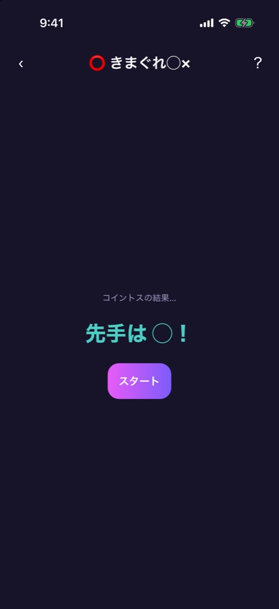
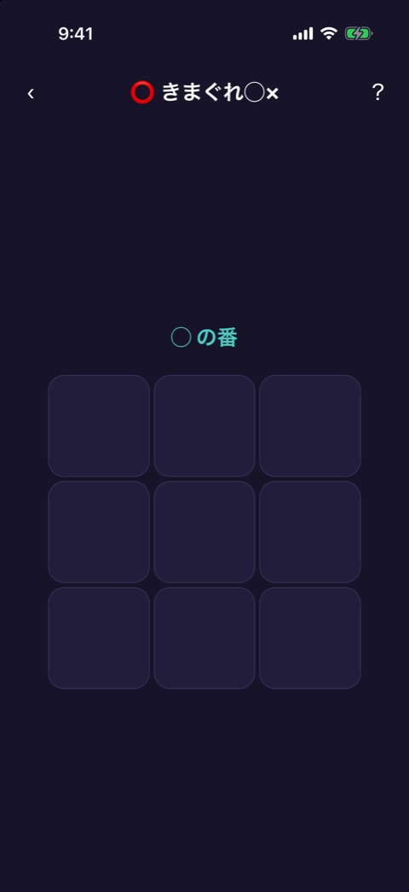
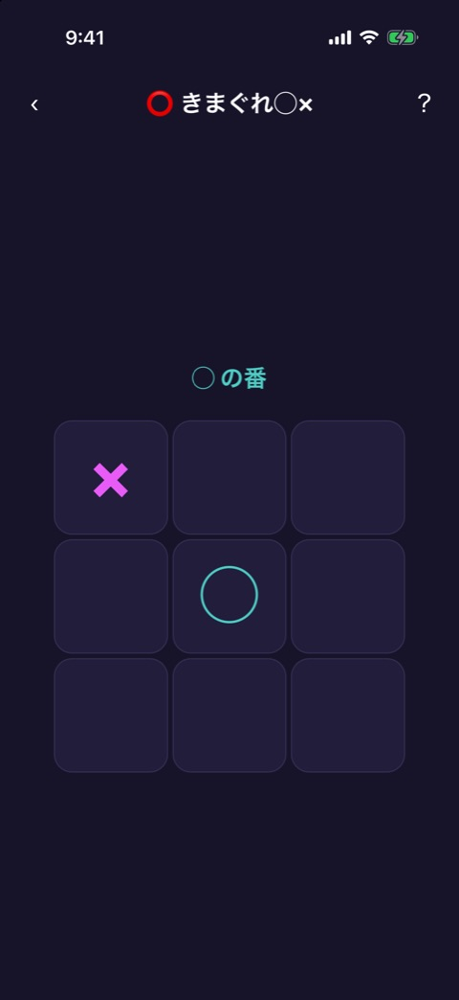
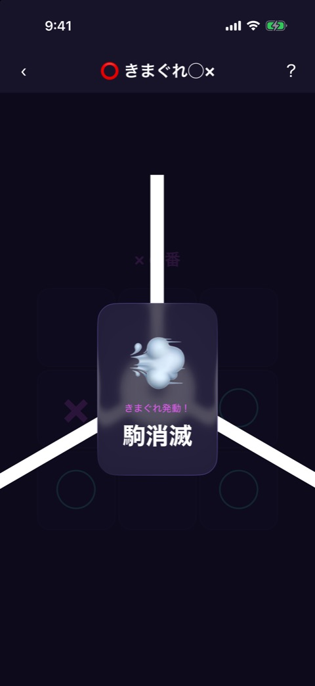
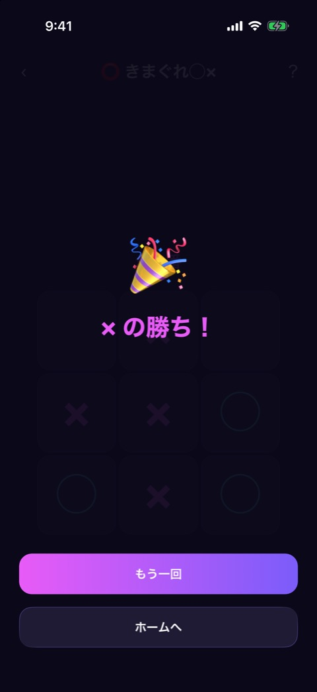

# きまぐれ◯×

| 項目       | 内容                          |
| ---------- | ----------------------------- |
| 画面ID     | `kimagure-ox`                 |
| ルート     | `/game/kimagure-ox`           |
| 実装       | `src/games/kimagure-ox/`      |
| 種別       | ゲーム（無料）                |
| 人数       | 2人固定。プレイヤー登録は不要 |
| お題パック | 使わない                      |

## 概要

3×3 の◯×ゲームに、ランダムなイベントを足したゲームです。タテ・ヨコ・ナナメのどれかに3つ並べたほうが勝ちで、イベントで3つ並んだ場合も勝ちになります。

フェーズは `reducer.ts` が持ちます。

| フェーズ   | 画面                       | 実装                                |
| ---------- | -------------------------- | ----------------------------------- |
| `intro`    | コイントス                 | `kimagure-ox-game.tsx`              |
| `playing`  | 盤面                       | `kimagure-ox-game.tsx`、`board.tsx` |
| `cutin`    | 盤面の上にイベントを重ねる | `event-cutin.tsx`、`events.ts`      |
| `finished` | 盤面の上に結果を重ねる     | 共通の `result-overlay.tsx`         |

画面上部には [ゲーム共通のヘッダー](game-play-frame.md) が出ます。

## コイントス

### 表示項目

| No  | 項目       | 内容                                                 |
| --- | ---------- | ---------------------------------------------------- |
| 1   | ラベル     | 「コイントスの結果…」                                |
| 2   | 先手の表示 | 「先手は ◯！」または「先手は ×！」。色は先手の駒の色 |
| 3   | 開始ボタン | 「スタート」                                         |

先手は、ゲームを開いた時点でランダムに決まります。

### 操作

| 操作                 | 結果       |
| -------------------- | ---------- |
| 「スタート」をタップ | 盤面へ進む |

## 盤面

 

左が開始時、右が2手進んだ状態です。

### 表示項目

| No  | 項目           | 内容                                         | 表示条件                           |
| --- | -------------- | -------------------------------------------- | ---------------------------------- |
| 1   | 手番の表示     | 「◯ の番」または「× の番」。色は手番の駒の色 | 常時                               |
| 2   | ダブル手番の印 | 「⚡ ダブル手番中」                          | ダブル手番の効果が残っているあいだ |
| 3   | 盤面           | 3×3 のマス。置いた駒は◯か×で表示する         | 常時                               |
| 4   | 封鎖マス       | 置けないマス                                 | 「1マス封鎖」が起きたあと          |

### 操作

| 操作                           | 結果                                                                                  |
| ------------------------------ | ------------------------------------------------------------------------------------- |
| 空いているマスをタップ         | 手番の駒を置く。3つ並べば結果へ進む。並ばなければ、イベントの抽選のあと相手の番になる |
| 駒のあるマス、封鎖マスをタップ | 何も起きない                                                                          |

## イベント

「駒消滅」が起きたときの演出です。

駒を置いたあと、30% の確率でイベントが起きます。抽選の対象になるのは、3手目を置いたあとからです。同じイベントが2回続くことはありません。

| イベント       | 効果                                               | 起きる条件                                    |
| -------------- | -------------------------------------------------- | --------------------------------------------- |
| マスシャッフル | 盤上の駒を、封鎖マス以外のマスへランダムに置き直す | 駒が2個以上あるとき                           |
| 1マス封鎖      | 空きマスの1つを、置けないマスにする                | まだ封鎖マスがなく、空きマスが2つ以上あるとき |
| 駒消滅         | 盤上の駒を1個、ランダムに取り除く                  | 駒が1個以上あるとき                           |
| ダブル手番     | 次の人が2手続けて置ける                            | いつでも                                      |

### 表示項目

| No  | 項目       | 内容                 |
| --- | ---------- | -------------------- |
| 1   | 絵文字     | イベントごとの絵文字 |
| 2   | ラベル     | 「きまぐれ発動！」   |
| 3   | イベント名 | 上の表の名前         |

演出は1.4秒で自動的に消え、イベントの効果を反映した盤面に戻ります。演出のあいだ、盤面は操作できません。イベントの結果で3つ並んだ場合は、そのまま結果へ進みます。

## 結果

### 表示項目

| No  | 項目           | 内容                                                                 |
| --- | -------------- | -------------------------------------------------------------------- |
| 1   | 絵文字         | 勝敗がついたときは 🎉、引き分けは 🤝                                 |
| 2   | 結果           | 「◯ の勝ち！」「× の勝ち！」（色は勝った駒の色）、または「引き分け」 |
| 3   | もう一回ボタン | 「もう一回」                                                         |
| 4   | ホームボタン   | 「ホームへ」                                                         |

結果が出ると、成功のバイブレーションが鳴ります。

### 操作

| 操作                 | 結果                                   |
| -------------------- | -------------------------------------- |
| 「もう一回」をタップ | 盤面を空にして、コイントスからやり直す |
| 「ホームへ」をタップ | ホームへ戻る                           |

## 遷移

- 入口: [ゲームのイントロ](game-intro.md) の「ゲームスタート」。
- 出口: ホーム（「ホームへ」、またはヘッダーの戻る）。

## テスト

- `src/games/kimagure-ox/__tests__/`（`engine`、`events`、`reducer`、`board`、`event-cutin`、`kimagure-ox-game`）

## 補足

- 封鎖マスとダブル手番の印が出ている盤面、引き分けの結果は、撮影していません。
