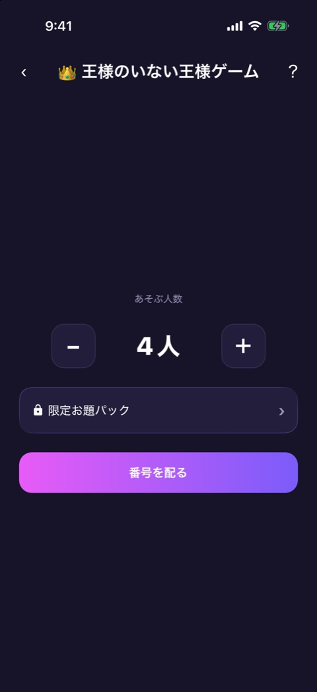
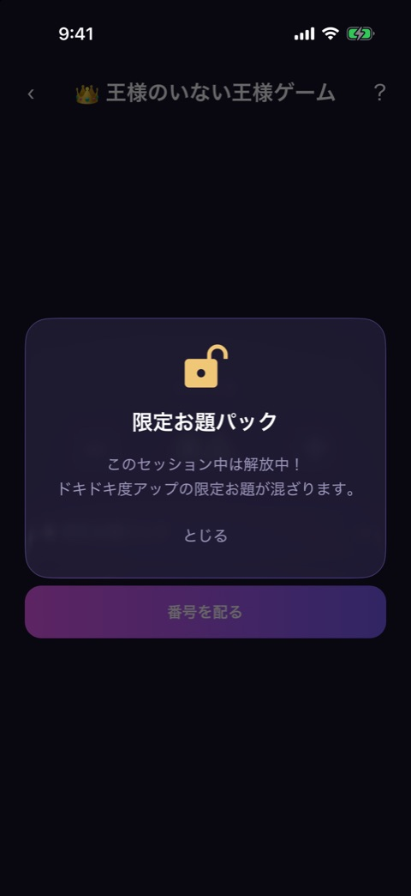
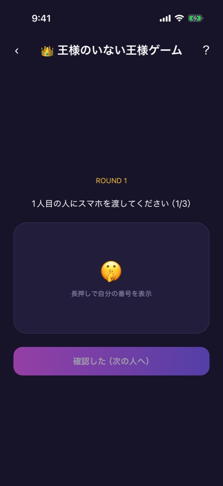
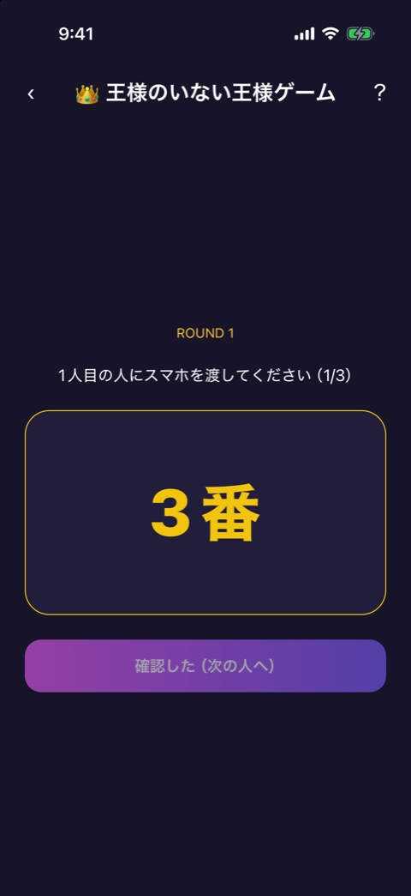
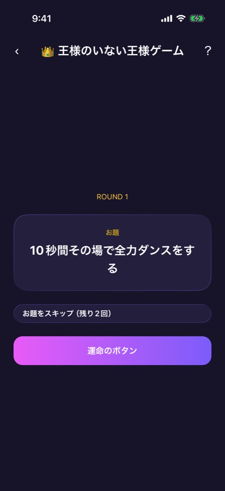
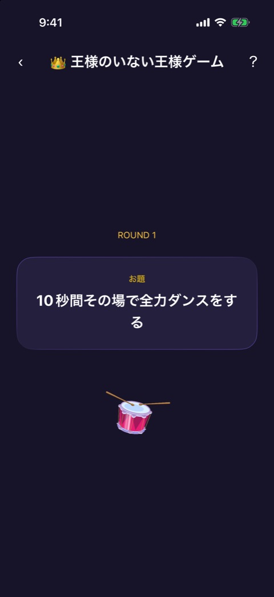
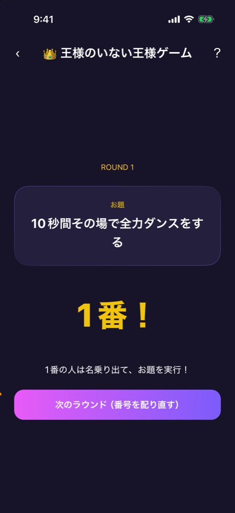

# 王様のいない王様ゲーム

| 項目       | 内容                                                      |
| ---------- | --------------------------------------------------------- |
| 画面ID     | `no-king-game`                                            |
| ルート     | `/game/no-king-game`                                      |
| 実装       | `src/games/no-king-game/`                                 |
| 種別       | ゲーム（無料）                                            |
| 人数       | 3〜12人。プレイヤー登録は不要（ゲームの中で人数だけ選ぶ） |
| お題パック | `king`。限定お題パック `king_premium` を解放すると混ざる  |

## 概要

全員に秘密の番号を配り、お題と「実行する番号」をランダムに発表する、王様ゲーム風のゲームです。王様役はいません。

フェーズは `reducer.ts` が持ちます。

| フェーズ | 画面           | 実装               |
| -------- | -------------- | ------------------ |
| `count`  | 人数の選択     | `count-select.tsx` |
| `deal`   | 番号の配布     | `deal-pass.tsx`    |
| `reveal` | お題の発表     | `topic-reveal.tsx` |
| `done`   | 実行役の発表後 | `topic-reveal.tsx` |

`deal` から `done` までが1ラウンドです。画面上部には [ゲーム共通のヘッダー](game-play-frame.md) が出ます。

## 人数の選択

 

左が人数の選択、右が「限定お題パック」を開いたときのモーダルです。

### 表示項目

| No  | 項目           | 内容                                   |
| --- | -------------- | -------------------------------------- |
| 1   | ラベル         | 「あそぶ人数」                         |
| 2   | 人数           | 「−」「4人」「＋」。初期値は4人        |
| 3   | 限定お題パック | 錠前のアイコンと「限定お題パック」の行 |
| 4   | 配布ボタン     | 「番号を配る」                         |

### 操作

| 操作                       | 結果                                                |
| -------------------------- | --------------------------------------------------- |
| 「−」「＋」をタップ        | 人数を1人ずつ変える。3人から12人まで                |
| 「限定お題パック」をタップ | 限定お題パックのモーダルを開く                      |
| 「番号を配る」をタップ     | 1〜人数の番号をランダムに割り当て、番号の配布へ進む |

### 限定お題パックのモーダル

| 状態     | 条件                                               | 表示                                                                                                                                 |
| -------- | -------------------------------------------------- | ------------------------------------------------------------------------------------------------------------------------------------ |
| 解放中   | プレミアム購読中、またはこのゲームの中で動画を見た | 「このセッション中は解放中！」「ドキドキ度アップの限定お題が混ざります。」                                                           |
| 未解放   | 上以外                                             | 「ドキドキ度アップの限定お題が遊べるパックです。」「動画を見るとこのセッション中だけ解放されます。」と、「動画を見て解放する」ボタン |
| 取得失敗 | 動画を見たあと、お題を取得できなかった             | 「お題の取得に失敗しました」と「再試行」                                                                                             |

どの状態でも、「とじる」でモーダルを閉じます。動画での解放は、このゲームを出ると元に戻ります。

## 番号の配布

 

左が表示前、右が長押ししているあいだの表示です。

### 表示項目

| No  | 項目         | 内容                                                                        |
| --- | ------------ | --------------------------------------------------------------------------- |
| 1   | ラウンド     | 「ROUND 1」                                                                 |
| 2   | 案内         | 「1人目の人にスマホを渡してください（1/3）」                                |
| 3   | 番号のパネル | ふだんは 🤫 と「長押しで自分の番号を表示」。長押し中だけ「3番」のように出る |
| 4   | 確認ボタン   | 最後の人は「確認した（発表へ！）」、それ以外は「確認した（次の人へ）」      |

### 操作

| 操作                 | 結果                                                                   |
| -------------------- | ---------------------------------------------------------------------- |
| 番号のパネルを長押し | 押しているあいだだけ番号を出す。指を離すと隠れる                       |
| 確認ボタンをタップ   | 次の人の配布へ進む。最後の人のあとは、お題と実行役を抽選して発表へ進む |

確認ボタンは、番号を一度表示するまで押せません。長押し中も押せません。

## お題の発表

  

左から、お題の発表、ドラムロール中、実行役の発表後です。

### 表示項目

| No  | 項目           | 内容                                                                  | 表示条件           |
| --- | -------------- | --------------------------------------------------------------------- | ------------------ |
| 1   | ラウンド       | 「ROUND 1」                                                           | 常時               |
| 2   | お題のカード   | 「お題」と、お題の本文                                                | 常時               |
| 3   | スキップボタン | 「お題をスキップ（残り2回）」。使い切ると「スキップは使い切りました」 | ドラムロールの前   |
| 4   | 運命のボタン   | 「運命のボタン」                                                      | ドラムロールの前   |
| 5   | ドラムロール   | ドラムのアニメーション                                                | ドラムロール中     |
| 6   | 実行役         | 「1番！」                                                             | ドラムロールのあと |
| 7   | 案内           | 「1番の人は名乗り出て、お題を実行！」                                 | 実行役の発表後     |
| 8   | 次へのボタン   | 「次のラウンド（番号を配り直す）」                                    | 実行役の発表後     |

お題の本文に `{B}` が含まれるときは、実行役以外の番号に置き換えて表示します（「2番の人を全力で褒める」など）。一度出たお題は、同じゲームの中では出にくくなります。

### 操作

| 操作                                       | 結果                                                    |
| ------------------------------------------ | ------------------------------------------------------- |
| 「お題をスキップ」をタップ                 | お題と実行役を抽選し直す。ゲームを開いてから合計2回まで |
| 「運命のボタン」をタップ                   | ドラムロールのあと、実行役の番号を発表する              |
| 「次のラウンド（番号を配り直す）」をタップ | ラウンド数を1つ進め、番号を配り直して、番号の配布へ戻る |

## 遷移

- 入口: [ゲームのイントロ](game-intro.md) の「ゲームスタート」。
- 出口: ホーム（ヘッダーの戻る）。このゲームには「ホームへ」のボタンがありません。

## テスト

- `src/games/no-king-game/__tests__/`（`engine`、`reducer`、`count-select`、`deal-pass`、`topic-reveal`、`premium-pack-modal`、`no-king-game`）

## 補足

- 限定お題パックの未解放の状態は、開発ビルドでは撮影できていません。
- 番号の配布で、確認ボタンが押せるようになる条件（番号を一度表示した）は、2人目以降に引き継がれます。1人目が番号を見たあとは、2人目以降は番号を見なくても確認ボタンを押せます。意図した動作かどうかは未確認です。
- お題を Supabase から取得できていないときは、アプリに同梱した予備のお題を使います。
