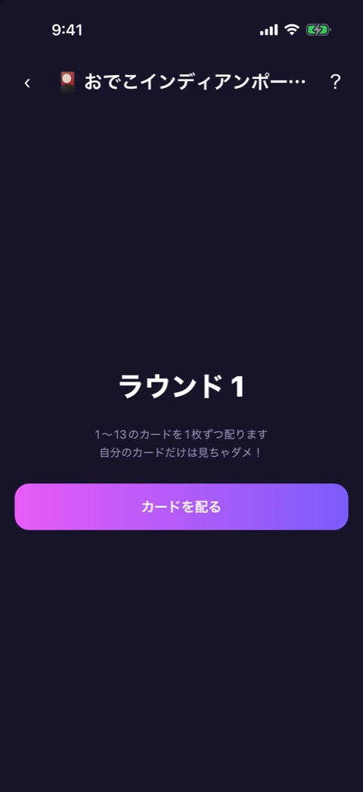
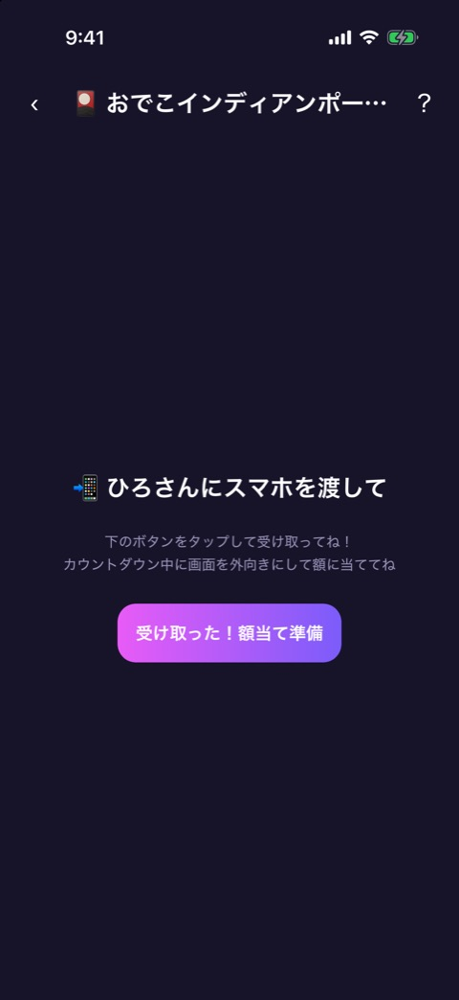
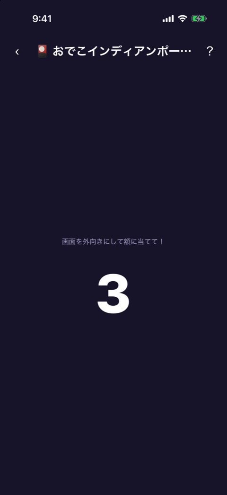
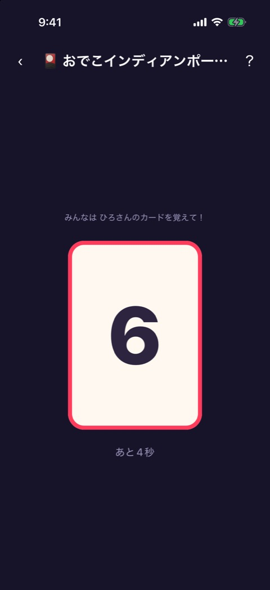
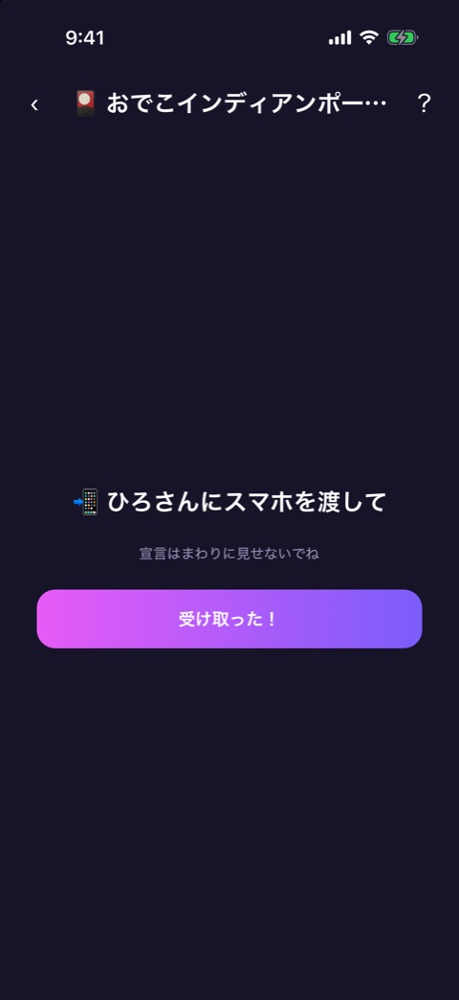
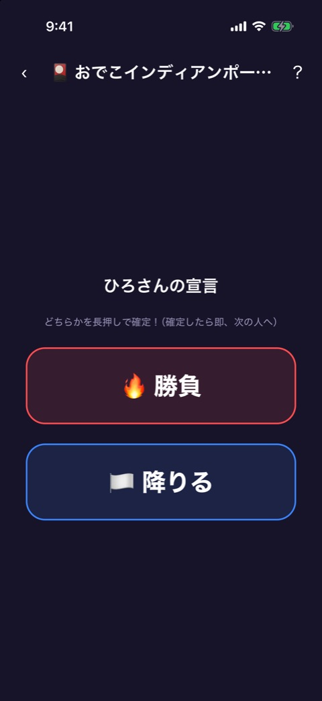
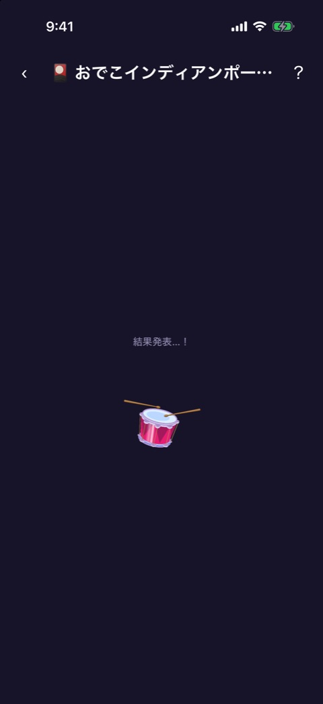
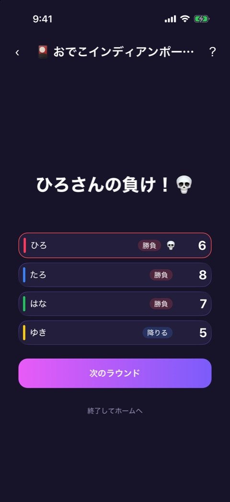

# おでこインディアンポーカー

| 項目       | 内容                          |
| ---------- | ----------------------------- |
| 画面ID     | `odeko-poker`                 |
| ルート     | `/game/odeko-poker`           |
| 実装       | `src/games/odeko-poker/`      |
| 種別       | ゲーム（プレミアム限定）      |
| 人数       | 3〜12人。プレイヤー登録が必要 |
| お題パック | 使わない                      |

## 概要

スマホを額に当てて、自分には見えないカード（1〜13）をみんなに見せるインディアンポーカーです。ほかの人の反応だけを頼りに、「勝負」か「降りる」かをこっそり宣言します。勝負した人の中で一番弱いカードの人が負けです。一番強いカードなのに降りた人は「ヘタレ賞」で、一緒に飲みます。

カードは 1〜13 から人数ぶんを重複なしで配ります。

フェーズは `reducer.ts` が持ちます。

| フェーズ   | 画面           | 実装                   |
| ---------- | -------------- | ---------------------- |
| `deal`     | ラウンドの開始 | `odeko-poker-game.tsx` |
| `forehead` | 額当て         | `forehead-screen.tsx`  |
| `declare`  | 宣言           | `declare-screen.tsx`   |
| `result`   | 結果           | `result-screen.tsx`    |

額当てと宣言は、それぞれ1人目から順に全員ぶん繰り返します。画面上部には [ゲーム共通のヘッダー](game-play-frame.md) が出ます。お試しプレイでは、結果が出るたびに1ラウンドを消費します（[お試しロック](trial-lock.md)）。

## ラウンドの開始

「ラウンド 1」「1〜13のカードを1枚ずつ配ります 自分のカードだけは見ちゃダメ！」と「カードを配る」を出します。「カードを配る」でカードを配り、1人目の額当てへ進みます。

## 額当て

  

左から、受け渡し、準備のカウントダウン、カードの表示です。

| 段階         | 表示                                                                                                                                               | 長さ             |
| ------------ | -------------------------------------------------------------------------------------------------------------------------------------------------- | ---------------- |
| 受け渡し     | 「📲 ◯◯さんにスマホを渡して」「下のボタンをタップして受け取ってね！ カウントダウン中に画面を外向きにして額に当ててね」と「受け取った！額当て準備」 | ボタンを押すまで |
| 準備         | 「画面を外向きにして額に当てて！」とカウントダウン（3、2、1）                                                                                      | 3秒              |
| カードの表示 | 「みんなは ◯◯さんのカードを覚えて！」、その人のプレイヤーカラーの枠のカード、「あと◯秒」                                                           | 5秒              |

カードの表示が終わると、自動で次の人の受け渡しへ進みます。最後の人のあとは、1人目の宣言へ進みます。

## 宣言

 

| 段階     | 表示                                                                                             |
| -------- | ------------------------------------------------------------------------------------------------ |
| 受け渡し | 「📲 ◯◯さんにスマホを渡して」「宣言はまわりに見せないでね」と「受け取った！」                    |
| 宣言     | 「◯◯さんの宣言」「どちらかを長押しで確定！（確定したら即、次の人へ）」と「🔥 勝負」「🏳️ 降りる」 |

| 操作                            | 結果                                                     |
| ------------------------------- | -------------------------------------------------------- |
| 「受け取った！」をタップ        | 宣言の画面へ                                             |
| 「勝負」「降りる」を0.6秒長押し | 宣言を確定し、次の人の受け渡しへ。最後の人のあとは結果へ |

タップだけでは確定しません。まわりの人に宣言を知られにくくするためです。

## 結果

 

「結果発表…！」のドラムロールのあと、全員のカードと宣言を一斉に公開します。

### 表示項目

| No  | 項目           | 内容                                                                                                                           |
| --- | -------------- | ------------------------------------------------------------------------------------------------------------------------------ |
| 1   | 見出し         | 結果ごとの文言。下の表のとおり                                                                                                 |
| 2   | 全員の一覧     | プレイヤーカラーの縦バー、名前、宣言（「勝負」「降りる」）、カードの数字。負けの人は 💀 と赤い枠、ヘタレ賞の人は「🐔ヘタレ賞」 |
| 3   | ヘタレ賞       | 「🐔 最強カードなのに降りた ◯◯さんも一緒に飲もう！」（該当者がいるとき）                                                       |
| 4   | 次へのボタン   | 「次のラウンド」                                                                                                               |
| 5   | ホームのリンク | 「終了してホームへ」                                                                                                           |

| 結果     | 条件                | 見出し                     | 負け                           |
| -------- | ------------------- | -------------------------- | ------------------------------ |
| 通常     | 勝負した人が2人以上 | 「◯◯さんの負け！💀」       | 勝負した中で一番弱いカードの人 |
| 一人勝ち | 勝負した人が1人     | 「◯◯さんの一人勝ち！🎉」   | なし                           |
| 全員降り | 勝負した人がいない  | 「全員降り！全員負け！🍻」 | 全員                           |

ヘタレ賞は、どの結果でも、一番強いカードを持っていて降りた人に付きます。

### 操作

| 操作                         | 結果                                        |
| ---------------------------- | ------------------------------------------- |
| 「次のラウンド」をタップ     | ラウンド数を1つ進めて、ラウンドの開始へ戻る |
| 「終了してホームへ」をタップ | ホームへ戻る                                |

## 遷移

- 入口: [参加メンバー](player-setup.md) の「つぎへ」。
- 出口: ホーム（「終了してホームへ」、またはヘッダーの戻る）。お試しを使い切ったときは [お試しロック](trial-lock.md) からペイウォールへ。

## テスト

- `src/games/odeko-poker/__tests__/`（`engine`、`reducer`、`forehead-screen`、`declare-screen`、`result-screen`、`odeko-poker-game`）

## 補足

- 一人勝ち、全員降り、ヘタレ賞の画面は撮影していません。
- ヘッダーのタイトルは長く、「おでこインディアンポー…」と途中で切れて表示されます。
