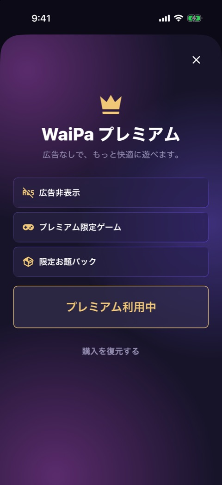

# ペイウォール

| 項目   | 内容                                        |
| ------ | ------------------------------------------- |
| 画面ID | `paywall`                                   |
| ルート | `/paywall`                                  |
| 実装   | `src/app/paywall.tsx`、`src/lib/premium.ts` |
| 種別   | モーダル画面                                |

## 目的

WaiPa プレミアムの特典を見せ、月額か年額のプランを購入してもらう画面です。購入の復元もできます。

## スクリーンショット

プレミアム利用中の表示です。未購読時の表示（プランの選択と購入ボタン）は、開発ビルドでは写せていません。

## 表示項目

| No  | 項目         | 内容                                                             | 表示条件                             |
| --- | ------------ | ---------------------------------------------------------------- | ------------------------------------ |
| 1   | 閉じるボタン | 右上の「×」                                                      | 常時                                 |
| 2   | 見出し       | 王冠、「WaiPa プレミアム」「広告なしで、もっと快適に遊べます。」 | 常時                                 |
| 3   | 特典の一覧   | 「広告非表示」「プレミアム限定ゲーム」「限定お題パック」         | 常時                                 |
| 4   | 利用中の表示 | 「プレミアム利用中」                                             | 購読中                               |
| 5   | プランの選択 | 「月額」と「年額」。それぞれ価格を表示する                       | 未購読                               |
| 6   | お得バッジ   | 「約39%お得」                                                    | 未購読                               |
| 7   | 準備中の表示 | 「近日対応予定」                                                 | 未購読で、商品を取得できなかったとき |
| 8   | 購入ボタン   | 「プレミアムを開始」。処理中は「処理中...」                      | 未購読                               |
| 9   | 復元のリンク | 「購入を復元する」                                               | 常時                                 |

価格は RevenueCat から取得した表示用の文字列を使います。取得できないときは、月額「¥150」、年額「¥1,100」を表示します。

## 操作

| 操作                           | 結果                                                                           |
| ------------------------------ | ------------------------------------------------------------------------------ |
| 「×」をタップ                  | モーダルを閉じて、元の画面へ戻る                                               |
| 「月額」または「年額」をタップ | そのプランを選択中にする。初期選択は年額                                       |
| 「プレミアムを開始」をタップ   | 選択中のプランを購入する。成功するとモーダルを閉じる。失敗するとアラートを出す |
| 「購入を復元する」をタップ     | 復元を依頼する。復元できたら「復元しました」を出してモーダルを閉じる           |

購入の結果は、次の3通りです。

| 結果                 | 挙動                                                                     |
| -------------------- | ------------------------------------------------------------------------ |
| 購入できた           | モーダルを閉じる                                                         |
| ユーザーがキャンセル | 何も出さず、この画面にとどまる                                           |
| 失敗した             | 「購入に失敗しました」「時間をおいてもう一度お試しください。」のアラート |

復元の結果とアラートは、[設定](settings.md) の「購入を復元する」と同じです。

## 状態

| 状態             | 条件                                       | 表示の違い                                                   |
| ---------------- | ------------------------------------------ | ------------------------------------------------------------ |
| 購読中           | プレミアムが有効                           | プランの選択と購入ボタンの代わりに「プレミアム利用中」を出す |
| 未購読・商品あり | RevenueCat から商品を取得できた            | プランを選んで購入できる                                     |
| 未購読・商品なし | 商品を取得できなかった（キー未設定を含む） | 「近日対応予定」を出し、購入ボタンは押せない                 |
| 読み込み中       | 商品の取得が終わっていない                 | 購入ボタンは押せない                                         |
| 購入処理中       | 購入の結果を待っている                     | 購入ボタンが「処理中...」になり、押せない                    |

## 遷移

- 入口: 設定の「アップグレード」、プレミアムロックのモーダルの「プレミアムにアップグレード」、お試しロックの「プレミアムにアップグレード」。
- 出口: 開いた元の画面。

## テスト

- `src/app/__tests__/paywall.test.tsx`
- `src/lib/__tests__/premium.test.ts`

## 補足

- 未購読時の画面は、RevenueCat の結線（issue #115）のあとで撮り直します。
- 「約39%お得」は固定の文言です。年額 ¥1,100 は、月額 ¥150 の12か月ぶん（¥1,800）より約39%安くなります。価格を変えるときは、この文言も直す必要があります。
