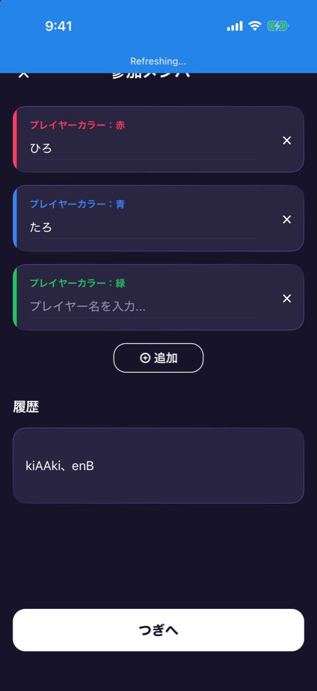
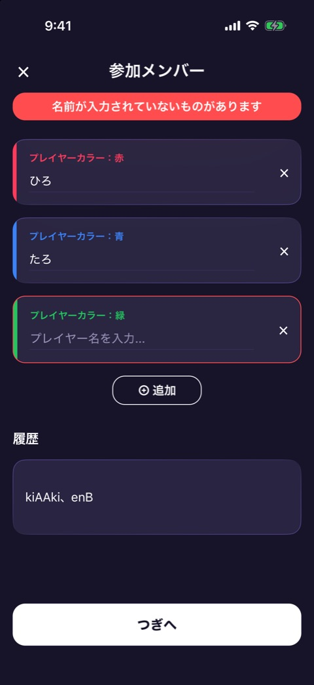

# 参加メンバー

| 項目   | 内容                                                                     |
| ------ | ------------------------------------------------------------------------ |
| 画面ID | `player-setup`                                                           |
| ルート | `/game/[id]`（`GameScreen` の setup の段階）                             |
| 実装   | `src/components/game/player-setup-sheet.tsx`、`src/lib/players-store.ts` |
| 種別   | 画面（プレイヤー登録が必要なゲームで共通）                               |

## 目的

一緒に遊ぶメンバーの人数と名前を決める画面です。`meta.requiresPlayers` が true のゲームで、イントロのあとに表示します。

## スクリーンショット

 

左が入力中、右が名前を空のまま「つぎへ」を押したときの表示です。

## 表示項目

| No  | 項目             | 内容                                                                           | 表示条件                                                   |
| --- | ---------------- | ------------------------------------------------------------------------------ | ---------------------------------------------------------- |
| 1   | ヘッダー         | 左に「×」、中央に「参加メンバー」                                              | 常時                                                       |
| 2   | エラーの帯       | 「名前が入力されていないものがあります」                                       | 名前が空のまま「つぎへ」を押したあと                       |
| 3   | 人数調整の帯     | 「このゲームは◯〜◯人用のため人数を調整しました」                               | 保存済みの人数が、このゲームの人数の範囲から外れていたとき |
| 4   | プレイヤーカード | 左端にプレイヤーカラーの縦バー、「プレイヤーカラー：赤」のラベル、名前の入力欄 | 人数ぶん                                                   |
| 5   | 削除ボタン       | カード右の「×」                                                                | 人数が、このゲームの最少人数より多いとき                   |
| 6   | 追加ボタン       | 「⊕ 追加」                                                                     | 人数が、このゲームの最大人数より少ないとき                 |
| 7   | 履歴             | 見出し「履歴」と、過去の名前のセット。1件もなければ「履歴がまだありません。」  | 常時                                                       |
| 8   | 進むボタン       | 画面下部の「つぎへ」                                                           | 常時                                                       |

プレイヤーカラーは、上から順に、赤、青、緑、黄、紫、オレンジ、ピンク、水色、黄緑、ゴールド、シルバー、茶です（`src/theme/player-colors.ts`）。

名前の入力欄は10文字までで、空のときは「プレイヤー名を入力...」と表示します。

## 操作

| 操作                      | 結果                                                                                         |
| ------------------------- | -------------------------------------------------------------------------------------------- |
| 「×」（ヘッダー）をタップ | 前の画面（通常はホーム）へ戻る                                                               |
| 名前を入力する            | 1文字ごとに保存する                                                                          |
| カードの「×」をタップ     | そのプレイヤーを削除し、以降の名前を繰り上げる                                               |
| 「⊕ 追加」をタップ        | 名前が空のプレイヤーを1人足す                                                                |
| 履歴の行をタップ          | その名前のセットを、今の人数と名前に置き換える                                               |
| 「つぎへ」をタップ        | 全員の名前が入っていれば、今のセットを履歴に保存してゲーム本体へ進む。空があればエラーを出す |

## 状態

| 状態         | 条件                                 | 表示の違い                                 |
| ------------ | ------------------------------------ | ------------------------------------------ |
| 入力中       | 通常                                 | 上の表のとおり                             |
| 名前の未入力 | 空の名前があるまま「つぎへ」を押した | エラーの帯を出し、空のカードを赤い枠で囲む |
| 人数の調整   | 保存済みの人数が範囲外               | 人数を範囲内に直し、人数調整の帯を出す     |

人数の範囲はゲームごとに違い、`meta.minPlayers` と `meta.maxPlayers` で決まります。アプリ全体では2人から12人までです。

人数、名前、履歴は AsyncStorage の `waipa.players` に保存され、すべてのゲームで共有します。履歴は新しい順に5件までで、同じセットは重複して残しません。名前が空白だけのセットは保存しません。履歴の中で名前が空の人は「1番」「2番」のように表示します。

## 遷移

- 入口: [ゲームのイントロ](game-intro.md) の「ゲームスタート」。
- 出口: ゲーム本体、ホーム。

## テスト

- `src/components/game/__tests__/player-setup-sheet.test.tsx`
- `src/lib/__tests__/players-store.test.ts`

## 補足

- 人数調整の帯は、撮影できていません。
- 右のスクリーンショットの履歴「kiAAki、enB」は、シミュレータに残っていた過去の入力です。
