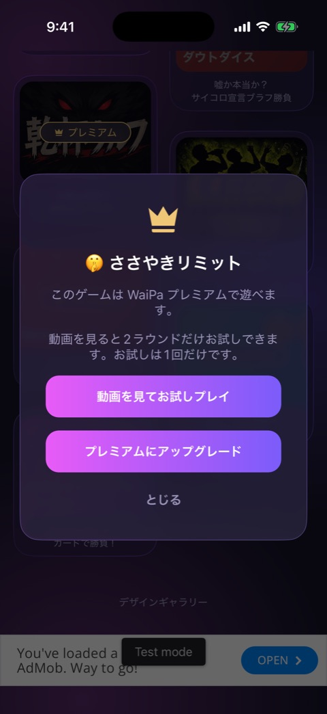
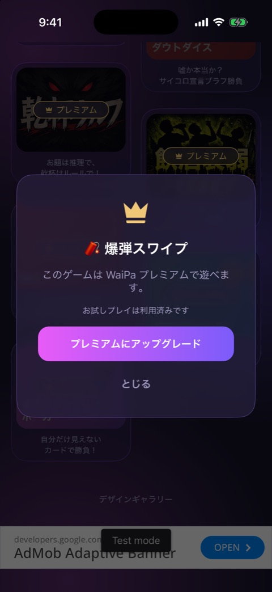

# プレミアムロック

| 項目   | 内容                                                                   |
| ------ | ---------------------------------------------------------------------- |
| 画面ID | `premium-lock`                                                         |
| ルート | なし（ホームの上に重ねて表示）                                         |
| 実装   | `src/components/home/premium-lock-modal.tsx`、`src/lib/trial-store.ts` |
| 種別   | モーダル                                                               |

## 目的

未購読の人がプレミアム限定ゲームをタップしたときに、プレミアムへの誘導と、動画を見て2ラウンドだけ遊べる「お試しプレイ」の入口を出すモーダルです。

## スクリーンショット

 

左がまだお試ししていないゲーム、右がお試し済みのゲームです。どちらも、撮影のときだけ開発ビルドを未購読扱いにして撮りました。

## 表示項目

| No  | 項目             | 内容                                                               | 表示条件         |
| --- | ---------------- | ------------------------------------------------------------------ | ---------------- |
| 1   | 王冠             | 王冠のアイコン                                                     | 常時             |
| 2   | ゲーム名         | 絵文字とゲーム名                                                   | 常時             |
| 3   | 説明             | 「このゲームは WaiPa プレミアムで遊べます。」                      | 常時             |
| 4   | お試しの説明     | 「動画を見ると2ラウンドだけお試しできます。お試しは1回だけです。」 | お試しできるとき |
| 5   | 動画ボタン       | 「動画を見てお試しプレイ」。動画の読み込みが終わるまで押せない     | お試しできるとき |
| 6   | お試し済みの表示 | 「お試しプレイは利用済みです」                                     | お試し済みのとき |
| 7   | アップグレード   | 「プレミアムにアップグレード」                                     | 常時             |
| 8   | 閉じるリンク     | 「とじる」                                                         | 常時             |

「お試しできるとき」は、未購読で、そのゲームをまだお試ししていないときです。

## 操作

| 操作                                   | 結果                                                                                                                     |
| -------------------------------------- | ------------------------------------------------------------------------------------------------------------------------ |
| 「動画を見てお試しプレイ」をタップ     | リワード広告を再生する。最後まで見て広告を閉じると、そのゲームを「お試し済み」として保存し、モーダルを閉じてゲームへ進む |
| 「プレミアムにアップグレード」をタップ | モーダルを閉じて、ペイウォールへ進む                                                                                     |
| 「とじる」、または背景をタップ         | モーダルを閉じる                                                                                                         |

お試し済みの記録は、動画を最後まで見て閉じた時点で AsyncStorage の `waipa.trials.used` に保存します。アプリを再起動しても、同じゲームのお試しはできません。

## 遷移

- 入口: ホームで、未購読のときにプレミアム限定ゲームのカードをタップ。
- 出口: ホーム（閉じる）、ゲーム（お試し開始）、[ペイウォール](paywall.md)。

## テスト

- `src/components/home/__tests__/premium-lock-modal.test.tsx`
- `src/lib/__tests__/trial-store.test.ts`

## 補足

- リワードの獲得は、広告がまだ画面に出ているうちに通知されます。その時点でモーダルを閉じると、広告ごと閉じられて遷移先の画面が操作できなくなるため、広告が閉じられるのを待ってから進みます（issue #168）。
- 広告とお試しプレイの全体の決まりは [ADS.md](../ADS.md) にあります。
