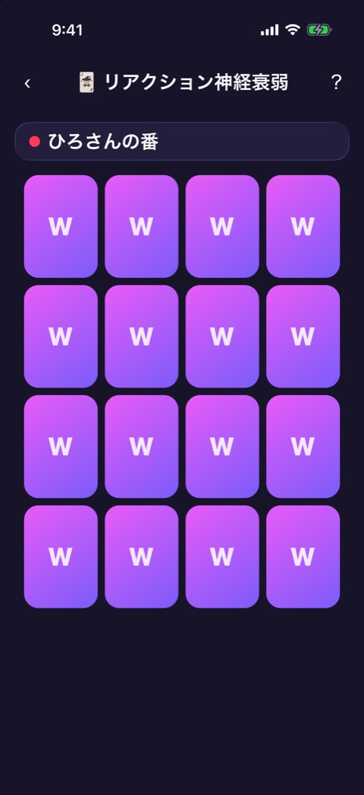
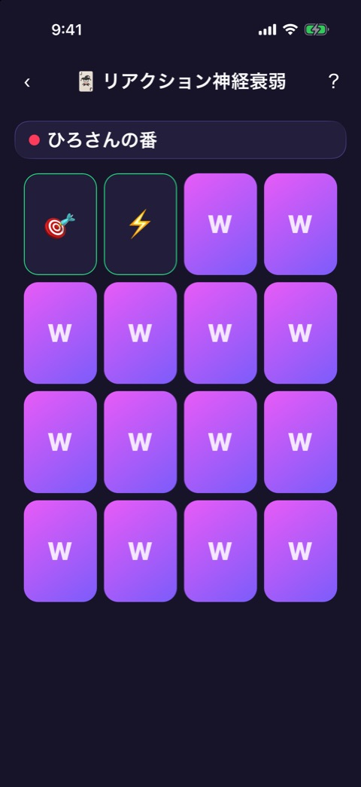
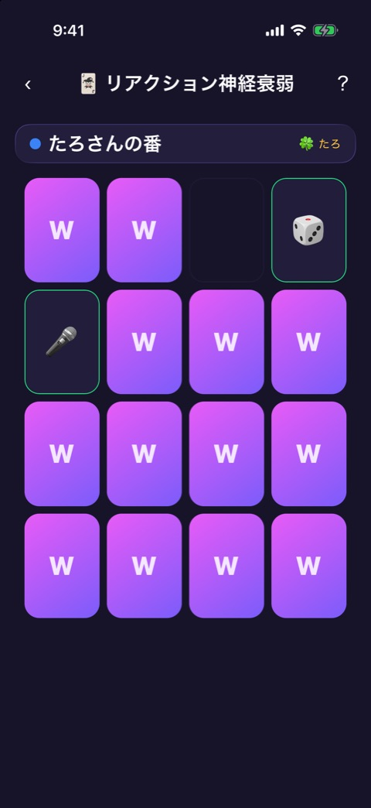
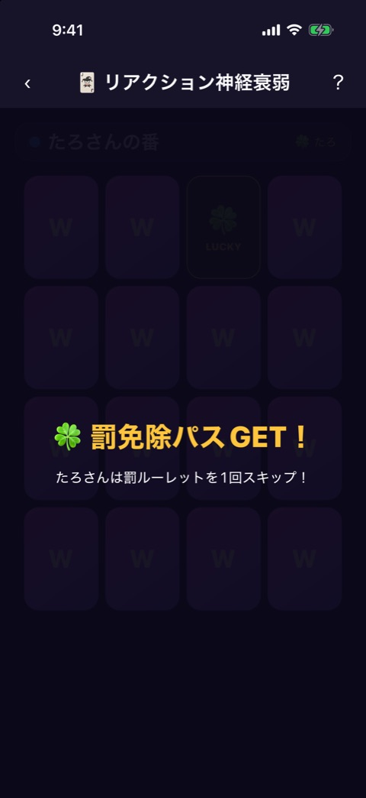
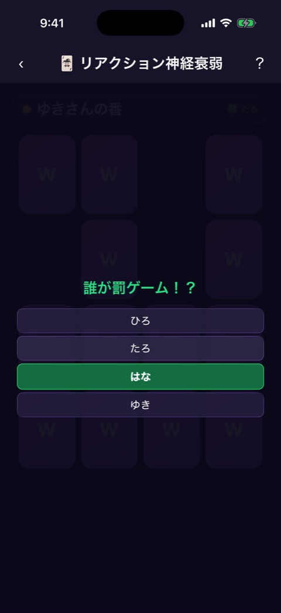
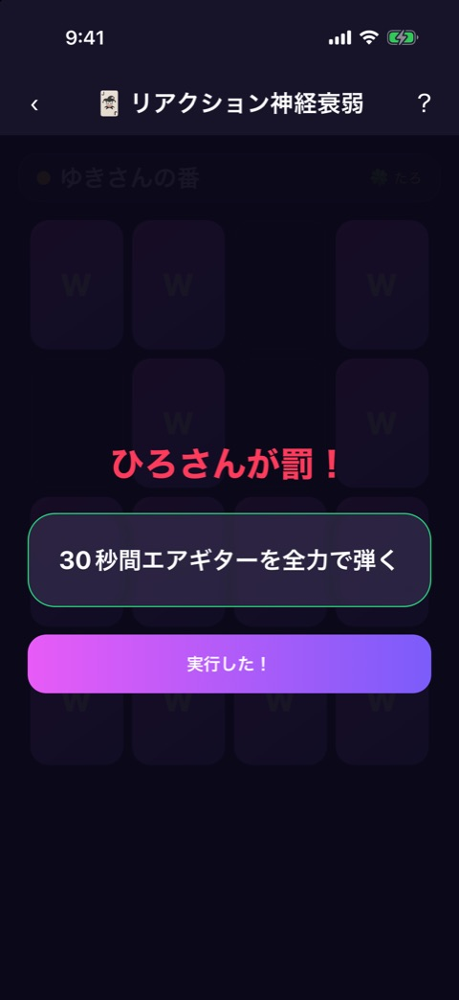
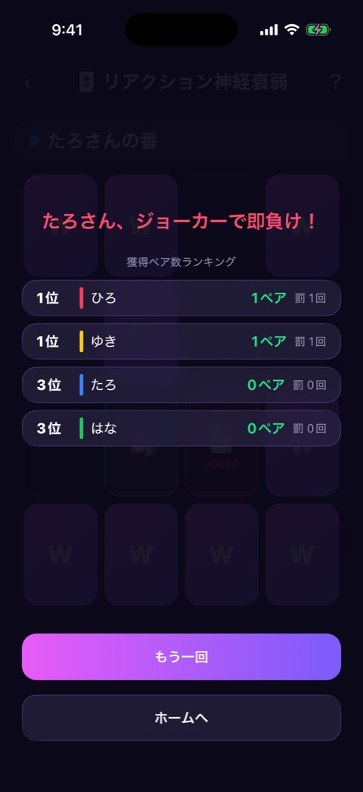

# リアクション神経衰弱

| 項目       | 内容                          |
| ---------- | ----------------------------- |
| 画面ID     | `reaction-pairs`              |
| ルート     | `/game/reaction-pairs`        |
| 実装       | `src/games/reaction-pairs/`   |
| 種別       | ゲーム（無料）                |
| 人数       | 2〜12人。プレイヤー登録が必要 |
| お題パック | `batsu`（罰ゲームのお題）     |

## 概要

4×4 の神経衰弱です。ペアがそろうたびに、全員を対象にしたルーレットで罰ゲームを受ける人が決まります。ジョーカーを引くとその場で負けになり、ラッキーを引くと罰を1回免除できるパスがもらえます。

カードは16枚で、7組のペア（14枚）、ジョーカー1枚、ラッキー1枚です。

フェーズは `reducer.ts` が持ちます。

| フェーズ   | 画面                           | 実装                                                          |
| ---------- | ------------------------------ | ------------------------------------------------------------- |
| `play`     | 盤面                           | `reaction-pairs-game.tsx`、`card-grid.tsx`、`lucky-cutin.tsx` |
| `roulette` | 盤面の上に罰ルーレットを重ねる | `player-roulette.tsx`                                         |
| `punish`   | 盤面の上に罰ゲームを重ねる     | `punish-reveal.tsx`                                           |
| `result`   | 盤面の上に結果を重ねる         | `result-screen.tsx`                                           |

画面上部には [ゲーム共通のヘッダー](game-play-frame.md) が出ます。

## 盤面

  

左から、開始時、2枚めくって不一致だったとき、免除パスを持っている人がいるときです。

### 表示項目

| No  | 項目           | 内容                                 | 表示条件                                 |
| --- | -------------- | ------------------------------------ | ---------------------------------------- |
| 1   | 手番の表示     | プレイヤーカラーの丸と「◯◯さんの番」 | 常時                                     |
| 2   | 免除パスの印   | 「🍀 ◯◯」。パスを持っている人の名前  | 誰かがパスを持っているあいだ             |
| 3   | カード         | 4×4 の16枚。裏は「W」、表は絵柄      | 常時                                     |
| 4   | 取られたカード | 空白になる                           | ペアがそろったあと、ラッキーを引いたあと |

### 操作

| 操作               | 結果                           |
| ------------------ | ------------------------------ |
| 裏のカードをタップ | カードをめくる。下の表のとおり |

| めくった結果      | 挙動                                                                           |
| ----------------- | ------------------------------------------------------------------------------ |
| 2枚がペア         | 2枚を盤面から取り、その人の獲得ペア数を1増やして、罰ルーレットへ進む           |
| 2枚がペアではない | 1.5秒見せてから裏に戻し、次の人の番にする                                      |
| ジョーカー        | その人の負けで、すぐに結果へ進む                                               |
| ラッキー          | 免除パスの演出を出し、その人がパスを持つ。カードは取り除かれ、その人の番が続く |

2枚めくられているあいだと、演出のあいだは、カードをめくれません。

### 免除パスの演出

「🍀 罰免除パスGET！」「◯◯さんは罰ルーレットを1回スキップ！」と出て、1.4秒で消えます。

## 罰ルーレット

### 表示項目

| No  | 項目   | 内容                                                                  |
| --- | ------ | --------------------------------------------------------------------- |
| 1   | 見出し | 「誰が罰ゲーム！？」。免除パスが使われるあいだは「🍀 免除パス発動！」 |
| 2   | 名前   | 全員の名前の一覧。光っている行が順に移り、最後に1人で止まる           |
| 3   | 決定   | 「◯◯さん！」                                                          |

操作はありません。止まると自動で罰ゲームへ進みます。

罰を受ける人は、全員の中からランダムに決まります。免除パスを持っている人に当たったときは、パスを使って、ほかの人から選び直します。パスは1回使うとなくなります。

## 罰ゲーム

### 表示項目

| No  | 項目       | 内容                                                   |
| --- | ---------- | ------------------------------------------------------ |
| 1   | 対象       | 「◯◯さんが罰！」。色はその人のプレイヤーカラー         |
| 2   | お題       | 罰ゲームの内容（「30秒間エアギターを全力で弾く」など） |
| 3   | 完了ボタン | 「実行した！」                                         |

### 操作

| 操作                   | 結果                                                             |
| ---------------------- | ---------------------------------------------------------------- |
| 「実行した！」をタップ | 次の人の番にして盤面へ戻る。ペアがすべて取られていれば結果へ進む |

## 結果

ジョーカーを引いて終わったときの表示です。

### 表示項目

| No  | 項目           | 内容                                                             | 表示条件                 |
| --- | -------------- | ---------------------------------------------------------------- | ------------------------ |
| 1   | 敗者の表示     | 「◯◯さん、ジョーカーで即負け！」                                 | ジョーカーで終わったとき |
| 2   | 見出し         | 「獲得ペア数ランキング」                                         | 常時                     |
| 3   | 順位の行       | 順位、プレイヤーカラーの縦バー、名前、獲得ペア数、罰を受けた回数 | 常時                     |
| 4   | もう一回ボタン | 「もう一回」                                                     | 常時                     |
| 5   | ホームボタン   | 「ホームへ」                                                     | 常時                     |

順位は獲得ペア数の多い順で、同じ数の人は同じ順位になります。

### 操作

| 操作                 | 結果                               |
| -------------------- | ---------------------------------- |
| 「もう一回」をタップ | カードを配り直して、最初から始める |
| 「ホームへ」をタップ | ホームへ戻る                       |

## 遷移

- 入口: [参加メンバー](player-setup.md) の「つぎへ」。
- 出口: ホーム（「ホームへ」、またはヘッダーの戻る）。

## テスト

- `src/games/reaction-pairs/__tests__/`

## 補足

- 免除パスが使われたときのルーレットと、ペアを取り切って終わったときの結果は、撮影していません。
- 罰ゲームのお題を Supabase から取得できていないときは、アプリに同梱した予備のお題を使います。
