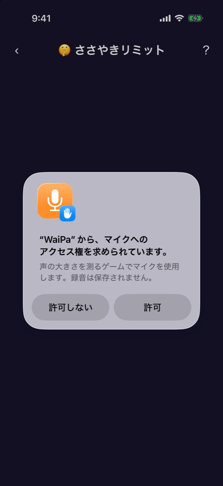
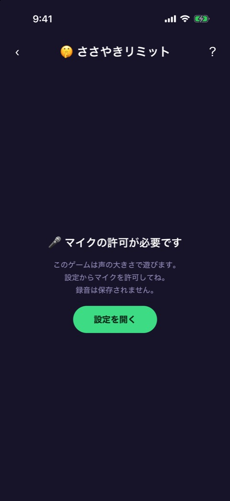

# ささやきリミット

| 項目       | 内容                                       |
| ---------- | ------------------------------------------ |
| 画面ID     | `sasayaki-limit`                           |
| ルート     | `/game/sasayaki-limit`                     |
| 実装       | `src/games/sasayaki-limit/`                |
| 種別       | ゲーム（プレミアム限定）                   |
| 人数       | 2〜12人。プレイヤー登録が必要              |
| お題パック | `whisper`（セリフのお題）                  |
| 端末の機能 | マイク（音量の計測だけ。録音は保存しない） |

## 概要

マイクの音量メーターを見ながら、お題のセリフを「緑ゾーンの中の音量」で言い切るゲームです。3ラウンド遊び、成功の合計が一番少ない人が負けです。ラウンドが進むほど緑ゾーンが狭くなります。

ゲームの前に、マイクの許可とまわりの音の計測（キャリブレーション）があります。ゲーム中のフェーズは `reducer.ts` が持ちます。

| 段階・フェーズ       | 画面                                        | 実装                                          |
| -------------------- | ------------------------------------------- | --------------------------------------------- |
| マイクの許可         | OS の許可ダイアログ、または許可が必要な案内 | `sasayaki-limit-game.tsx`、`use-mic-level.ts` |
| キャリブレーション   | まわりの音の計測                            | `calibration-screen.tsx`                      |
| `speech`             | お題と発声の開始                            | `sasayaki-limit-game.tsx`、`volume-gauge.tsx` |
| `measuring`          | 計測中（3秒）                               | 同上                                          |
| `judged`             | 判定                                        | 同上                                          |
| `round-result`       | ラウンドの結果                              | `sasayaki-limit-game.tsx`                     |
| `sudden-death-intro` | サドンデスの案内                            | `sasayaki-limit-game.tsx`                     |
| `result`             | 結果                                        | `result-screen.tsx`                           |

画面上部には [ゲーム共通のヘッダー](game-play-frame.md) が出ます。お試しプレイでは、結果が出るたびに1ラウンドを消費します（[お試しロック](trial-lock.md)）。

## マイクの許可

 

ゲームを開くと、マイクの許可を求めます。OS のダイアログの説明文は「声の大きさを測るゲームでマイクを使用します。録音は保存されません。」です（`app.json` の `expo-audio` の設定）。

| 状態                           | 表示                                                                                                                                  |
| ------------------------------ | ------------------------------------------------------------------------------------------------------------------------------------- |
| 許可した（許可済み）           | キャリブレーションへ進む                                                                                                              |
| 許可しなかった                 | 「🎤 マイクの許可が必要です」「このゲームは声の大きさで遊びます。設定からマイクを許可してね。録音は保存されません。」と「設定を開く」 |
| 音量の計測に対応していない端末 | 「この端末ではマイクを利用できません」「音量の計測に対応していないため、このゲームは遊べません。」                                    |

「設定を開く」で、端末の設定アプリのこのアプリのページを開きます。

## キャリブレーション

まわりの音の大きさを3秒間はかり、それを基準に音量の範囲を決めます。

| 状態   | 表示                                                                               |
| ------ | ---------------------------------------------------------------------------------- |
| 計測中 | 「🎤 まわりの音をはかっています」「3秒間、しゃべらず静かにしてね」と進み具合のバー |
| 計測後 | 「準備OK！この場の音を基準にゾーンを作りました」と「再計測」「スタート」           |

| 操作                 | 結果                           |
| -------------------- | ------------------------------ |
| 「再計測」をタップ   | もう一度3秒はかる              |
| 「スタート」をタップ | 1ラウンド目の1人目のお題へ進む |

計測した音の中央値を「まわりの音」とし、それより 8dB 大きい音（-45〜-20dB の範囲に収める）を音量の0、-2dBFS を音量の最大にします。突発的な大きな音に引きずられないよう、中央値を使っています。

## お題と発声

### 表示項目

| No  | 項目         | 内容                                                                   |
| --- | ------------ | ---------------------------------------------------------------------- |
| 1   | ラウンド     | 「ラウンド 1 / 3」。サドンデス中は「⚡ サドンデス」                    |
| 2   | 名前         | 発声する人の名前                                                       |
| 3   | お題         | 「「◯◯」」のように、かぎかっこ付きのセリフ                             |
| 4   | 音量メーター | 縦のメーター。緑ゾーンの帯、今の音量、前回のピークの印                 |
| 5   | 開始ボタン   | 「タップして発声スタート」（お題を出しているとき）                     |
| 6   | 合図         | 「🎤 いまだ！言え！」（計測中）                                        |
| 7   | 判定         | 「🔻 小さすぎ…」「✅ 緑ゾーン内！」「🔺 大きすぎ！」のどれか（判定後） |
| 8   | 次へのボタン | 「つぎの人へ」（判定後）                                               |

音量メーターのバーは、緑ゾーンの中なら緑、上なら赤、下なら青になります。

緑ゾーンの幅は、音量の範囲に対して1ラウンド目40%、2ラウンド目30%、3ラウンド目22%、サドンデス15%です。ゾーンの位置はラウンドごとにランダムです。

### 操作と判定

| 操作                               | 結果                                           |
| ---------------------------------- | ---------------------------------------------- |
| 「タップして発声スタート」をタップ | 3秒間、音量をはかる。そのあいだにお題を言う    |
| （3秒たつ）                        | 3秒間で一番大きかった音量（ピーク）で判定する  |
| 「つぎの人へ」をタップ             | 次の人のお題へ。全員終わったらラウンドの結果へ |

ピークが緑ゾーンの中なら成功です。下なら「小さすぎ」、上なら「大きすぎ」で失敗です。お題は、まだ出ていないものから選びます。

## ラウンドの結果

「ラウンド ◯ おわり！」、全員の「◯◯：◯ 成功」、「次のラウンドはゾーンが狭くなるよ！」と、「ラウンド ◯ へ」のボタンを出します。3ラウンド目のあとは出さずに、結果かサドンデスへ進みます。

## サドンデス

3ラウンドの成功の合計で、最少の人が2人以上いるときに行います。

- 「⚡ サドンデス！」「◯◯ vs ◯◯」「極狭ゾーンで1発勝負。外したら負け！」と「はじめる」を出します。
- 対象の人だけが、1人1回ずつ発声します。
- 失敗した人が1人なら、その人の負けです。
- 全員成功したときは同じ顔ぶれで、2人以上失敗したときは失敗した人だけで、もう一度サドンデスをします。

## 結果

### 表示項目

| No  | 項目           | 内容                                     |
| --- | -------------- | ---------------------------------------- |
| 1   | 見出し         | 「結果発表」                             |
| 2   | 敗者           | 「🍻 負けはこの人！」と敗者の名前        |
| 3   | 成功数の一覧   | 名前と「◯ / 3 成功」。敗者の行は強調する |
| 4   | もう一回ボタン | 「もう一回あそぶ」                       |

| 操作                       | 結果                                                                       |
| -------------------------- | -------------------------------------------------------------------------- |
| 「もう一回あそぶ」をタップ | 成功数を0に戻し、1ラウンド目から始める（キャリブレーションはやり直さない） |

この画面には「ホームへ」のボタンがありません。ホームへはヘッダーの戻るで戻ります。

## 遷移

- 入口: [参加メンバー](player-setup.md) の「つぎへ」。
- 出口: ホーム（ヘッダーの戻る）、端末の設定アプリ（「設定を開く」）。お試しを使い切ったときは [お試しロック](trial-lock.md) からペイウォールへ。

## テスト

- `src/games/sasayaki-limit/__tests__/`（`engine`、`reducer`、`topics`、`use-mic-level`、`volume-gauge`、`calibration-screen`、`result-screen`、`sasayaki-limit-game`）

## 補足

- キャリブレーション以降の画面は撮影していません。シミュレータでマイクを許可すると Mac のマイクを使うことになるため、許可しない側の画面だけを撮りました。
- お題を Supabase から取得できていないときは、アプリに同梱した予備のお題（20件）を使います。
- サドンデス中の成功・失敗は、3ラウンドの成功数には足しません。
