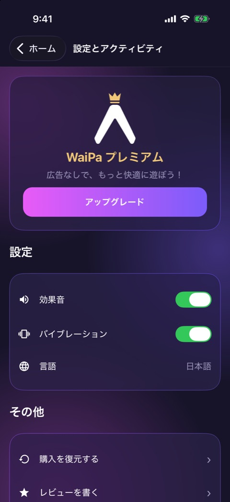
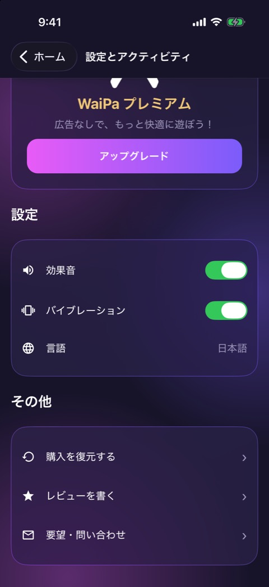

# 設定とアクティビティ

| 項目   | 内容                                                                     |
| ------ | ------------------------------------------------------------------------ |
| 画面ID | `settings`                                                               |
| ルート | `/settings`                                                              |
| 実装   | `src/app/settings.tsx`、`src/components/settings/`、`src/components/ui/` |
| 種別   | 画面（ネイティブのヘッダー付き）                                         |

## 目的

効果音とバイブレーションを切り替える画面です。プレミアムへの誘導、購入の復元、レビュー、問い合わせの入口もここにあります。

## スクリーンショット

 

## 表示項目

| No  | 項目                 | 内容                                                                                                 | 実装                      |
| --- | -------------------- | ---------------------------------------------------------------------------------------------------- | ------------------------- |
| 1   | ヘッダー             | 戻るボタン「ホーム」と、タイトル「設定とアクティビティ」                                             | `_layout.tsx`             |
| 2   | プレミアム誘導カード | マスコットと王冠、「WaiPa プレミアム」「広告なしで、もっと快適に遊ぼう！」、「アップグレード」ボタン | `premium-upsell-card.tsx` |
| 3   | 見出し               | 「設定」                                                                                             | `settings.tsx`            |
| 4   | 効果音               | トグル。初期値は ON                                                                                  | `setting-toggle-row.tsx`  |
| 5   | バイブレーション     | トグル。初期値は ON                                                                                  | `setting-toggle-row.tsx`  |
| 6   | 言語                 | 「日本語」と表示するだけの行                                                                         | `setting-value-row.tsx`   |
| 7   | 見出し               | 「その他」                                                                                           | `settings.tsx`            |
| 8   | 購入を復元する       | 矢印付きの行                                                                                         | `chevron-row.tsx`         |
| 9   | レビューを書く       | 矢印付きの行                                                                                         | `chevron-row.tsx`         |
| 10  | 要望・問い合わせ     | 矢印付きの行                                                                                         | `chevron-row.tsx`         |

## 操作

| 操作                                 | 結果                                                                              |
| ------------------------------------ | --------------------------------------------------------------------------------- |
| 「ホーム」をタップ                   | ホームへ戻る                                                                      |
| 「アップグレード」をタップ           | ペイウォール（`/paywall`）をモーダルで開く                                        |
| 効果音のトグルを切り替える           | 設定を保存する。OFF にすると、以後 `playSound()` は鳴らない                       |
| バイブレーションのトグルを切り替える | 設定を保存する。OFF にすると、以後 `haptics.*` は動かない                         |
| 「言語」をタップ                     | 何も起きない                                                                      |
| 「購入を復元する」をタップ           | RevenueCat に復元を依頼し、結果をアラートで知らせる                               |
| 「レビューを書く」をタップ           | OS のアプリ内レビューを依頼する。使えない環境では何も起きない                     |
| 「要望・問い合わせ」をタップ         | メールアプリを開く。宛先はサポート用アドレス、件名は「【WaiPa】要望・問い合わせ」 |

「購入を復元する」の結果は、次の3通りです。

| 結果           | アラート                                                       |
| -------------- | -------------------------------------------------------------- |
| 復元できた     | 「復元しました」                                               |
| 購入がなかった | 「復元できる購入が見つかりませんでした」                       |
| 失敗した       | 「復元に失敗しました」「時間をおいてもう一度お試しください。」 |

## 状態

効果音とバイブレーションの設定は、AsyncStorage の `waipa.settings` に保存され、次回の起動時に復元されます。

プレミアム誘導カードは、購読中でも同じ表示です。

## 遷移

- 入口: ホームのプレミアムボタン、またはメニューボタン。
- 出口: ホーム、ペイウォール、メールアプリ。

## テスト

- `src/app/__tests__/settings.test.tsx`
- `src/lib/__tests__/settings-store.test.ts`、`support.test.ts`

## 補足

- 言語は日本語だけで、切り替えはありません。
- RevenueCat の API キーが未設定のときは、「購入を復元する」は「復元に失敗しました」になります。
