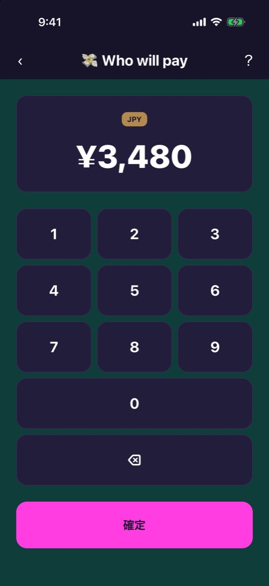
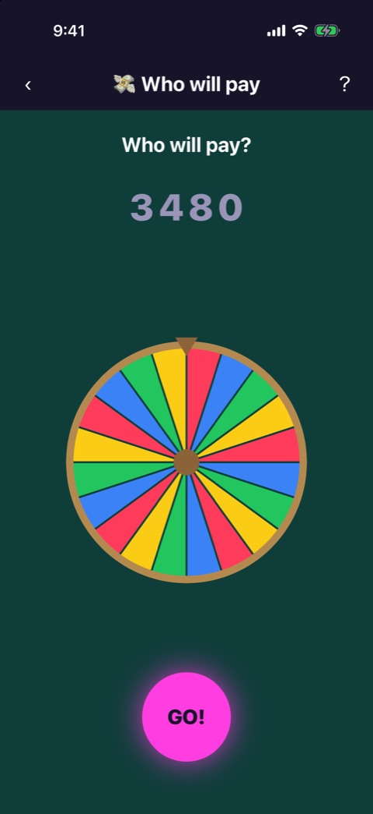
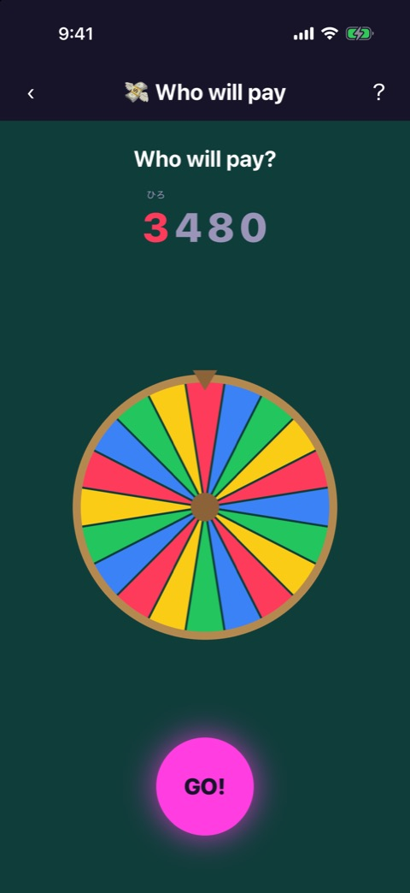
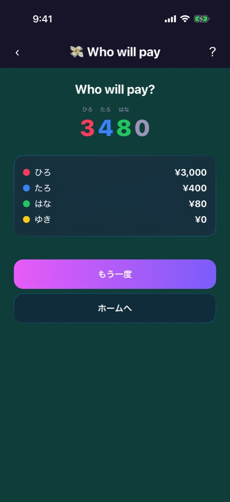

# Who will pay

| 項目       | 内容                         |
| ---------- | ---------------------------- |
| 画面ID     | `who-will-pay`               |
| ルート     | `/game/who-will-pay`         |
| 実装       | `src/games/who-will-pay/`    |
| 種別       | ゲーム（無料）               |
| 人数       | 2〜8人。プレイヤー登録が必要 |
| お題パック | 使わない                     |

## 概要

お会計の金額を1桁ずつルーレットにかけ、その桁の金額を誰が払うかを決めるゲームです。

ゲームは3つのフェーズで進みます。フェーズは `who-will-pay-game.tsx` が持つ状態で切り替えます。

| フェーズ   | 画面       | 実装                                                               |
| ---------- | ---------- | ------------------------------------------------------------------ |
| `amount`   | 金額の入力 | `amount-entry.tsx`                                                 |
| `roulette` | ルーレット | `roulette-play.tsx`、`roulette-wheel.tsx`、`use-digit-roulette.ts` |
| `result`   | 結果       | `result.tsx`                                                       |

どのフェーズでも、画面上部に [ゲーム共通のヘッダー](game-play-frame.md)（戻る、タイトル、遊び方）が出ます。

## 金額の入力

### 表示項目

| No  | 項目       | 内容                                               |
| --- | ---------- | -------------------------------------------------- |
| 1   | 金額の表示 | 「JPY」のバッジと、3桁区切りの金額。初期値は「¥0」 |
| 2   | テンキー   | 1〜9 と 0                                          |
| 3   | 削除キー   | 「⌫」                                              |
| 4   | 確定ボタン | 「確定」                                           |

### 操作

| 操作             | 結果                                                       |
| ---------------- | ---------------------------------------------------------- |
| 数字キーをタップ | 末尾に1桁足す。7桁まで。それ以上は無視する                 |
| 「⌫」をタップ    | 末尾の1桁を消す                                            |
| 「確定」をタップ | 金額が1円以上ならルーレットへ進む。0円のときは何も起きない |

## ルーレット

 

左が開始時、右が1桁目の支払い担当が決まった状態です。

### 表示項目

| No  | 項目         | 内容                                                                           |
| --- | ------------ | ------------------------------------------------------------------------------ |
| 1   | 見出し       | 「Who will pay?」                                                              |
| 2   | 金額の各桁   | 未確定の桁は薄い色。確定した桁は担当者のプレイヤーカラーになり、上に名前が出る |
| 3   | ルーレット盤 | プレイヤーカラーで塗り分けた円盤。上端の針が指した色の人が担当になる           |
| 4   | GO ボタン    | 「GO!」                                                                        |

盤の区画は、合計が18前後になるように、1人あたりの区画数を決めています（最少2区画）。4人なら1人4区画ぐらいになります。

### 操作

| 操作            | 結果                                                              |
| --------------- | ----------------------------------------------------------------- |
| 「GO!」をタップ | 対象の桁が点滅し、盤が3.5秒回る。止まると、その桁の担当者が決まる |

対象の桁は、上の位から順に進みます。0 の桁は飛ばします。回転中と全桁の確定後は、GO ボタンは押せません。

最後の桁が決まると、自動で結果へ進みます。

## 結果

### 表示項目

| No  | 項目           | 内容                                       |
| --- | -------------- | ------------------------------------------ |
| 1   | 見出し         | 「Who will pay?」                          |
| 2   | 金額の各桁     | 桁ごとに担当者の色と名前                   |
| 3   | 支払額の一覧   | プレイヤーごとの色の丸、名前、支払額の合計 |
| 4   | もう一度ボタン | 「もう一度」                               |
| 5   | ホームボタン   | 「ホームへ」                               |

支払額は、担当した桁の金額の合計です。¥3,480 で千の位を担当した人は ¥3,000 を払います。

### 操作

| 操作                 | 結果             |
| -------------------- | ---------------- |
| 「もう一度」をタップ | 金額の入力に戻る |
| 「ホームへ」をタップ | ホームへ戻る     |

## 遷移

- 入口: [参加メンバー](player-setup.md) の「つぎへ」。
- 出口: ホーム（「ホームへ」、またはヘッダーの戻る）。

## テスト

- `src/games/who-will-pay/__tests__/`（`amount-entry`、`roulette-play`、`use-digit-roulette`、`spin`、`payment`、`result-glass`、`who-will-pay-game`）

## 補足

- 参加メンバーが9人以上登録されていても、このゲームで使うのは先頭の8人です。
- 桁が点滅している最中の画面は撮影していません。
